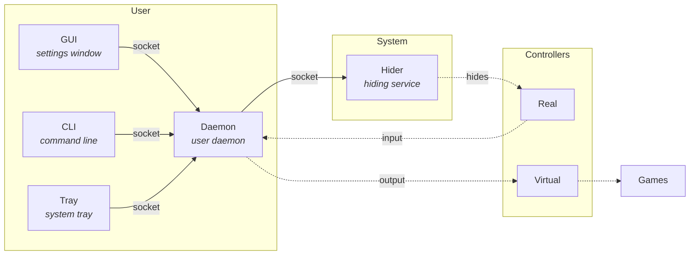

<!-- ANCHOR: overview -->

**CtrlAssist** brings "controller assist" to Linux gaming, as Xbox's Controller Assist and PlayStation's Second Controller Assistance do on consoles: several controllers act as one, so a second person can help someone play. It works below the game, which sees one ordinary controller and needs no support for any of it. It makes games easier to share for players of all ages and abilities: a parent taking the hard jumps for a child, a friend steering while you handle the buttons, a player with limited mobility sharing a game's controls with a helper.

## ✨ Features

- 🎮 Combine or split controllers into virtual gamepads
  - Merge a Primary and an Assist into one virtual gamepad
  - Or split one controller across several virtual gamepads
- 🎛️ Customizable multiplexing modes for buttons and axes
  - Logically merging or preempting events is flexible
  - Route to one virtual gamepad at a time, or to all at once
- 🙈 Real controllers hidden while it runs
  - A game never sees a press twice, Steam included
  - They come back when the profile stops
- 🕹️ A virtual controller games recognize
  - Appears as a plain gamepad, an Xbox or a DualSense
  - Xbox or PlayStation button prompts, where a game has them
- 🫨 Feedback reaches the real controllers
  - Rumble to the primary, the assist, or both
  - A DualSense's lightbar, player lights and trigger effects
- 🧭 Motion and touchpad pass-through
  - Gyro and touchpad of a DualSense or DualShock 4
  - The assist can take the aim while holding a button
- 🔌 Disconnects are held, not broken
  - The other player carries on with the same virtual controller
  - A returning controller takes its place again
- 🖱️ Graphical user interfaces
  - A window for controllers, profiles and settings
  - A system tray for quick start, stop and hand-over
- 🛋️ Couch mode for the big screen
  - Drive the window from a TV remote or a gamepad, no mouse needed
  - Scaled-up 10-foot layout, automatic under Plasma Bigscreen
- ⌨️ Scriptable
  - A `ctrlassist` command for everything, with shell completions
  - Profiles as short files, for arrangements of your own
- ⚡ Low latency
  - One thread carries all input, real-time where the system allows
  - Tens of microseconds from a real controller to the virtual one

## 🎛️ Modes

<!-- ANCHOR: modes -->
### 🔀 mux

Combine Primary and Assist controllers into one virtual gamepad.

- 👑 **Priority** (default): Assist controller overrides when active
  - Sticks and D-pad: Prioritize Assist when active (exceeds deadzone)
    - Buttons: Pressed while either controller presses
    - Triggers: Prioritize largest value from either
  - Ideal for partial and asynchronous assistance
    - E.g. Assist for camera while Primary for actions
- ⚖️ **Average**: Blend inputs from both controllers
  - Sticks: Averaged when both are active (exceed deadzone)
    - Buttons and D-pad: Logically OR'ed between controllers
    - Triggers: Averaged when both are active (exceed deadzone)
  - Ideal for cooperative input and subtle corrections
    - E.g. For counter steer/brake assist in racing games
- 🔃 **Toggle**: Switch Active controller on demand
  - All inputs forwarded from currently active controller
    - Toggle Active controller via Mode button on Assist
    - Or hand over from the window or the system tray
  - Ideal when fine-grain conflict-free control is needed
    - E.g. Game menu navigation or precise interventions

### 🔁 demux

Split one controller into multiple virtual gamepads.

- 🔂 **Unicast**: Route controller to Active gamepad
  - All inputs forwarded to currently active virtual gamepad
    - Cycle Active gamepad via Mode button on the controller
    - The other virtual gamepads rest meanwhile
  - Ideal for switching between multiple virtual gamepads
    - E.g. One player taking turns at several seats of a game
- 📢 **Multicast**: Route controller to all virtual gamepads
  - All inputs forwarded to all virtual gamepads simultaneously
    - Including Mode button events from the controller
  - Ideal for replicating input across multiple devices
    - E.g. For more advanced input multiplexing pipelines
<!-- ANCHOR_END: modes -->

## 📸 Screenshots

The window and the tray follow your desktop's theme and accent color.

| **Pads** — every controller and what has it | **Pads** — in the light theme |
|:---:|:---:|
|  |  |
| **Profiles** — who plays which part | **Virtual controller** — what games see |
|  |  |
| **Settings** — notifications and couch mode | **About** — every part and its release |
|  |  |
| **Tray tip** — what runs, at a glance | **Tray menu** — start, stop and change a profile |
|  |  |

## 🏛️ Architecture

CtrlAssist is comprised of a collection of cooperating components:

| Component | Description |
|-----------|-------------|
| `Daemon` | Combines real controllers into virtual ones via profiles |
| `Hider` | Hides a running profile's real controllers from games |
| `Tray` | System tray for quick access and desktop notifications |
| `GUI` | Controller status, profile editor, and stack settings |
| `CLI` | Command line for everything the GUI and Tray can do |

Services ship as `ctrlassist` CLI subcommands; `ctrlassist-gui` as separate binary.

<!-- ANCHOR_END: overview -->

## 📖 Documentation

Rendered docs available at [ctrlassist.readthedocs.io](https://ctrlassist.readthedocs.io/). Relative source links below:

- 🧭 New here? Start with [Installation](docs/book/src/getting-started/installation.md), then [Quick Start](docs/book/src/getting-started/quick-start.md).
- 🎛️ Setting things up? See [GUI & Tray](docs/book/src/guide/gui-tray.md) and [Profiles](docs/book/src/guide/profiles.md).
- 🩺 Something wrong? See [Troubleshooting](docs/book/src/operations/troubleshooting.md) and the [FAQ](docs/book/src/reference/faq.md).
- ⌨️ Scripting? See the [Command Line](docs/book/src/guide/cli.md) and [Configuration Files](docs/book/src/guide/configuration.md).
- 🏗️ Curious how it works? See [How It Works](docs/book/src/reference/how-it-works.md), and the design in [docs/architecture.md](docs/architecture.md).
- 🤝 Want to help? See the [Contributing Guide](.github/CONTRIBUTING.md).

## 🙏 Acknowledgments

The third-party notices ship with the packages. Notable among what CtrlAssist builds on:

- [Slint](https://slint-ui.com) – Declarative GUI toolkit powering `ctrlassist-gui`'s responsive interface
- [Zenoh](https://www.zenoh.io) – Zero-overhead pub/sub unifying socket IPC across the `ctrlassist` stack
- [ksni](https://github.com/iovxw/ksni), the StatusNotifierItem library behind the tray.
- [evdev](https://github.com/cmr/evdev), for reading controllers and making virtual ones.
- [SDL_GameControllerDB](https://github.com/mdqinc/SDL_GameControllerDB), the community controller database.
- [TisVlay](https://github.com/TisVlay/TisVlay), whose tooling, settings window and conventions this rewrite is built on.
