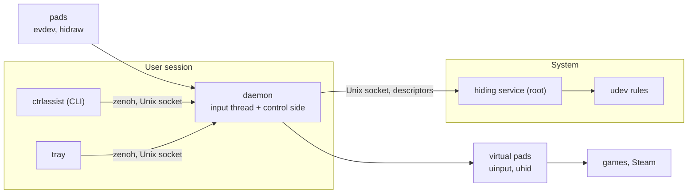
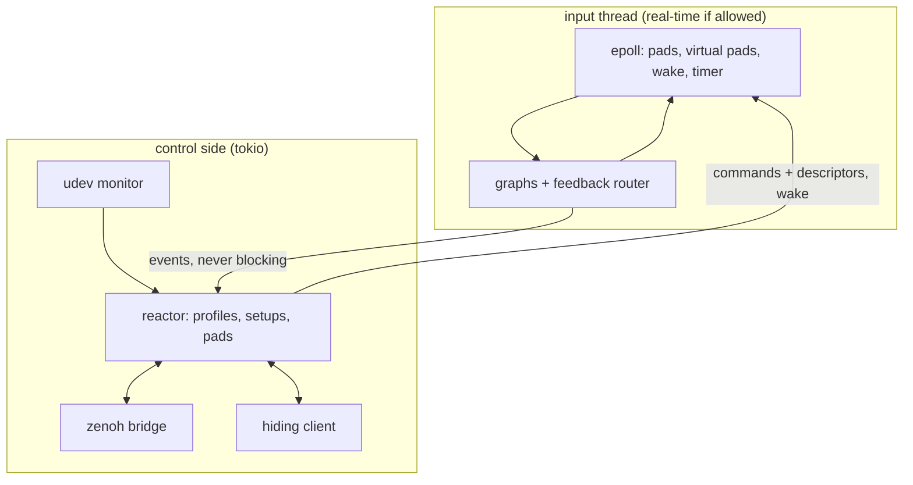

# Architecture

CtrlAssist merges or splits game controllers. It reads physical pads, routes what they do through a graph, and writes the result to virtual pads that games read instead, passing rumble and other feedback the other way.

This document describes the design and the reasons for it. [What the platform does](#what-the-platform-does) records the observations the design rests on. What has not yet been observed is tracked in [concerns/](concerns/README.md), and deferred work in [ideas/](ideas/README.md).

## Terms

| Term | Meaning |
|---|---|
| pad | A physical controller. |
| virtual pad | A controller the daemon creates for games to read. |
| primary, assist | The two roles in an assist setup: the player's pad and the helping pad. |
| source, sink | A pad, or a virtual pad, as it appears in a graph. |
| node | A transform between sources and sinks: a mux or a demux. |
| control | One button or axis on a pad. |
| group | Controls owned together: a stick's axes, a lone button. |
| layout | A pad's controls arranged into groups. |
| rule | How a mux chooses a group's output from its inputs. |
| mode | A named table of rules: priority, average, toggle; and for a demux, unicast or multicast. |
| switch | The signal that moves a toggle or unicast node to its next input or output. |
| profile | A saved graph with its settings. |
| preset | A built-in profile shape offered by name. |
| setup | A profile that is running. |
| hide | Keep games from seeing a pad. |
| identity | What a virtual pad presents itself as. |
| feedback | What flows from game to pad: rumble, LEDs, trigger effects. |
| mirror | A pad's live state, published for a client to draw. |
| daemon | The user service that owns pads, virtual pads, setups and profiles. |
| hiding service | The root process that hides and restores pads for the daemon. |

## Processes



| Process | Runs as | Does |
|---|---|---|
| daemon | the user, as a systemd user service | Owns the pads, the virtual pads, the running setups and the profiles. |
| hiding service | root, started on demand by a system socket | Hides and restores pads, and hands the daemon open descriptors for them. Nothing else. |
| clients | the user | The CLI and the tray. They hold no state the daemon doesn't. |

The daemon and the clients are verbs of one binary, `ctrlassist`. The hiding service is a separate, small binary with no async runtime and no zenoh, so that the code running as root is short enough to read in one sitting.

These are separate processes because a client crash must not drop a virtual pad mid-game, a GUI toolkit should not share a process with the input thread, and a gamescope session may have no tray at all. The separation does not extend to the daemon itself: when the daemon stops, its virtual pads go with it and the hidden pads are restored, so a game falls back to the real pads.

This is a user daemon, where TisVlay's is a system service: the pads belong to the seat user and Steam's configuration is in their home.

## Crates

One workspace, one shared version.

| Crate | Holds |
|---|---|
| `ctrlassist-core` | Controls, pad state, groups, layouts; the mux and demux nodes; the graph; the feedback router. No device or async code; serialization behind a feature. |
| `ctrlassist-protocol` | The key space, wire payloads, the rpc table, the profile schema, typed wire errors, session configuration. |
| `ctrlassist` | The client SDK: a daemon client and a state watcher. |
| `ctrlassist-device` | Everything that touches the kernel: pads from descriptors, uinput and uhid virtual pads, the controller database, hotplug, the input thread, the hiding service's client, the unprivileged hiding fallback. |
| `ctrlassist-hider` | The hiding service: a library holding its wire types, which the device crate also uses, and the root binary. |
| `ctrlassist-daemon` | The control side: profile store, setup lifecycle, the zenoh bridge. A library that the CLI's `service daemon` verb runs. |
| `ctrlassist-cli` | The `ctrlassist` binary and its clap tree as a library. |
| `ctrlassist-tray` | The ksni tray and notifications. |
| `ctrlassist-test` | Fake pads through uinput and uhid, and the fixtures the VM checks use. |
| `ctrlassist-docgen` | Generated partials for the book. |

The core and device crates don't depend on zenoh, which keeps the routing model and the input path buildable and testable without the control plane.

## The core model

A graph is sources, nodes and sinks. It is validated once and then stepped.

**It is level-based.** A node computes its output state from its input states and a little state of its own. A step evaluates the nodes in dependency order and reports, per virtual pad, the difference from what that pad last held. A switch, a pad dropping out, a pad returning and a resync are therefore the same computation as an ordinary event, and nothing can stay held by a pad that is gone.

**A step is one report frame.** The input thread steps the graph once per frame a pad delivers, so a press and release in separate frames both reach the game however fast they are. The exception is the kernel's dropped-events marker, after which the pad's current state is read and stepped once.

**Pads, virtual pads and nodes are named by number, each with its own type,** so a virtual pad's number can't be passed where a pad's is wanted. The names a profile uses are mapped to these once, by the daemon, when it builds the graph.

**Pad state** is a fixed-size value, 64 buttons and 16 axes, addressed by kind and index. The gamepad names are well-known positions in that space, which is what lets two different pads be merged control by control. A step allocates nothing.

**No profile can panic a step.** Building a graph rejects anything that could: a control index beyond the capacity, a reference to a source, node or output that doesn't exist, a cycle, more than 8 inputs to a mux or 32 sources, a release threshold above its engage threshold, a value that isn't a number. This is a tested invariant, because a panic on the input thread would take every virtual pad with it. As a second line, a setup whose step does panic is torn down alone.

**Scope.** The model is built for controls that rest at zero: buttons, sticks, triggers. A lever with no rest position (a throttle) would count as touched forever, and a relative control (a mouse, a gyro delta) has no level to diff. Both are out of scope until a pad needs them ([ideas](ideas/README.md)).

### Mux

A mux takes up to eight inputs, later ones outranking earlier, and applies one rule to each group:

| Rule | Meaning |
|---|---|
| owned | The highest input active on the group owns every member; with none active, the first input does. |
| largest | Each axis takes the input furthest from rest; a button is down if any input holds it. |
| blended | Each axis is the mean of the inputs active on the group, or the first input's if none is; a button is down if any input holds it. |
| switched | The input the switch last selected owns the group. |

A mode is a table from group kind to rule; there is no per-mode code.

| Mode | Stick | Trigger | Button | Hat |
|---|---|---|---|---|
| priority | owned | largest | owned | owned |
| average | blended | blended | largest | largest |
| toggle | switched | switched | switched | switched |

A control in no declared group is treated as a group of one, a button as a button and an axis as a stick, so every control obeys the mode. A profile may override the rule for a kind.

**Groups** generalize the stick pair. One rule covers a lone button, a stick's two axes and a larger set alike: whoever is active on the group owns every member, so the output is one person's direction rather than a blend of two. A gamepad's groups are derived from the well-known names; a profile may declare its own.

**Activity** has two parts. A source's deadzone zeroes a group's axes while they rest inside it, as a whole, so rest noise on a worn stick never reaches a node. A mux marks an input active on a group at its engage threshold and inactive below its lower release threshold, so an owner doesn't flicker. No ownership is held by a timer.

**The switch** is a signal into a node. A configured button raises it once per press and is consumed; a client raises the same signal with an rpc that names the input to select, so a repeated request does nothing. A selection never rests on an input that is absent: if the selected pad disconnects, the next present input is selected.

**On a switch the virtual pad takes the incoming pad's state.** What both pads hold stays down with no blip, what only the outgoing pad held goes up, and analog values step to the incoming value. Nothing in the code says so; it follows from selecting another input and reporting the difference.

### Demux

A demux sends its input to the selected output and rests the others (unicast), or sends it to all (multicast). Its switch works as a mux's does.

### Feedback

Feedback is not input run backward.

**The graph answers one question:** which pads does this virtual pad's feedback go to, right now? It walks back from the sink. A mux passes feedback to a fixed set of its inputs, to the inputs that can currently reach its output (the selected one if any group is switched, otherwise all), or to none. A demux passes it back only from outputs its input currently reaches. The answer changes when a switch does.

**Rumble is routed as levels.** The router keeps each game's effects and their timing (strengths, duration, delay, repeat count, gain) and computes one strong and one weak level per pad from everything playing that is routed there. It keeps a single effect on each pad updated to that level. Within one virtual pad, playing effects add and clamp; across virtual pads sharing a pad, the strongest request wins on each motor. This is the kernel's own approach for rumble-only pads, moved to where the routing is known:

- a hand-off part-way through a rumble gives the new pad the current level, and it ends on time;
- a rumble that has ended contributes nothing, so it can't be replayed later;
- a pad uses one effect slot however many games rumble it;
- a virtual pad that delivers levels natively needs no conversion.

**A game's upload is answered leniently.** The router holds the effects itself, so an upload succeeds whether or not any pad can rumble, and a game that insists on rumble still runs when one pad lacks it or rumble is off. The daemon's state says which pads can't.

The options that were set aside are in [ideas/rumble-routing-model.md](ideas/rumble-routing-model.md).

## The daemon



### The input thread

The input thread is the whole data path, for every setup. It sleeps in `epoll_wait` with no timeout over every pad, every virtual pad, one wake descriptor and one timer, and makes no wakeups while idle.

- **On a pad's readiness** it reads a whole report frame, maps it to a pad state, steps that setup's graph, and writes the changes to the virtual pads.
- **On a virtual pad's readiness** it answers the game's request through the router at once, because the game's call blocks until it is answered: up to 30 seconds for a force-feedback upload and 5 for a HID report request. A request it doesn't understand gets an error reply, not silence.
- **On the timer** it lowers rumble levels as effects end. The timer is armed only while something is playing, for the game's own durations.
- **On the wake descriptor** it takes commands from the control side.

It is created before the async runtime and shares nothing with it but the queues. Rules that keep it dependable:

- **Nothing on it waits for the control side.** Commands arrive through a bounded queue that is only ever polled, with a wake descriptor. Reports back (a pad read failed, a switch happened, a pad refused rumble) are sent without waiting and dropped if the control side is behind. No input event crosses this boundary except the mirror.
- **It doesn't log, allocate or free.** A setup (its graph, router, pads and virtual pads) is built by the control side and handed over whole; a retired one, and a pad that has gone, are handed back to be dropped.
- **One setup's failure is its own.** Each setup's handling is guarded, so a panic or a virtual pad that refuses a write takes that setup down and leaves the others running.
- **It asks for real-time scheduling** at a low priority, and carries on without it if refused. It sets no CPU-time limit of its own: exceeding one kills the process, and the kernel's limit on real-time threads as a whole already protects the machine. The daemon's state says which. Real-time scheduling is what makes the latency tail dependable when the machine is saturated.
- **No `println!`,** here or anywhere, as in TisVlay. A write to a closed pipe panics, and a panic in the daemon takes the virtual pads with it.

### The control side

A single reactor task owns the profiles, the known pads and the running setups, with commands in and state out. It is not an ECS as TisVlay's daemon is: the state is a pad list and a few setups, not many interacting state machines. Beside it run the zenoh bridge, a udev monitor for hotplug, and the hiding service's client.

A setup goes by the name of the profile it runs, and moves through starting, running, held and failed. Starting covers the round trip to the hiding service and creating the virtual pads; that work blocks, so it is done off the reactor and comes back to it as a result. Held means a pad it needs is missing: the virtual pads stay, the missing pad reads as at rest, and the rest carries on. A setup may start held, and a start that fails leaves nothing behind; failed is for a setup that was running and stopped working, which stays listed until it is stopped.

A source that names an exact pad is that pad, there or not. One that names a model takes the first pad of that model to have connected that no setup uses, and from then on waits for that pad and no other.

A change to a running setup is live if the virtual pads are untouched (a threshold, a rule, the switch, a feedback setting) and disruptive if one must be recreated (its identity or capabilities), which the game sees as a disconnect. The daemon says which before applying it.

## Pads

**Reading.** Pads are read through evdev from descriptors, not paths, because with hiding on the daemon cannot open the path itself.

**Reading is level-based,** like the graph it feeds: the reader reports the pad's whole state after each report frame that changed it. A pad opened mid-press starts with what is held. When the kernel drops events because they weren't read in time, the pad's true state is fetched again, so a dropped release can't leave a button held.

**Layout.** Xbox and PlayStation family pads get a standard layout from their kernel drivers: face buttons by position, sticks on X/Y and RX/RY, triggers on Z and RZ, the directional pad as a hat or as four buttons. A stick at rest reads exactly zero. A trigger that only clicks drives its axis fully, and a click reported beside an analog trigger is ignored. Without a stick on RX/RY, Z and RZ are read as the right stick. A pad's other buttons and axes take the spare positions of the pad state in the order of their codes. For others the device crate applies SDL's controller database through its own parser of that format. The parser treats the database as untrusted input and has a never-panics property test: a line that doesn't parse is skipped and counted, a binding to a control the pad lacks is dropped, and the rest of the line is kept.

A pinned snapshot of the community database's Linux entries is built in, and a file of the user's own in the same format is laid over it, so one pad can be fixed without waiting for a release. A pad is looked up by bus, vendor, product and version, then by any version on the same bus. A pad whose kernel driver is one of the gamepad drivers is never looked up: a database line for it describes some other driver's view of the pad. A pad that is neither is read as a gamepad.

**Identification.** A pad is known by the kernel's `uniq` value: the pad's own address. For PlayStation pads the kernel driver sets it from the pad's pairing report, so it is the same over USB and Bluetooth, and Steam keys its per-pad configuration by the same value. An Xbox One pad on USB reports no `uniq`, but its USB serial number is in udev's `ID_SERIAL_SHORT`, so that is the second choice. Failing both, by vendor and product plus port, then by name. A profile names a pad by this identifier when it must be that exact pad, or by model when any pad of that kind will do. udev's `ID_SERIAL` and `ID_PATH` are not identifiers by themselves: for a PlayStation pad the first is only the model name, the second is the port, and neither exists over Bluetooth.

**Hotplug.** Which pads are connected, and each change to that, comes from udev after it has finished with a device, so a pad that is reported can be opened at once. When a pad in a running setup disconnects, the input thread releases what it held, hands the pad back, and the setup is held. When the same pad returns it is hidden again before any game can see it, re-bound to the setup, and given the current rumble level. A notification says what happened.

**Not our own output.** The daemon never takes its own virtual pads as sources. It marks them at the start of the `phys` string, which uinput lets a pad's creator set, and refuses any pad that carries the marker, whichever process made it. A Bluetooth pad can itself be a uhid device, so "under uhid" cannot be the test; a uhid virtual pad will carry its mark in its address. Other software's virtual pads are sources only if a profile names them.

## Hiding

No unprivileged mechanism makes a pad absent to games ([what the platform does](#hiding-mechanisms)), so hiding is the hiding service's job.

**Hiding a pad is two steps.** A runtime udev rule denies the pad's event, js and hidraw nodes to everyone. Then the pad's driver is re-bound, which cuts off every program that already had the pad open, as Steam does from the moment a pad is plugged in, and recreates the nodes already denied. Restoring is the same in reverse, and because programs see the pad arrive again, Steam picks it up without a restart.

**Access arrives as descriptors, not permissions,** because the daemon and the games are the same user: anything that denies the games denies the daemon. After the re-bind, the only descriptors open on the pad are the ones the hiding service opened and passed on.

### The hiding service's protocol

The service listens on a system Unix socket, `/run/ctrlassist/hider.sock`, that systemd holds and starts it from. Each request and each reply is one message on a sequenced-packet socket, so there is no framing; descriptors travel beside them. Its vocabulary is small on purpose:

| Request | Carries | Does |
|---|---|---|
| hide | an open descriptor on the pad's event node | Checks the pad, installs the rule, re-binds the driver, opens the new event node, returns its descriptor and a token. |
| reopen | a token | After the pad has reconnected: returns a fresh descriptor. The rule already covered the new nodes. |
| restore | a token | Removes the rule, re-binds the driver. |
| (connection closes) | | Restores everything that connection hid. |

- **A pad is named by a descriptor the caller already holds, never a path or a name.** The service takes the device number from the descriptor and finds the pad from that. Possession proves the caller could already read that pad, so for event nodes the service grants nothing new.
- **It refuses anything that isn't a pad the seat user could open:** the device must be classified as a joystick, must not be classified as a keyboard or mouse, and must carry the seat-access tag.
- **No string from a device reaches a rule unchecked.** A pad's name and address are chosen by whoever created it, and a seat user can create devices. Rule text is built only from numbers the service parsed itself, plus an address or a serial number that has exactly the expected shape; one that doesn't is left out, and the rule matches the model alone. The kernel names written to sysfs for a re-bind are checked the same way.
- **It remembers what a pad is, never where.** A pad that reconnects while hidden comes back under new kernel names, so its nodes and its driver binding are looked up each time they are needed.
- **A hidraw node is opened only for a pad whose kernel driver is on a short built-in list.** On a stock machine hidraw is closed to users, so this is the one thing the service grants that the user didn't have; the list starts with the PlayStation driver, which the DualSense identity needs. This arrives with that identity; until then the service denies hidraw nodes and passes none.
- **One user at a time.** A pad hidden for one user is refused to another.
- **Who is served:** the user whose session is in front on a seat, where that session is a person at the machine: class `user`, graphical, not remote. This is TisVlay's rule, and it never asks whether a session is "active", because an SSH login reports that it is. Anyone may connect; the check is made once per connection, by the peer's user ID, against logind through its login library, with no D-Bus connection. A client that later leaves the foreground, as on a user switch, keeps what it has hidden.

What this defends: another user's session, and the rest of the system, against a process of the seat user. It does not defend the seat user against their own processes; a game running as that user can already read the pads and talk to the daemon.

**Cleanup hangs on the connection.** The kernel reports the daemon's connection closing even when the daemon is killed. For the service's own failure, what each rule hides is recorded under `/run/ctrlassist/hidden` before the rule is written: the pad's identity, and for a pad with no driver to re-bind, its nodes' modes and owners. The records are reconciled when the service starts and by its unit when it stops, however it stopped, and are read back as warily as a device is. `/run` is emptied at boot, which bounds the worst case.

**Reconnects are driven by the daemon.** Its udev monitor sees the pad return and asks for `reopen`, so the service has no event loop of its own.

### Without the hiding service

In a Flatpak, or where the service isn't installed, the daemon uses what an unprivileged process can:

- **A grab** on each pad's event node, which silences evdev and joydev readers and is undone by the kernel if the daemon dies.
- **Steam's controller blacklist,** which hides a pad from Steam, by vendor and product, the next time Steam starts. It is a persistent edit to a file the daemon doesn't own, so each entry is recorded in the daemon's state directory before it is written, reconciled at startup, and removed when the setup stops.

The daemon's state says which mechanism is in use and what it leaves visible.

## Virtual pads

A virtual pad's capabilities and identity are fixed when it is created. So a sink is created from what the profile declares, with a copied identity taken from the cache rather than from a pad that may be absent.

| Identity | Made with | Why |
|---|---|---|
| generic (the default) | uinput | Adopted by SDL and Steam; honest about being virtual. |
| Xbox family | uinput with the pad's IDs | SDL and Steam recognize the IDs by name. |
| PlayStation family | uhid | SDL and Steam claim Sony's IDs for their hidraw driver and ignore an evdev node carrying them, so a uinput pad with those IDs is invisible to both. |

A uinput virtual pad carries the gamepad's own controls (eleven buttons, two sticks, two triggers, a hat) and rumble, and is written level-based, as pads are read: the state it should hold, sent as the difference from what it holds. The generic identity reports the sample numbers 0.4.0's virtual pad did, which SDL and Steam are known to adopt.

uinput is the default kind because it gives rumble directly, needs no per-identity emulator, and has no side effects; uhid is used only where the consumer insists on a HID device.

**At the sink,** pad state becomes that kind's output: evdev events on a uinput pad, an input report on a uhid pad. Opposed hat directions held together resolve to neither, and the digital trigger buttons are derived from the trigger axes.

### The PlayStation identity

A small emulator: it presents a real pad's report descriptor, answers the kernel driver's feature-report requests, and turns pad state into the pad's input report.

- **Its data is copied from a connected pad** and cached in the user's state directory, per model and transport; none of it ships in the repository. Reading it needs the pad's hidraw node, so it needs the hiding service.
- **Each virtual pad gets its own address,** stable for that sink and marked as locally administered. The kernel driver refuses a second pad with an address it already knows, and Steam keys configuration by address. The address is also the daemon's marker.
- **Calibration is synthesized as neutral,** not copied: the daemon feeds values the source pad's driver already calibrated, and a real pad's calibration would be applied to another pad's data.
- **The kernel driver picks its rumble report layout from the firmware version** the pad reports, so the emulator parses both layouts.
- **Side effects:** the kernel registers a battery device and LEDs for every such pad, which a desktop will show.

**Feedback on a virtual pad** comes in two forms: force-feedback requests on uinput, and the pad's raw output report on uhid, which carries rumble as two levels beside LEDs and trigger effects. Rumble from either feeds the router. Between a sink and a source of the same kind the rest of the output report passes through; the last one is kept per sink so that a pad joining gets it and a pad leaving gets a reset. Between unlike pads everything but rumble is dropped.

## Control plane

zenoh over a Unix socket at `$XDG_RUNTIME_DIR/ctrlassist/zenoh.sock`, with the daemon listening as a peer, as TisVlay's does: its clients only ever talk to it, never to each other, so nothing needs routing between them. The patterns are TisVlay's: cached publishers for state, rpcs declared once in a table, a liveliness token for presence, typed wire errors, and a `major.minor` check between client and daemon. Its [zenoh laws](https://github.com/TisVlay/TisVlay/blob/main/docs/architecture.md) apply; the ones this design leans on:

- clients gate an rpc on the querier matching, not on liveliness, because a request matching no handler returns no reply at once;
- clients keep trying to connect, so the tray may start before the daemon;
- after a suspend a link may have dropped, and a client re-reads state rather than trusting what it held;
- zenoh needs tokio's multi-thread scheduler.

| Key | Kind | Holds |
|---|---|---|
| `ctrlassist/alive/daemon` | liveliness | present while the daemon runs |
| `ctrlassist/daemon` | state | version; whether real-time scheduling was granted; the hiding mechanism in use |
| `ctrlassist/rpc/daemon/info` | rpc | the daemon's release, for the version check; its reply's shape is frozen |
| `ctrlassist/identity/<id>` | state | each identity a virtual pad can take, and whether it is available now |
| `ctrlassist/pad/<id>` | state | the id it is known by across reconnects, name, model, connected, hidden, which setup uses it, whether it can rumble |
| `ctrlassist/profile/<name>` | state | the profile as its TOML, and what is wrong with it if anything is |
| `ctrlassist/setup/<name>` | state | starting, running, held or failed with a reason; which pad each source is and whether it is there; each virtual pad's identity and node; each node's selected input |
| `ctrlassist/mirror/<pad>` | stream | the pad's current state |
| `ctrlassist/rpc/profile/{validate,put,delete}` | rpc | check a profile and say where it is wrong; write one |
| `ctrlassist/rpc/setup/{start,stop,update,select}` | rpc | run a profile; stop it; change it, replying live or disruptive; select a node's input |
| `ctrlassist/rpc/pad/{identify,forget}` | rpc | buzz a pad so the user can tell which is which; drop a remembered pad |

Key segments marked `<id>` are derived by the daemon, never taken raw from a pad's or a profile's name, since those are free text. A pad's segment is a hash of the id it is known by, so a client can work it out too; an rpc that names a pad takes that id, the segment, a bare address, or a model when only one known pad is of it.

`identify` buzzes for a duration the caller gives, and replies once the motors run. `forget` is refused for a pad that is connected, which would be taken in again at once.

**The mirror** is published only while something subscribes: the input thread checks one flag per frame and, when it is set, offers the state with a send that never waits. The control side publishes the latest state each time its previous publish completes, skipping what arrived in between, so the cost follows what the subscriber takes rather than the pad's rate.

## Profiles

A profile is a TOML file the daemon owns, kept under a name of lowercase letters, digits and hyphens, which is also its key. Clients write profiles through the daemon, never the files: `put` checks a profile before it is kept, so what the daemon wrote is right, and keeps the text as it was given, comments included. A preset is a profile whose graph is implied by its name:

```toml
preset = "priority"          # two pads, one mux, one virtual pad
primary = "0c:27:56:4f:bd:14"
assist  = "model:054c:09cc"  # any pad of this model
auto-start = true            # once the daemon is up and both are connected
```

The full form names sources, nodes and sinks, here one helper assisting two players in turn:

```toml
[source.one]
pad = "0c:27:56:4f:bd:14"

[source.two]
pad = "a4:5e:60:c1:22:07"

[source.helper]
pad = "1c:96:5a:a1:35:da"
deadzone = 0.15                    # this one's stick is worn

[node.share]
demux = "unicast"
input = "helper"
outputs = 2

[node.first]
mux = "priority"
inputs = ["one", "share.0"]        # later inputs outrank earlier ones

[node.second]
mux = "priority"
inputs = ["two", "share.1"]
engage = 0.2
release = 0.1
rules = { trigger = "blended" }    # priority everywhere else
feedback = ["two"]                 # the helper doesn't feel this game

[sink.player-one]
input = "first"
identity = "generic"

[sink.player-two]
input = "second"
identity = "xbox"
```

Groups appear only when a pad isn't laid out as a gamepad; the schema has no key for them yet.

- **The presets** are `priority`, `average` and `toggle`, which take `primary` and `assist`, and `unicast` and `multicast`, which take `pad` and `outputs`. Each is shorthand for a full-form profile and is expanded into one before anything else looks at it.
- **A pad is named** by its address, by the name `ctrlassist pads` gives it (`address:`, `serial:`, `port:` or `model:` and what follows), or as `model:<vendor>:<product>` for any pad of a model.
- **A reference** is a source's or node's name, or `name.N` for a demux's output N. Sources, nodes and sinks are numbered in the order of their names, so a profile means the same graph however its tables are ordered.
- **A node's switch** is a button's name, a table naming the button and whose it is, or `false`.
- **Every problem is reported with where it is,** in the file's own terms: `node.second.inputs[1]: no source or node named \`tow\``. Text that isn't a profile at all is reported with its line. The core has the last word: a profile that passes the schema but describes a graph the core refuses is refused with the core's reason.
- **The file carries a schema version** only once it isn't the current one; a file for a newer schema is refused rather than half-read.

## What the daemon stores

| What | Where | Notes |
|---|---|---|
| Profiles | `$XDG_CONFIG_HOME/ctrlassist/profiles/` | One file each, named for the profile, with a schema version; written durably. A file that arrived some other way is listed with what is wrong with it, and left as it is. |
| Known pads | `$XDG_STATE_HOME/ctrlassist/pads.toml` | Id, model and name of pads seen, and whether each could rumble, for profiles that name a pad that isn't connected. Written durably; a file that can't be understood is left as it is. |
| Identity data | `$XDG_STATE_HOME/ctrlassist/identities/` | What a PlayStation identity was copied from, per model and transport. |
| Steam blacklist record | `$XDG_STATE_HOME/ctrlassist/` | Entries the daemon added, so they can be removed after a crash. |

## Permissions

A stock machine gives a seat user a pad's event and js nodes and nothing else this needs: not uinput, not uhid, not hidraw. The packages install a udev rule granting the seat user `/dev/uinput` and `/dev/uhid`, the hiding service with its socket and service units, and the daemon's user unit. The real-time priority limit has to be raised from the system side, since a user unit cannot raise its own. hidraw is never opened to users; the hiding service hands out descriptors for it. How each channel is built is in the packaging notes.

## Errors, logging and testing

The conventions are TisVlay's. In one line each: published crates expose typed errors and binaries may use `anyhow`; logging is `tracing` to the journal, never from the input thread; the routing model is tested without devices, device code against fake pads made through uinput and uhid, the wire on a temporary socket, and the whole in a NixOS virtual machine.

## What the platform does

Observations the design rests on, made on a clean NixOS virtual machine and on a desktop with a DualSense on USB, a DualShock 4 over Bluetooth, Steam and SDL2, in November 2026. They are facts about other people's software and will age; when one stops holding, the section it supports needs another look.

### Hiding mechanisms

What each consumer still sees of a pad under each mechanism:

| Mechanism | Steam | SDL, default (hidraw) | SDL, evdev backend | Raw evdev and joydev |
|---|---|---|---|---|
| evdev grab | visible | visible | listed but silent | silent |
| Steam's blacklist | absent after Steam restarts | visible | visible | visible |
| SDL's ignore-devices variable | n/a | absent, at launch only | absent, at launch only | visible |
| udev rule alone | still reads, if it had the pad open | absent to new programs | absent to new programs | cannot open |
| udev rule, then driver re-bind | closes the pad and doesn't find it again | absent | absent | cannot open |

- Steam and SDL read PlayStation pads through hidraw, which has no grab.
- Steam's blacklist and SDL's variable work by vendor and product, so they also hide a virtual pad carrying the same IDs.
- A descriptor opened before a node is denied keeps working: a reader holding a DualSense's hidraw node went on receiving 250 reports a second after the node was set to mode 000, until the driver was re-bound.
- The rule file must sort after systemd's `70-uaccess.rules` and before `73-seat-late.rules`. Numbered below 70 it hides a connected pad but not a reconnected one.
- Removing a rule does not restore a node's mode; a re-bind recreates the nodes with their defaults.
- A node is created owned by root with no access for others, and udev applies rules before anything unprivileged can open it, so a returning pad covered by a rule is never visible.
- After removing the rule and re-binding, Steam found the DualSense again within seconds, with no restart.
- The re-bind was observed for three pads under two drivers: a DualSense on USB and a DualShock 4 over Bluetooth (the `playstation` HID driver, re-bound at the HID device) and an Xbox One pad on USB (the `xpad` driver, re-bound at the USB interface). The result was the same each time: the open reader was cut off, Steam closed the pad, and after restoring Steam found it again six or seven seconds later. Every pad stayed connected and kept its node numbers. An Xbox pad over Bluetooth, which uses another driver, is [not yet observed](concerns/README.md).
- A rule that names the pad's HID device hid one of two connected PlayStation pads and left the other untouched.

### Permissions on a clean machine

A seat user with no extra groups:

| Node | Mode, owner | Can open |
|---|---|---|
| `/dev/uinput` | 600 root:root | no |
| `/dev/uhid` | 600 root:root | no |
| a pad's event node | 660 root:input, plus a seat-access ACL | yes |
| a pad's js node | 664 root:input, plus a seat-access ACL | yes |
| a pad's hidraw node | 600 root:root | no |

A machine with Steam's or Sunshine's udev rules installed opens more of these, which hides the problem on a developer's desktop.

### Virtual pad identity

| Virtual pad | Kernel | SDL, default | Steam |
|---|---|---|---|
| uinput with a DualSense's name and IDs | plain input device | not listed | not adopted |
| uhid with a DualSense's descriptor | the PlayStation driver binds | listed as a DualSense | adopted as a DualSense |
| uinput with Xbox Series IDs | plain input device | listed as an Xbox Series pad | adopted as one |
| uinput, generic | plain input device | listed, with a generated mapping | adopted |

- Copying a PlayStation pad's IDs onto a uinput pad is worse than not copying them.
- On binding, the PlayStation driver reads three feature reports: pairing information, firmware version and calibration.
- uinput cannot set a device's `uniq`; it can set `phys`. The `evdev` crate's call for that (0.13.2) is refused by the kernel, because it declares the request with the size of a character where the kernel expects that of a pointer; the copy in `vendor/` carries the fix.
- The kernel ends a report frame itself once the frame holds about as many changes as the device has axes (16 for a gamepad's eight), so one write that changes nearly every control reaches a reader as two frames.
- Before erasing a force-feedback effect, the kernel sends a stop for it.
- The uhid interface is a handful of fixed-layout events, written by hand here; the available binding crate needs libclang at build time.
- A Bluetooth DualShock 4 appeared as a uhid device created by the Bluetooth daemon.
- What identifies a pad differs by driver: a DualSense on USB and a DualShock 4 over Bluetooth each report their own address as `uniq`; an Xbox One pad on USB, under the `xpad` driver, reports an empty `uniq`, no HID device and no hidraw node, and a USB serial number through udev.

### The input path

Timed between two fake pads and a virtual pad, at 1,000 events a second per pad, against the 0.4.0 release, which read pads through gilrs on several threads:

| Condition | | p50 | p99 | worst | Idle wakeups/s |
|---|---|---|---|---|---|
| Idle machine | one epoll thread | 26–34 µs | 107–115 µs | 247–344 µs | 0 |
| | 0.4.0 | 26–27 µs | 110–135 µs | 217–916 µs | 85–107 |
| Every CPU busy | one epoll thread | 6–8 µs | 9–13 µs | 1–2 ms | 0 |
| | one epoll thread, real-time | 5–6 µs | 8–9 µs | 24–78 µs | 0 |
| | 0.4.0 | 6–9 µs | 548–864 µs | 1.5–2.6 ms | 95–125 |

- Tens of microseconds on an idle machine is the kernel round trip, not the program.
- The built input thread, with its mux and graph step in the path, measures the same: 28 µs median and 141 µs at the 99th percentile idle; 11 µs and 18 µs with every CPU busy and real-time scheduling granted; no idle wakeups. `just bench` repeats it.
- The comparison flatters the new loop slightly: it forwarded frames unchanged, where 0.4.0 also ran its mapping and its priority mode. A graph step adds 0.24 to 0.5 µs.
- gilrs opens pads by path and keeps its controller-database parser private, so it can neither take a descriptor nor lend its mappings.

### zenoh beside the input thread

With a zenoh router in the same process, the input thread still made no wakeups when idle, and its latency was unchanged on an idle machine and under load with real-time scheduling (worst frame 34 µs). The rest of the daemon woke about three times a second and used about 8 MB more memory; the stripped binary grew from 1 MB to 10 MB. With every CPU busy and no real-time scheduling, the daemon had a bad run (p99 near 1 ms) in 3 of 11 runs against 1 of 11 for the loop alone. A one-shot client call took 5 to 6 ms from opening its session to the reply.

### Rumble in the kernel

For a pad that can only rumble, the kernel's `ff-memless` layer keeps up to 16 uploaded effects, combines the playing ones into one level (strengths added and clamped, after gain), gives the driver that level, and sets a timer for the next change. A game's upload to a uinput pad blocks until the pad's owner answers.
