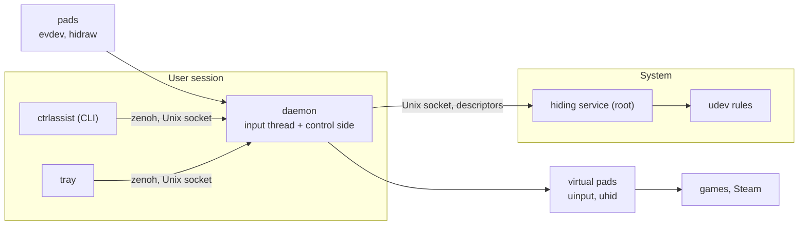
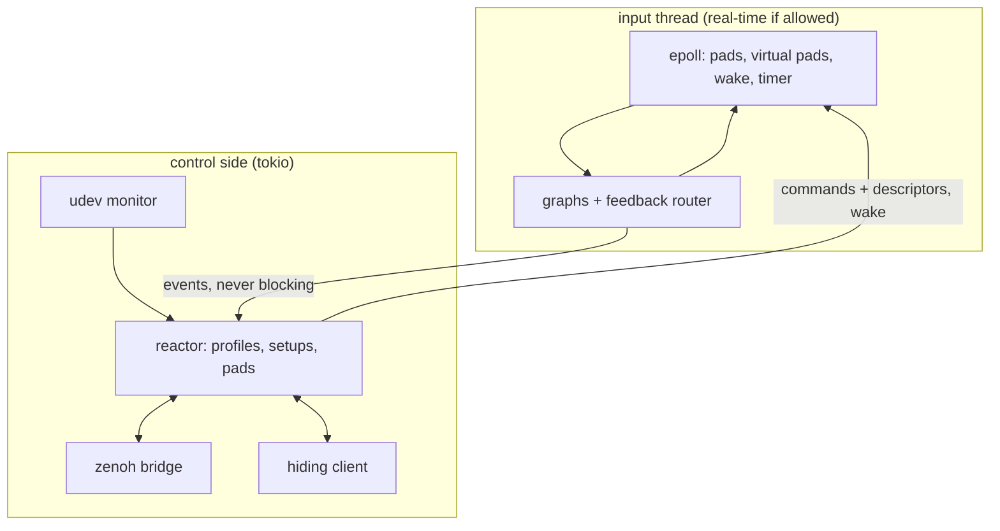

# Architecture

CtrlAssist merges or splits game controllers. It reads physical pads, routes what they do through a graph, and writes the result to virtual pads that games read instead, passing rumble and other feedback the other way.

This document describes the design and the reasons for it. [What the platform does](#what-the-platform-does) records the observations the design rests on. What has not yet been observed is tracked in [concerns/](concerns/README.md), and deferred work in [ideas/](ideas/README.md).

## Terms

| Term | Meaning |
|---|---|
| pad | A physical controller. |
| virtual pad | A controller the daemon creates for games to read. |
| primary, assist | The two roles in an assist setup: the player's pad and the helping pad. |
| managed | A profile the daemon starts by itself whenever its pads are connected, by `managed = true`. One that isn't is started by hand. |
| source, sink | A pad, or a virtual pad, as it appears in a graph. |
| node | A transform between sources and sinks: a mux or a demux. |
| control | One button or axis on a pad. |
| group | Controls owned together: a stick's axes, a lone button. |
| layout | A pad's controls arranged into groups. |
| rule | How a mux chooses a group's output from its inputs. |
| mode | A named table of rules: priority, average, toggle; and for a demux, unicast or multicast. |
| switch | The signal that moves a toggle or unicast node to its next input or output. |
| profile | A saved graph with its settings. |
| preset | A built-in profile shape offered by name. |
| setup | A profile that is running. |
| hide | Keep games from seeing a pad. |
| identity | What a virtual pad presents itself as. |
| feedback | What flows from game to pad: rumble, LEDs, trigger effects. |
| mirror | A pad's live state, published for a client to draw. |
| daemon | The user service that owns pads, virtual pads, setups and profiles. |
| hiding service | The root process that hides and restores pads for the daemon. |

## Processes



| Process | Runs as | Does |
|---|---|---|
| daemon | the user, as a systemd user service | Owns the pads, the virtual pads, the running setups and the profiles. |
| hiding service | root, started on demand by a system socket | Hides and restores pads, and hands the daemon open descriptors for them. Nothing else. |
| clients | the user | The CLI and the tray. They hold no state the daemon doesn't. |

The daemon and the clients are verbs of one binary, `ctrlassist`. The hiding service is a separate, small binary with no async runtime and no zenoh, so that the code running as root is short enough to read in one sitting.

These are separate processes because a client crash must not drop a virtual pad mid-game, a GUI toolkit should not share a process with the input thread, and a gamescope session may have no tray at all. The separation does not extend to the daemon itself: when the daemon stops, its virtual pads go with it and the hidden pads are restored, so a game falls back to the real pads.

This is a user daemon, where TisVlay's is a system service: the pads belong to the seat user and Steam's configuration is in their home.

## Crates

One workspace, one shared version.

| Crate | Holds |
|---|---|
| `ctrlassist-core` | Controls, pad state, groups, layouts; the mux and demux nodes; the graph; the feedback router. No device or async code; serialization behind a feature. |
| `ctrlassist-protocol` | The key space, wire payloads, the rpc table, the profile schema, typed wire errors, session configuration. |
| `ctrlassist` | The client SDK: a daemon client and a state watcher. |
| `ctrlassist-device` | Everything that touches the kernel: pads from descriptors, uinput and uhid virtual pads, the controller database, hotplug, the input thread, the hiding service's client, the unprivileged hiding fallback. |
| `ctrlassist-hider` | The hiding service: a library holding its wire types, which the device crate also uses, and the root binary. |
| `ctrlassist-daemon` | The control side: profile store, setup lifecycle, the zenoh bridge. A library that the CLI's `service daemon` verb runs. |
| `ctrlassist-cli` | The `ctrlassist` binary and its clap tree as a library. |
| `ctrlassist-tray` | The ksni tray and notifications. |
| `ctrlassist-test` | Fake pads through uinput and uhid, and the fixtures the VM checks use. |
| `ctrlassist-docgen` | Generated partials for the book. |

The core and device crates don't depend on zenoh, which keeps the routing model and the input path buildable and testable without the control plane.

## The core model

A graph is sources, nodes and sinks. It is validated once and then stepped.

**It is level-based.** A node computes its output state from its input states and a little state of its own. A step evaluates the nodes in dependency order and reports, per virtual pad, the difference from what that pad last held. A switch, a pad dropping out, a pad returning and a resync are therefore the same computation as an ordinary event, and nothing can stay held by a pad that is gone.

**A step is one report frame.** The input thread steps the graph once per frame a pad delivers, so a press and release in separate frames both reach the game however fast they are. The exception is the kernel's dropped-events marker, after which the pad's current state is read and stepped once.

**Pads, virtual pads and nodes are named by number, each with its own type,** so a virtual pad's number can't be passed where a pad's is wanted. The names a profile uses are mapped to these once, by the daemon, when it builds the graph.

**Pad state** is a fixed-size value, 64 buttons and 16 axes, addressed by kind and index. The gamepad names are well-known positions in that space, which is what lets two different pads be merged control by control. A step allocates nothing.

**No profile can panic a step.** Building a graph rejects anything that could: a control index beyond the capacity, a reference to a source, node or output that doesn't exist, a cycle, more than 8 inputs to a mux, 32 sources, 64 nodes or 32 sinks, thresholds outside 0 < release ≤ engage ≤ 1, a switch on a node that never selects (which would only keep its button from the game), a value that isn't a number. This is a tested invariant, because a panic on the input thread would take every virtual pad with it. As a second line, a setup whose step does panic is torn down alone.

**Scope.** The model is built for controls that rest at zero: buttons, sticks, triggers. A lever with no rest position (a throttle) would count as touched forever, and a relative control (a mouse, a gyro delta) has no level to diff. Both are out of scope until a pad needs them ([ideas](ideas/README.md)).

### Mux

A mux takes up to eight inputs, later ones outranking earlier, and applies one rule to each group:

| Rule | Meaning |
|---|---|
| owned | The highest input active on the group owns every member; with none active, the first input does. |
| largest | Each axis takes the input furthest from rest; a button is down if any input holds it. |
| blended | Each axis is the mean of the inputs active on the group, or the first input's if none is; a button is down if any input holds it. |
| switched | The input the switch last selected owns the group. |

A mode is a table from group kind to rule; there is no per-mode code.

| Mode | Stick | Trigger | Button | Hat |
|---|---|---|---|---|
| priority | owned | largest | owned | owned |
| average | blended | blended | largest | largest |
| toggle | switched | switched | switched | switched |

A control in no declared group is treated as a group of one, a button as a button and an axis as a stick, so every control obeys the mode. A profile may override the rule for a kind.

**Groups** generalize the stick pair. One rule covers a lone button, a stick's two axes and a larger set alike: whoever is active on the group owns every member, so the output is one person's direction rather than a blend of two. A gamepad's groups are derived from the well-known names; a profile may declare its own.

**Activity** has two parts. A source's deadzone zeroes a group's axes while they rest inside it, as a whole, so rest noise on a worn stick never reaches a node. A mux marks an input active on a group at its engage threshold and inactive below its lower release threshold, so an owner doesn't flicker. No ownership is held by a timer.

**The switch** is a signal into a node. A configured button raises it once per press and is consumed; a client raises the same signal with an rpc that names the input to select, so a repeated request does nothing. A selection never rests on an input that is absent: if the selected pad disconnects, the next present input is selected.

**On a switch the virtual pad takes the incoming pad's state.** What both pads hold stays down with no blip, what only the outgoing pad held goes up, and analog values step to the incoming value. Nothing in the code says so; it follows from selecting another input and reporting the difference.

### Demux

A demux sends its input to the selected output and rests the others (unicast), or sends it to all (multicast). Its switch works as a mux's does.

### Feedback

Feedback is not input run backward.

**The graph answers one question:** which pads does this virtual pad's feedback go to, right now? Each step works it out for every node's outputs, from the answers for their inputs, so it costs the same however many ways a pad reaches a sink. A mux passes feedback to a fixed set of its inputs, to the inputs that can currently reach its output (the selected one if any group is switched, otherwise all), or to none. A demux passes it back only from outputs its input currently reaches. The answer changes when a switch does.

**Rumble is routed as levels.** The router keeps each game's effects and their timing (strengths, duration, delay, repeat count, gain) and computes one strong and one weak level per pad from everything playing that is routed there. It keeps a single effect on each pad updated to that level. Within one virtual pad, playing effects add and clamp; across virtual pads sharing a pad, the strongest request wins on each motor. This is the kernel's own approach for rumble-only pads, moved to where the routing is known:

- a hand-off part-way through a rumble gives the new pad the current level, and it ends on time;
- a rumble that has ended contributes nothing, so it can't be replayed later;
- a pad uses one effect slot however many games rumble it;
- a virtual pad that delivers levels natively needs no conversion.

**A game's upload is answered leniently.** The router holds the effects itself, so an upload succeeds whether or not any pad can rumble, and a game that insists on rumble still runs when one pad lacks it or rumble is off. The daemon's state says which pads can't.

**What passes through feedback can be watched.** With the daemon logging at debug level, the input thread reports each thing a game asks of a virtual pad, each output report a virtual DualSense is sent, and each level a pad is told, and the daemon logs them. It is off otherwise: a game can ask for rumble many times a second.

The options that were set aside are in [ideas/rumble-routing-model.md](ideas/rumble-routing-model.md).

## The daemon



### The input thread

The input thread is the whole data path, for every setup. It sleeps in `epoll_wait` with no timeout over every pad, every virtual pad, one wake descriptor and one timer, and makes no wakeups while idle.

- **On a pad's readiness** it reads a whole report frame, maps it to a pad state, steps that setup's graph, and writes the changes to the virtual pads.
- **On a virtual pad's readiness** it answers the game's request through the router at once, because the game's call blocks until it is answered: up to 30 seconds for a force-feedback upload and 5 for a HID report request. A request it doesn't understand gets an error reply, not silence.
- **On the timer** it lowers rumble levels as effects end. The timer is armed only while something is playing, for the game's own durations.
- **On the wake descriptor** it takes commands from the control side.

It is created before the async runtime and shares nothing with it but the queues. Rules that keep it dependable:

- **Nothing on it waits for the control side.** Commands arrive through a bounded queue that is only ever polled, with a wake descriptor. Reports back (a pad has gone, a node selects another input, a setup failed) are sent without waiting. One that hands something back is never dropped: the thread takes a command only once every report it may cause has room, and holds the rest of the queue until then; a selection waits for room, and what only says what passed through feedback is dropped if the control side is behind. No input event crosses this boundary except the mirror.
- **It doesn't log, allocate or free.** A setup (its graph, router, pads and virtual pads) is built by the control side and handed over whole; a retired one, and a pad that has gone, are handed back to be dropped.
- **One setup's failure is its own.** Each setup's handling is guarded, so a panic or a virtual pad that refuses a write takes that setup down and leaves the others running. Catching a panic needs unwinding, so no build profile aborts on panic, the packages' included.
- **It asks for real-time scheduling** at a low priority, and carries on without it if refused. It sets no CPU-time limit of its own: exceeding one kills the process, and the kernel's limit on real-time threads as a whole already protects the machine. The daemon's state says which. Real-time scheduling is what makes the latency tail dependable when the machine is saturated.
- **No `println!`,** here or anywhere, as in TisVlay. A write to a closed pipe panics, and a panic in the daemon takes the virtual pads with it.

### The control side

A single reactor task owns the profiles, the known pads and the running setups, with commands in and state out. It is not an ECS as TisVlay's daemon is: the state is a pad list and a few setups, not many interacting state machines. Beside it run the zenoh bridge, a udev monitor for hotplug, and the hiding service's client.

A setup goes by the name of the profile it runs, and moves through starting, running, held and failed. Starting covers the round trip to the hiding service and creating the virtual pads; that work blocks, so it is done off the reactor and comes back to it as a result. Held means a pad it needs is missing: the virtual pads stay, the missing pad reads as at rest, and the rest carries on. A setup may start held, and a start that fails leaves nothing behind; failed is for a setup that was running and stopped working, which stays listed until it is stopped.

A **managed** profile, one with `managed = true`, is started by the daemon when it can run, not merely be held: when the daemon starts, when the profile is put, and when a pad it names connects, if by then every pad it names is connected and free. A setup the user stopped stays stopped until one of its pads is plugged in again.

A node that selects, a mux that follows its switch or a demux that sends to one output at a time, has its choices and the one selected in the setup's state. The input thread reports each change of selection, whether from the switch button or from `select`, which names a choice or asks for the next. A mux doesn't hand over to a pad that isn't there.

A node is only where a pad was last seen: the kernel hands a freed node number to the next pad to connect, which can happen before the first pad's leaving has been heard of. So what a setup opens is checked to be the pad it wants before it is hidden, grabbed or read.

A source that names an exact pad is that pad, there or not. One that names a model takes the first pad of that model to have connected that no setup uses, and from then on waits for that pad and no other.

A change to a running setup is live if the virtual pads are untouched (a threshold, a rule, the switch, a feedback setting) and disruptive if one must be recreated (its identity or capabilities), which the game sees as a disconnect. The daemon says which before applying it. The test is whether the profile as kept now has the setup's virtual pads, as many, of the same identities in the same order, and keeps its pads from games the same way. A virtual pad is made anew only to be another thing to a game; everything else is taken as the setup runs, its pads included. **A profile says how its pads are kept from games,** with `hide`: `full`, the default, is the hiding service or failing that a grab with Steam's blacklist; `grab` is a grab and nothing more, with the hiding service there or not; `none` leaves the pads as they are, for a game that is to read one directly. A setup's pads are all taken the one way, at its start and when one returns, so another `hide` is another start. The daemon works out which pads the setup keeps: a source keeps the pad of the slot of its name that wants the same pad, or failing that of a slot that wants the same pad under another name, or failing that a pad the setup has that the source could mean, so a pad stays open wherever the new profile has a use for it and two pads changing parts are only renumbered. Any other source is found a pad as at a start, which is then hidden and opened off the reactor. Then the daemon hands the input thread the new graph with the pads it brings, and the thread swaps both in between two frames: kept pads move to their new sources, a pad no source keeps stops rumbling and is handed back, the new graph is brought to what the pads hold at that moment, a node that selects goes on selecting what the node of its name had, found by what the profile calls it, and the virtual pads change only where the two graphs disagree; the games' rumble effects are untouched. The old graph and the pads given up are handed back to be dropped off the thread, the hiding service then shows those pads again, and only then is the update answered. Until the thread reports the graph taken the daemon follows the setup as it was, and sends nothing that names a pad or a node by number: a selection or a buzz asked in that moment is refused as busy, and a missing pad is brought back afterwards. Another identity stops the setup and starts it again on the profile as kept now. Putting a profile changes nothing that runs until `update` is asked, and a profile that is wrong or gone by then leaves the setup as it was.

## Pads

**Reading.** Pads are read through evdev from descriptors, not paths, because with hiding on the daemon cannot open the path itself.

**Reading is level-based,** like the graph it feeds: the reader reports the pad's whole state after each report frame that changed it. A pad opened mid-press starts with what is held. When the kernel drops events because they weren't read in time, the pad's true state is fetched again, so a dropped release can't leave a button held.

**Layout.** Xbox and PlayStation family pads get a standard layout from their kernel drivers: face buttons by position, sticks on X/Y and RX/RY, triggers on Z and RZ, the directional pad as a hat or as four buttons. A stick at rest reads exactly zero. A trigger that only clicks drives its axis fully, and a click reported beside an analog trigger is ignored. Without a stick on RX/RY, Z and RZ are read as the right stick. A pad's other buttons and axes take the spare positions of the pad state in the order of their codes. For others the device crate applies SDL's controller database through its own parser of that format. The parser treats the database as untrusted input and has a never-panics property test: a line that doesn't parse is skipped and counted, a binding to a control the pad lacks is dropped, and the rest of the line is kept.

A pinned snapshot of the community database's Linux entries is built in, and a file of the user's own in the same format is laid over it, so one pad can be fixed without waiting for a release. A pad is looked up by bus, vendor, product and version, then by any version on the same bus. A pad whose kernel driver is one of the gamepad drivers is never looked up: a database line for it describes some other driver's view of the pad. A pad that is neither is read as a gamepad.

**Identification.** A pad is known by the kernel's `uniq` value: the pad's own address. For PlayStation pads the kernel driver sets it from the pad's pairing report, so it is the same over USB and Bluetooth, and Steam keys its per-pad configuration by the same value. An Xbox One pad on USB reports no `uniq`, but its USB serial number is in udev's `ID_SERIAL_SHORT`, so that is the second choice. Failing both, by vendor and product plus port, then by name. A profile names a pad by this identifier when it must be that exact pad, or by model when any pad of that kind will do. udev's `ID_SERIAL` and `ID_PATH` are not identifiers by themselves: for a PlayStation pad the first is only the model name, the second is the port, and neither exists over Bluetooth.

**Hotplug.** Which pads are connected, and each change to that, comes from udev after it has finished with a device, so a pad that is reported can be opened at once. When a pad in a running setup disconnects, the input thread releases what it held, hands the pad back, and the setup is held. When the same pad returns it is hidden again before any game can see it, re-bound to the setup, and given the current rumble level. A notification says what happened.

**Not our own output.** The daemon never takes its own virtual pads as sources. It marks them at the start of the `phys` string, which uinput lets a pad's creator set, and refuses any pad that carries the marker, whichever process made it. A Bluetooth pad can itself be a uhid device, so "under uhid" cannot be the test; a uhid virtual pad will carry its mark in its address. Other software's virtual pads are sources only if a profile names them.

## Hiding

No unprivileged mechanism makes a pad absent to games ([what the platform does](#hiding-mechanisms)), so hiding is the hiding service's job.

**Hiding a pad is two steps.** A runtime udev rule denies the pad's event, js and hidraw nodes to everyone. Then the pad's driver is re-bound, which cuts off every program that already had the pad open, as Steam does from the moment a pad is plugged in, and recreates the nodes already denied. Restoring is the same in reverse, and because programs see the pad arrive again, Steam picks it up without a restart.

**Access arrives as descriptors, not permissions,** because the daemon and the games are the same user: anything that denies the games denies the daemon. After the re-bind, the only descriptors open on the pad are the ones the hiding service opened and passed on.

### The hiding service's protocol

The service listens on a system Unix socket, `/run/ctrlassist/hider.sock`, that systemd holds and starts it from. Each request and each reply is one message on a sequenced-packet socket, so there is no framing; descriptors travel beside them. Its vocabulary is small on purpose:

| Request | Carries | Does |
|---|---|---|
| hide | an open descriptor on the pad's event node | Checks the pad, installs the rule, re-binds the driver, opens the new event node, returns its descriptor and a token. |
| reopen | a token | After the pad has reconnected: returns a fresh descriptor. The rule already covered the new nodes. |
| restore | a token | Removes the rule, re-binds the driver. |
| raw | an open descriptor on the pad's event node | Checks the pad and its driver, opens the pad's hidraw node, returns its descriptor. Nothing is hidden and nothing is remembered. |
| raw of | a token | The same for a pad this connection has hidden, which its event node no longer names to the service: the driver is checked as it is now. |
| version | nothing | Returns the service's release, packed into the reply's token: twelve bits of major and ten each of minor and patch. |
| (connection closes) | | Restores everything that connection hid. |

- **A pad shown again goes and comes back, and the daemon doesn't publish that.** Re-binding a driver makes the kernel remove the pad and add it back. The service says in its reply to `hide` whether it re-bound the driver, and shows the pad again the same way; the daemon remembers that for the pad, expects one going and coming back when it lets the pad go, and publishes the pad as connected throughout, where its clients would otherwise be told of a pad leaving and one connecting after every stop. Nothing prompts a start from that arrival either.
- **Its release is the daemon's to pass on.** The daemon is the service's only client, so it asks the release on finding the service and publishes it in its own state, where the window's About and anything else can judge it against their own, as they judge the daemon's and the tray's by the `info` each serves. A service left running from before an upgrade is then seen for what it is; one too old to be asked refuses the request, and is shown as running with no release. The reply stays the one fixed size, which is why the release is packed and anything after the patch doesn't travel.
- **A pad is named by a descriptor the caller already holds, never a path or a name.** The service takes the device number from the descriptor and finds the pad from that. Possession proves the caller could already read that pad, so for event nodes the service grants nothing new.
- **It refuses anything that isn't a pad the seat user could open:** the device must be classified as a joystick, must not be classified as a keyboard or mouse, and must carry the seat-access tag.
- **No string from a device reaches a rule unchecked.** A pad's name and address are chosen by whoever created it, and a seat user can create devices. Rule text is built only from numbers the service parsed itself, plus an address or a serial number that has exactly the expected shape; one that doesn't is left out, and the rule matches the model alone. The kernel names written to sysfs for a re-bind are checked the same way.
- **It remembers what a pad is, never where.** A pad that reconnects while hidden comes back under new kernel names, so its nodes and its driver binding are looked up each time they are needed.
- **A hidraw node is opened only for a pad whose kernel driver is on a short built-in list.** On a stock machine hidraw is closed to users, so this is the one thing the service grants that the user didn't have; the list is the PlayStation driver alone, which the DualSense identity needs. The caller names the pad as for hiding, by a descriptor on its event node, and the same checks apply before the driver is looked at; a pad of any other driver is refused.
- **One user at a time.** A pad hidden for one user is refused to another.
- **Who is served:** the user whose session is in front on a seat, where that session is a person at the machine: class `user`, graphical, not remote. This is TisVlay's rule, and it never asks whether a session is "active", because an SSH login reports that it is. Anyone may connect; the check is made as a client connects and, for one not yet found in front, again at each request, by the peer's user ID, against logind through its login library, with no D-Bus connection. A user's daemon starts with their services, which can be before their session is in front, and it keeps the one connection. A client that later leaves the foreground, as on a user switch, keeps what it has hidden.

What this defends: another user's session, and the rest of the system, against a process of the seat user. It does not defend the seat user against their own processes; a game running as that user can already read the pads and talk to the daemon.

**Cleanup hangs on the connection.** The kernel reports the daemon's connection closing even when the daemon is killed. For the service's own failure, what each rule hides is recorded under `/run/ctrlassist/hidden` before the rule is written: the pad's identity, and for a pad with no driver to re-bind, its nodes' modes and owners. The records are reconciled when the service starts and by its unit when it stops, however it stopped, and are read back as warily as a device is. `/run` is emptied at boot, which bounds the worst case.

**Reconnects are driven by the daemon.** Its udev monitor sees the pad return and asks for `reopen`, so the service has no event loop of its own.

### Without the hiding service

In a Flatpak, or where the service isn't installed, the daemon uses what an unprivileged process can:

- **A grab** on each pad's event node, which silences evdev and joydev readers and is undone by the kernel if the daemon dies.
- **Steam's controller blacklist,** which hides a pad from Steam, by vendor and product, the next time Steam starts. As a setup starts, each of its pads that is only grabbed has its model added to `controller_blacklist` in Steam's `config.vdf`, where Steam is installed (as a distribution installs it, or as a Flatpak), and it is taken out when the setup stops and when the daemon does. A model that one of the setup's virtual pads presents itself as is left out: Steam goes by the numbers, and would leave the virtual pad alone too. The file is Steam's, so only that one line is touched and every other byte kept; only entries the daemon added are ever removed, so one the user put there stays; and what was added is recorded in the daemon's state directory before Steam's file is written, so that the next daemon cleans up after one that died. A file that isn't shaped as Steam's is left alone. The list follows the pads a setup started with: a pad swapped in by a live update isn't added. A Steam that is running doesn't see the change, and may write its own copy of the file back as it exits.

The daemon looks for the service when it starts and, as long as it hasn't found it, again each time it needs it: when a setup takes its pads and when a DualSense connects. So a daemon that starts before the service does uses it from the next setup on. Its state says which mechanism is in use, and is published again when that changes. A pad's own state says `hidden` only when the service has hidden it: a grabbed pad is silenced, not absent. If the service is there but refuses a pad, that pad is grabbed instead and the setup still starts.

**In a setup's life,** each pad is hidden as the setup starts, before its virtual pads are made; a pad that left and returns is opened again through the service, having never been visible in between; and when the setup stops, the daemon drops everything that read the pads and then has the service restore them, so `stop` returns with the pads back as they were.

## Virtual pads

A virtual pad's capabilities and identity are fixed when it is created. So a sink is created from what the profile declares, with a copied identity taken from the cache rather than from a pad that may be absent.

| Identity | Made with | Why |
|---|---|---|
| generic (the default) | uinput | Adopted by SDL and Steam; honest about being virtual. |
| Xbox family | uinput with the pad's IDs | SDL and Steam recognize the IDs by name. |
| PlayStation family | uhid | SDL and Steam claim Sony's IDs for their hidraw driver and ignore an evdev node carrying them, so a uinput pad with those IDs is invisible to both. |

A uinput virtual pad carries the gamepad's own controls (eleven buttons, two sticks, two triggers, a hat) and rumble, and is written level-based, as pads are read: the state it should hold, sent as the difference from what it holds. The generic identity reports the sample numbers 0.4.0's virtual pad did, which SDL and Steam are known to adopt.

uinput is the default kind because it gives rumble directly, needs no per-identity emulator, and has no side effects; uhid is used only where the consumer insists on a HID device.

**At the sink,** pad state becomes that kind's output: evdev events on a uinput pad, an input report on a uhid pad. Opposed hat directions held together resolve to neither, and the digital trigger buttons are derived from the trigger axes.

### The PlayStation identity

A small emulator: it presents a real pad's report descriptor, answers the kernel driver's feature-report requests, and turns pad state into the pad's input report.

- **Its report descriptor ships with CtrlAssist,** read from a retail DualSense over USB and kept as hex in the device crate's data, so the identity is there for everyone. The firmware report is synthesized: it says only the update version, set to the first at which both the kernel's driver and SDL use the pad's newer rumble. This reverses the plan's first choice, which was to ship nothing of Sony's and copy it from the user's pad; the maintainer chose it on 2026-11-21, when the copy turned out to leave the identity greyed out until a pad had been connected in just the right way.
- **A connected pad's own data is still copied, and then used in place of the shipped:** it may be of a later revision. The copy is the pad's report descriptor over USB and its firmware report, kept in the user's state directory; over Bluetooth the descriptor is another one, so a pad is copied only while on USB. Reading it needs the pad's hidraw node, so it needs the hiding service.
- **Each virtual pad gets its own address,** stable for that sink and marked as locally administered. The kernel driver refuses a second pad with an address it already knows, and Steam keys configuration by address. The address is also the daemon's marker: every one starts `02:ca:55:`, because the driver carries a pad's address to its input devices and nothing else its creator sets, the `phys` string that marks a uinput pad included.
- **Calibration is synthesized as neutral,** not copied: the daemon feeds values the source pad's driver already calibrated, and a real pad's calibration would be applied to another pad's data.
- **The kernel driver picks its rumble report layout from the firmware version** the pad reports, so the emulator parses both layouts. Rumble arrives as a level, not an effect, and is held in the router as one endless effect of the pad's own. An output report that marks rumble in neither layout ends it, as it does on the pad: a real DualSense buzzing from one report stopped at the next that carried no mark (tried on the maintainer's, firmware update 5.88), and SDL stops a rumble that way.
- **Making one waits for the driver, as events.** The driver reads its three feature reports as it binds, registers the pad's input devices, and only once it is bound does the kernel pass on what the pad reports: a report written before that is dropped. So creation answers the driver and returns when udev has reported both the pad's event node and the driver bound. A driver that binds and then refuses the pad lets it go, which ends the wait with an error; another driver binding in its place does too. A descriptor the kernel's parser refuses ends in neither, nor in any event at all, so a copied descriptor is checked by the parser's rules before it is used, and one that fails leaves the shipped one in use.
- **It reports all the time, as the pad does,** though less often: a real one reports every 4 ms over USB, changed or not, and the virtual one whenever it has sent nothing for 10 ms, so real input replaces these, each report with its count and the time its sensors were read. Ten is under the 16 ms SDL2 waits (probed under Proton: every open found the pad at 8, 12 and 16 ms, and not every one at 20 and 33) and is what inputtino sends; InputPlumber sends every 4. This is the one thing that wakes the input thread with nothing to carry, and only while a virtual DualSense exists. It isn't optional. SDL reads one report as it opens a DualSense, waiting 16 ms, and takes a pad that said nothing for one on Bluetooth in its limited mode; hearing nothing after that either, it takes the pad for gone. A game's own SDL under Proton (Hades II, SDL 2.32.6) dropped a virtual DualSense that reported only on change and never sent it rumble, while nixpkgs' `sdl2-jstest` was content, being SDL3 underneath (`sdl2-compat`), which goes by the bus the pad says it is on and not by that first read. Found with a probe built for it: a few lines of C against the game's `SDL2.dll`, cross-compiled with nixpkgs' MinGW and run under the game's Proton.
- **Its `phys` ends in `/input3`,** as a real one's does on USB, where the pad is the fourth interface of its device: Wine takes a raw HID device's interface number from there. Whether anything needs it isn't known; it is what the real pad says.
- **Its input report says what a real pad's does at rest:** on a USB cable, gravity on one axis of the accelerometer, a sensor clock that moves.
- **Side effects:** the kernel registers a battery device and LEDs for every such pad, which a desktop will show.
- **The copy is made when a DualSense connects,** if none has been copied and the hiding service is there: the daemon opens the pad's event node, asks the service for its raw node, reads the two things off it and keeps them. It happens once and says nothing. Without the service nothing is copied, even where a machine's own rules would let the user open the raw node, and the shipped data is used.
- **The driver has to be loaded before the pad is made,** or the generic HID driver takes it. The packages load it at boot; making a pad without it is refused with why.

**Feedback on a virtual pad** comes in two forms: force-feedback requests on uinput, and the pad's raw output report on uhid, which carries rumble as two levels beside lights and trigger effects. Rumble from either feeds the router.

**Between a virtual DualSense and a real one behind it, the whole output report passes through.** A hidden DualSense is given its raw node by the hiding service, and from then on everything it is sent is written there as whole output reports: a game's report, with its rumble replaced by the level the router has for that pad, or a report of that level alone when only the level changes. Rumble goes that way too, and not through the kernel's effects, because the pad takes a report without the rumble mark as the end of the rumble: a light changing would otherwise stop it. A sink's last report is kept, so a pad that joins its feedback, by a switch or by returning, is sent it. A pad that leaves is told to stop rumbling and keeps the lights it had until its driver is bound again, as when it is shown again. Over Bluetooth the output report is another one: the same settings under another number, after a sequence number and a tag, and before a checksum, as the kernel's driver writes it; the daemon wraps the report so, and a DualSense on Bluetooth gets what one on USB does. A pad without the hiding service rumbles through the kernel and is sent nothing else. Anything that presents itself as a DualSense on Bluetooth is treated as one, as the virtual pads of a game-streaming host are: Moonshine's pass the lights on to the pads on the far side. **A DualShock 4 behind a virtual DualSense gets the lightbar's color,** and nothing else of the report: the two pads' reports aren't alike, and the color is the one thing in them that means the same. It is written to the pad's raw node, with the pad's rumble, as for a DualSense: the kernel's driver sends a DualShock 4 its own lightbar color with every rumble, so a color set beside it would be undone at the next. Between any other unlike pads everything but rumble is dropped.

## The tray

The tray is a client like the CLI: `ctrlassist service tray` holds an SDK client, renders its menu from the client's mirror of the daemon, and turns each click into an rpc. It keeps nothing the daemon doesn't, and it may start before the daemon and outlive it.

- **The menu is made as plain data** from one snapshot of the mirror, then turned into the toolkit's items in one place, so what the menu shows for any state is tested without a desktop.
- **Its order** is the kept profiles, the default profile first with its check mark; then the pads, with identify and forget, and after them the virtual pads that exist, with identify; then the hiding mechanism and whether real-time scheduling was granted. Its words are the window's: a phase, a pad's part and a virtual pad's name read the same in both.
- **The icon's tooltip and its gestures.** The tooltip is made as plain data too: each setup with its phase, mode, pads and virtual pads, then the profiles that could start. A middle click starts or stops one profile, the one the tooltip marks: the last started or stopped, which the tray learns from setups coming and going whoever asked, or the one the wheel was scrolled to. The profile last used is kept in `tray.toml`, beside the switches, so the mark is where it was after the tray restarts. The wheel moves the mark over the setups and the ready profiles, one for each notch: smaller scrolls, as a finer wheel or a touchpad reports, add up to a notch, and what was added is dropped when the direction turns or the wheel has been still for 0.3 s, a notch coming as a burst that adds up to more than one.
- **Its icons are the desktop's.** A row carries icon names in order of preference, as plain data; the tray resolves them against the desktop's icon theme (`ctrlassist-icons`) and sends its host a name the theme has, in the symbolic form where there is one, so the host draws it in the panel's text color. The tray's own icon is the colored pad glyph, with a warning or an error in its place for a setup held or failed. As TisVlay's tray does; the choice of glyphs follows 0.4.0's tray.
- **A profile's menu is the window's detail in small:** start or stop and, while it runs, its phase and who has control; then, for a profile in the preset form, the fields the daemon serves, in the order of the window's cards, each a submenu by its kind and every label the served one, so the menu and the window's form can't word a choice differently. Until the daemon has served them a profile's menu has only what to do with it; a profile no form can show has, while it runs, what it is made of. A pick is worked into the profile's text and put, and a setup that runs the profile is updated: all but another identity it takes as it runs, and another identity restarts it. The tray shows a pick as made without waiting for the daemon to publish it, and holds it over a view read before the daemon did, so a second pick builds on the first; one the daemon refuses is said in a notification, and the menu shows what is kept again. A pad's long name is cut short on a profile's own menu, and whole where pads are picked from. Nothing of a profile is the tray's to remember. The tray logs each action it takes up. A pad that isn't connected or is part of another setup can't be picked. One that another part of the profile has can: the two change places in the one pick, there being no other way for two pads to change parts, since a profile never names one pad twice. The window's dropdowns do the same.
- **Notifications come from the difference between two snapshots,** less what was asked for from the tray itself: a start or a stop clicked there isn't said, and a change picked there that restarts a setup is said once, as a restart, not as its stop and its start. Otherwise: a setup started or stopped, held or running again, or failed; the daemon stopped or back; as a setup starts, pads that are only grabbed or can't rumble; and a pad that no setup uses connecting or leaving, since a setup speaks for its own. Nothing is said while state is still arriving, nor of a daemon that was absent when the tray started. Something asked from the menu that the daemon refuses is said as a notification too, since a menu has nowhere else to say it.
- **Each kind of notification has a switch,** kept in `tray.toml` beside the daemon's files: a setup started or stopped; trouble (held, failed, pads only grabbed or without rumble, the daemon stopped or back); a pad connected or left; something asked from the menu that was refused. The tray owns the switches and serves them, so the window can show and set them: on a second link to the daemon, in client mode, which is what the daemon relays to its other clients. Such a link can't be opened with nobody listening, so the tray opens it when the daemon's liveliness token shows on its first link and drops it when the token goes, with no timer. A notification of a kind that is switched off is never queued.
- **Settings, and a left click on the icon, open the window.** The tray asks the session bus to activate it (`org.freedesktop.Application.Activate` on `io.github.ctrlassist.Gui`): where the window is installed the bus starts it for the call, and one already open comes to the front, since the window claims that name before it shows and a second launch hands over to the first and ends. Where the bus knows no such service, as from a build tree, nothing opens and a notification says why.
- **Without a StatusNotifier host,** as on GNOME with no extension for it, the tray keeps running for its notifications and its icon appears if a host does.

## Control plane

zenoh over a Unix socket at `$XDG_RUNTIME_DIR/ctrlassist/zenoh.sock`, with the daemon listening as a zenoh router, as the hub TisVlay's tray serves on does. Its clients connect as peers that only ever dial out, which lets them start before the daemon and wait for it, and what such a client declares is seen by the daemon and by no other client. A client that serves something to another client does it on a second link in client mode, which a router relays. The patterns are TisVlay's: cached publishers for state, rpcs declared once in a table, a liveliness token for presence, typed wire errors, and a `major.minor` check between client and daemon. Its [zenoh laws](https://github.com/TisVlay/TisVlay/blob/main/docs/architecture.md) apply; the ones this design leans on:

- clients gate an rpc on the querier matching, not on liveliness, because a request matching no handler returns no reply at once;
- clients keep trying to connect, so the tray may start before the daemon;
- after a suspend a link may have dropped, and a client re-reads state rather than trusting what it held;
- zenoh needs tokio's multi-thread scheduler.

| Key | Kind | Holds |
|---|---|---|
| `ctrlassist/alive/daemon` | liveliness | present while the daemon runs |
| `ctrlassist/daemon` | state | version; whether real-time scheduling was granted; the hiding mechanism in use, `service` or `grab` |
| `ctrlassist/alive/tray` | liveliness | the tray's settings service is running. Declared by the tray, on its client-mode link, and relayed by the daemon: a tray is seen only while a daemon runs |
| `ctrlassist/tray/settings` | state | the tray's notification switches, published by the tray |
| `ctrlassist/rpc/tray/{get,update,test,info,reload}` | rpc | served by the tray: read the switches; set some of them; show a test notification; the tray's release and its settings file; take up a hand edit of that file |
| `ctrlassist/rpc/daemon/info` | rpc | the daemon's release, for the version check; its reply's shape is frozen |
| `ctrlassist/rpc/daemon/reload` | rpc | read the profiles directory again, for files changed some other way than through the daemon; says what changed, what is gone and what is wrong, and sets the running setups whose profiles changed to taking them up, live or by a restart |
| `ctrlassist/identity/<id>` | state | each identity a virtual pad can take, and whether it is available now |
| `ctrlassist/pad/<id>` | state | the id it is known by across reconnects, name, model, connected, hidden, which setup uses it, whether it can rumble |
| `ctrlassist/profile/<name>` | state | the profile as its TOML, and what is wrong with it if anything is |
| `ctrlassist/setup/<name>` | state | starting, running, held or failed with a reason; which pad each source is and whether it is there; each virtual pad's identity and node; each node's selected input |
| `ctrlassist/mirror/<pad>` | stream | the pad's current state |
| `ctrlassist/rpc/profile/{validate,put,delete}` | rpc | check a profile and say what keeps it from running; write one, which is kept if it is a profile or a preset that lacks only its pads; delete one, refused with `profile-reserved` for the default profile |
| `ctrlassist/rpc/profile/schema` | rpc | a preset's fields, for a client's form: each one's key, label, help, kind, choices, default, the presets it belongs to, and the card a form shows it in. A client renders them and writes the profile; the daemon checks it like any other |
| `ctrlassist/rpc/setup/{start,stop,update,select}` | rpc | run a profile; stop it; have it take up its profile as kept now, or ask what that would cost, replying live or disruptive; select a node's input |
| `ctrlassist/rpc/pad/{identify,forget}` | rpc | buzz a pad so the user can tell which is which, or rumble a setup's virtual pad, named `virtual:<setup>/<sink>`, as a game would, so the pads behind it buzz as the profile sends it on; drop a remembered pad |

Key segments marked `<id>` are derived by the daemon, never taken raw from a pad's or a profile's name, since those are free text. A pad's segment is a hash of the id it is known by, so a client can work it out too; an rpc that names a pad takes that id, the segment, a bare address, or a model when only one known pad is of it.

`identify` buzzes for a duration the caller gives, and replies once the motors run. A pad a setup holds is buzzed through the input thread, the only thing that can reach a hidden pad: for that long the buzz is what the pad plays, whatever a game is rumbling, and then the pad goes back to what the games want of it. `forget` is refused for a pad that is connected, which would be taken in again at once.

**The mirror** is published only while something subscribes: the input thread checks one flag per frame and, when it is set, offers the state with a send that never waits. The control side publishes the latest state each time its previous publish completes, skipping what arrived in between, so the cost follows what the subscriber takes rather than the pad's rate.

## Profiles

A profile is a TOML file the daemon owns, kept under a name of lowercase letters, digits and hyphens, which is also its key. Clients write profiles through the daemon, never the files: `put` checks a profile before it is kept, so what the daemon wrote is right, and keeps the text as it was given, comments included. A preset is a profile whose graph is implied by its name:

```toml
mode = "priority"          # two pads, one mux, one virtual pad
primary = "0c:27:56:4f:bd:14"
assist  = "model:054c:09cc"  # any pad of this model
managed = true            # once the daemon is up and both are connected
```

- **The default profile is always kept.** The daemon makes the profile `default` where there is none, at its start and when a reload finds its file gone, as the first preset with no pads, and refuses to delete it (`profile-reserved`). It is otherwise a profile like any other, and what a person makes of it is kept. It is the one the tray is quickest to and the window lists first; nothing inherits from it, where TisVlay's default profile is what its others inherit from.
- **A preset that lacks only its pads is kept,** and published with the keys still to choose (`unset`): it isn't wrong, and it can't be started. So a client can keep a profile from the first pick, and none has to hold picks of its own until two pads make a profile. Validating one still says what it lacks to run.
- **One pad is one source.** A profile that names the same pad for two sources is refused when checked; two sources of one model are two pads of it.

The full form names sources, nodes and sinks, here one helper assisting two players in turn:

```toml
[source.one]
pad = "0c:27:56:4f:bd:14"

[source.two]
pad = "a4:5e:60:c1:22:07"

[source.helper]
pad = "1c:96:5a:a1:35:da"
deadzone = 0.15                    # this one's stick is worn

[node.share]
demux = "unicast"
input = "helper"
outputs = 2

[node.first]
mux = "priority"
inputs = ["one", "share.0"]        # later inputs outrank earlier ones

[node.second]
mux = "priority"
inputs = ["two", "share.1"]
engage = 0.2
release = 0.1
rules = { trigger = "blended" }    # priority everywhere else
feedback = ["two"]                 # the helper doesn't feel this game

[sink.player-one]
input = "first"
identity = "generic"

[sink.player-two]
input = "second"
identity = "xbox"
```

Groups appear only when a pad isn't laid out as a gamepad; the schema has no key for them yet.

- **The presets** are `priority`, `average` and `toggle`, which take `primary` and `assist`, and `unicast` and `multicast`, which take `pad` and `outputs`. Each is shorthand for a full-form profile and is expanded into one before anything else looks at it.
- **A pad is named** by its address, by the name `ctrlassist pads` gives it (`address:`, `serial:`, `port:` or `model:` and what follows), or as `model:<vendor>:<product>` for any pad of a model.
- **A reference** is a source's or node's name, or `name.N` for a demux's output N. Sources, nodes and sinks are numbered in the order of their names, so a profile means the same graph however its tables are ordered.
- **A node's switch** is a button's name, a table naming the button and whose it is, or `false`.
- **Every problem is reported with where it is,** in the file's own terms: `node.second.inputs[1]: no source or node named \`tow\``. Text that isn't a profile at all is reported with its line. The core has the last word: a profile that passes the schema but describes a graph the core refuses is refused with the core's reason.
- **The file carries a schema version** only once it isn't the current one; a file for a newer schema is refused rather than half-read.

## What the daemon stores

| What | Where | Notes |
|---|---|---|
| Profiles | `$XDG_CONFIG_HOME/ctrlassist/profiles/` | One file each, named for the profile, with a schema version; written durably. A file that arrived some other way is listed with what is wrong with it, and left as it is. |
| Known pads | `$XDG_STATE_HOME/ctrlassist/pads.toml` | Id, model and name of pads seen, and whether each could rumble, for profiles that name a pad that isn't connected. Written durably; a file that can't be understood is left as it is. |
| Identity data | `$XDG_STATE_HOME/ctrlassist/identities/dualsense.toml` | A DualSense's report descriptor and firmware report, as hex, copied from the first one seen on USB and used in place of the shipped data. A file that isn't whole is left alone and the shipped data used. |
| Steam blacklist record | `$XDG_STATE_HOME/ctrlassist/steam-blacklist.toml` | The entries the daemon has added to Steam's controller blacklist, so that they can be taken out after a crash. |

## Permissions

A stock machine gives a seat user a pad's event and js nodes and nothing else this needs: not uinput, not uhid, not hidraw. The packages install a udev rule granting the seat user `/dev/uinput` and `/dev/uhid`, the hiding service with its socket and service units, and the daemon's user unit. The real-time priority limit has to be raised from the system side, since a user unit cannot raise its own. hidraw is never opened to users; the hiding service hands out descriptors for it. How each channel is built is in the packaging notes.

## Errors, logging and testing

The conventions are TisVlay's. In one line each: published crates expose typed errors and binaries may use `anyhow`; logging is `tracing` to the journal, never from the input thread; the routing model is tested without devices, device code against fake pads made through uinput and uhid, the wire on a temporary socket, and the whole in a NixOS virtual machine.

## What the platform does

Observations the design rests on, made on a clean NixOS virtual machine and on a desktop with a DualSense on USB, a DualShock 4 over Bluetooth, Steam and SDL2, in November 2026. They are facts about other people's software and will age; when one stops holding, the section it supports needs another look.

### Hiding mechanisms

What each consumer still sees of a pad under each mechanism:

| Mechanism | Steam | SDL, default (hidraw) | SDL, evdev backend | Raw evdev and joydev |
|---|---|---|---|---|
| evdev grab | visible | visible | listed but silent | silent |
| Steam's blacklist | absent after Steam restarts | visible | visible | visible |
| SDL's ignore-devices variable | n/a | absent, at launch only | absent, at launch only | visible |
| udev rule alone | still reads, if it had the pad open | absent to new programs | absent to new programs | cannot open |
| udev rule, then driver re-bind | closes the pad and doesn't find it again | absent | absent | cannot open |

- Steam and SDL read PlayStation pads through hidraw, which has no grab.
- Steam's blacklist and SDL's variable work by vendor and product, so they also hide a virtual pad carrying the same IDs.
- A descriptor opened before a node is denied keeps working: a reader holding a DualSense's hidraw node went on receiving 250 reports a second after the node was set to mode 000, until the driver was re-bound.
- The rule file must sort after systemd's `70-uaccess.rules` and before `73-seat-late.rules`. Numbered below 70 it hides a connected pad but not a reconnected one.
- Removing a rule does not restore a node's mode; a re-bind recreates the nodes with their defaults.
- A node is created owned by root with no access for others, and udev applies rules before anything unprivileged can open it, so a returning pad covered by a rule is never visible.
- After removing the rule and re-binding, Steam found the DualSense again within seconds, with no restart.
- The re-bind was observed for three pads under two drivers: a DualSense on USB and a DualShock 4 over Bluetooth (the `playstation` HID driver, re-bound at the HID device) and an Xbox One pad on USB (the `xpad` driver, re-bound at the USB interface). The result was the same each time: the open reader was cut off, Steam closed the pad, and after restoring Steam found it again six or seven seconds later. Every pad stayed connected and kept its node numbers. An Xbox pad over Bluetooth, which uses another driver, is [not yet observed](concerns/README.md).
- A rule that names the pad's HID device hid one of two connected PlayStation pads and left the other untouched.

### Permissions on a clean machine

A seat user with no extra groups:

| Node | Mode, owner | Can open |
|---|---|---|
| `/dev/uinput` | 600 root:root | no |
| `/dev/uhid` | 600 root:root | no |
| a pad's event node | 660 root:input, plus a seat-access ACL | yes |
| a pad's js node | 664 root:input, plus a seat-access ACL | yes |
| a pad's hidraw node | 600 root:root | no |

A machine with Steam's or Sunshine's udev rules installed opens more of these, which hides the problem on a developer's desktop.

### Virtual pad identity

| Virtual pad | Kernel | SDL, default | Steam |
|---|---|---|---|
| uinput with a DualSense's name and IDs | plain input device | not listed | not adopted |
| uhid with a DualSense's descriptor | the PlayStation driver binds | listed as a DualSense | adopted as a DualSense |
| uinput with Xbox Series IDs | plain input device | listed as an Xbox Series pad | adopted as one |
| uinput, generic | plain input device | listed, with a generated mapping | adopted |

- Copying a PlayStation pad's IDs onto a uinput pad is worse than not copying them.
- On binding, the PlayStation driver reads three feature reports: pairing information, firmware version and calibration.
- uinput cannot set a device's `uniq`; it can set `phys`. The `evdev` crate's call for that (0.13.2) is refused by the kernel, because it declares the request with the size of a character where the kernel expects that of a pointer; the copy in `vendor/` carries the fix.
- The kernel ends a report frame itself once the frame holds about as many changes as the device has axes (16 for a gamepad's eight), so one write that changes nearly every control reaches a reader as two frames.
- Before erasing a force-feedback effect, the kernel sends a stop for it.
- The uhid interface is a handful of fixed-layout events, written by hand here; the available binding crate needs libclang at build time.
- A Bluetooth DualShock 4 appeared as a uhid device created by the Bluetooth daemon.
- What identifies a pad differs by driver: a DualSense on USB and a DualShock 4 over Bluetooth each report their own address as `uniq`; an Xbox One pad on USB, under the `xpad` driver, reports an empty `uniq`, no HID device and no hidraw node, and a USB serial number through udev.

### The input path

Timed between two fake pads and a virtual pad, at 1,000 events a second per pad, against the 0.4.0 release, which read pads through gilrs on several threads:

| Condition | | p50 | p99 | worst | Idle wakeups/s |
|---|---|---|---|---|---|
| Idle machine | one epoll thread | 26–34 µs | 107–115 µs | 247–344 µs | 0 |
| | 0.4.0 | 26–27 µs | 110–135 µs | 217–916 µs | 85–107 |
| Every CPU busy | one epoll thread | 6–8 µs | 9–13 µs | 1–2 ms | 0 |
| | one epoll thread, real-time | 5–6 µs | 8–9 µs | 24–78 µs | 0 |
| | 0.4.0 | 6–9 µs | 548–864 µs | 1.5–2.6 ms | 95–125 |

- Tens of microseconds on an idle machine is the kernel round trip, not the program.
- The built input thread, with its mux and graph step in the path, measures the same: 28 µs median and 141 µs at the 99th percentile idle; 11 µs and 18 µs with every CPU busy and real-time scheduling granted; no idle wakeups. `just bench` repeats it.
- The comparison flatters the new loop slightly: it forwarded frames unchanged, where 0.4.0 also ran its mapping and its priority mode. A graph step adds 0.24 to 0.5 µs.
- gilrs opens pads by path and keeps its controller-database parser private, so it can neither take a descriptor nor lend its mappings.

### zenoh beside the input thread

The built daemon, timed through a setup of its own beside its zenoh session, measures as the input thread alone does: 36 µs median and 150 µs at the 99th percentile on an idle machine; 8 µs and 16 µs with every CPU busy and real-time scheduling granted; no idle wakeups. `just bench-daemon` repeats it.

Before it was built: with a zenoh router in the same process, the input thread still made no wakeups when idle, and its latency was unchanged on an idle machine and under load with real-time scheduling (worst frame 34 µs). The rest of the daemon woke about three times a second and used about 8 MB more memory; the stripped binary grew from 1 MB to 10 MB. With every CPU busy and no real-time scheduling, the daemon had a bad run (p99 near 1 ms) in 3 of 11 runs against 1 of 11 for the loop alone. A one-shot client call took 5 to 6 ms from opening its session to the reply.

### Rumble in the kernel

For a pad that can only rumble, the kernel's `ff-memless` layer keeps up to 16 uploaded effects, combines the playing ones into one level (strengths added and clamped, after gain), gives the driver that level, and sets a timer for the next change. A game's upload to a uinput pad blocks until the pad's owner answers.
