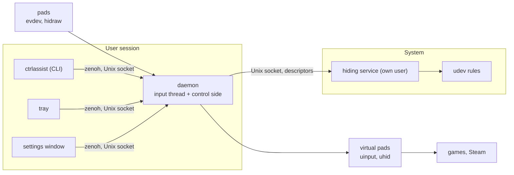
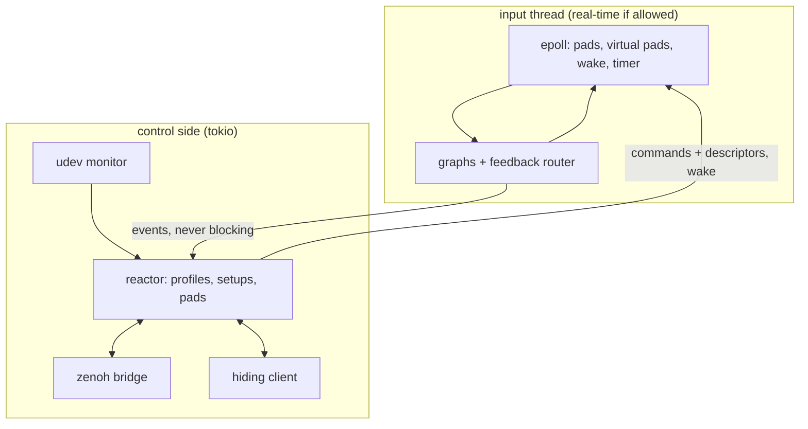

# Architecture

CtrlAssist merges or splits game controllers. It reads physical pads, routes what they do through a graph, and writes the result to virtual pads that games read instead, passing rumble and other feedback the other way.

This document describes the design and the reasons for it. [What the platform does](#what-the-platform-does) records the observations the design rests on. What has not yet been observed is tracked in [concerns/](concerns/README.md), and deferred work in [ideas/](ideas/README.md).

## Terms

| Term | Meaning |
|---|---|
| pad | A physical controller. |
| virtual pad | A controller the daemon creates for games to read. |
| primary, assist | The two roles in an assist setup: the player's pad and the helping pad. |
| managed | A profile the daemon starts by itself whenever its pads are connected, by `managed = true`. One that isn't is started by hand. |
| source, sink | A pad, or a virtual pad, as it appears in a graph. |
| node | A transform between sources and sinks: a mux or a demux. |
| control | One button or axis on a pad. |
| group | Controls owned together: a stick's axes, a lone button. |
| layout | A pad's controls arranged into groups. |
| rule | How a mux chooses a group's output from its inputs. |
| mode | A named table of rules: priority, average, toggle; and for a demux, unicast or multicast. |
| switch | The signal that moves a toggle or unicast node to its next input or output. |
| profile | A saved graph with its settings. |
| preset | A built-in profile shape offered by name. |
| setup | A profile that is running. |
| hide | Keep games from seeing a pad. |
| identity | What a virtual pad presents itself as. |
| feedback | What flows from game to pad: rumble, LEDs, trigger effects. |
| mirror | A pad's live state, published for a client to draw. |
| daemon | The user service that owns pads, virtual pads, setups and profiles. |
| hiding service | The system service that hides and restores pads for the daemon. |

## Processes



| Process | Runs as | Does |
|---|---|---|
| daemon | the user, as a systemd user service | Owns the pads, the virtual pads, the running setups and the profiles. |
| hiding service | its own user, `ctrlassist-hider`, with no capabilities, started on demand by a system socket and staying until stopped | Hides and restores pads, and hands the daemon open descriptors for them. Nothing else. |
| clients | the user | The CLI, the tray and the settings window. They hold no state the daemon doesn't. |

The daemon, the CLI and the tray are verbs of one binary, `ctrlassist`. The settings window is a binary of its own, `ctrlassist-gui`, so that neither the daemon nor the CLI links a GUI toolkit. The hiding service is a separate, small binary with no async runtime and no zenoh, so that the one process every user's daemon trusts with their pads is short enough to read in one sitting.

These are separate processes because a client crash must not drop a virtual pad mid-game, a GUI toolkit should not share a process with the input thread, and a gamescope session may have no tray at all. The separation does not extend to the daemon itself: when the daemon stops, its virtual pads go with it and the hidden pads are restored, so a game falls back to the real pads.

This is a user daemon, where TisVlay's is a system service: the pads belong to the seat user and Steam's configuration is in their home.

## Crates

One workspace, one shared version.

| Crate | Holds |
|---|---|
| `ctrlassist-core` | Controls, pad state, groups, layouts; the mux and demux nodes; the graph; the feedback router. No device or async code; serialization behind a feature. |
| `ctrlassist-protocol` | The key space, wire payloads, the rpc table, the profile schema, typed wire errors, session configuration. |
| `ctrlassist` | The client SDK: a daemon client and a state watcher. |
| `ctrlassist-device` | Everything that touches the kernel: pads from descriptors, uinput and uhid virtual pads, the controller database, hotplug, the input thread, and the grab that is the unprivileged hiding fallback. |
| `ctrlassist-hider` | The hiding service: a library holding its wire types and its client, which the daemon uses, and the service's binary. |
| `ctrlassist-daemon` | The control side: profile store, setup lifecycle, the zenoh bridge. A library that the CLI's `service daemon` verb runs. |
| `ctrlassist-cli` | The `ctrlassist` binary and its clap tree as a library. |
| `ctrlassist-tray` | The ksni tray and notifications. |
| `ctrlassist-gui` | The settings window's compiled Slint UI: tokens, theme, widgets and panes. It owns the gettext domain, which Slint names after the package. |
| `ctrlassist-gui-app` | The code that drives the settings window, its tests, and the `ctrlassist-gui` binary. Split from the UI so that a change to the Rust doesn't recompile the Slint. |
| `ctrlassist-icons` | Freedesktop icon-theme lookup for the tray and the window: an icon's name, with fallbacks, to a file in the desktop's theme. |
| `ctrlassist-test` | Fake pads through uinput and uhid, and the fixtures the VM checks use. |
| `ctrlassist-docgen` | Generated partials for the book. |

The core and device crates don't depend on zenoh, which keeps the routing model and the input path buildable and testable without the control plane.

## The core model

A graph is sources, nodes and sinks. It is validated once and then stepped.

**It is level-based.** A node computes its output state from its input states and a little state of its own. A step evaluates the nodes in dependency order and reports, per virtual pad, the difference from what that pad last held. A switch, a pad dropping out, a pad returning and a resync are therefore the same computation as an ordinary event, and nothing can stay held by a pad that is gone.

**A step is one report frame.** The input thread steps the graph once per frame a pad delivers, so a press and release in separate frames both reach the game however fast they are. The exception is the kernel's dropped-events marker, after which the pad's current state is read and stepped once.

**Pads, virtual pads and nodes are named by number, each with its own type,** so a virtual pad's number can't be passed where a pad's is wanted. The names a profile uses are mapped to these once, by the daemon, when it builds the graph.

**Pad state** is a fixed-size value, 64 buttons and 16 axes, addressed by kind and index. The gamepad names are well-known positions in that space, which is what lets two different pads be merged control by control; the touchpad's click is one of them, a button at the place the controller database gives `touchpad`. Beside the controls it holds two blocks that are not controls: the motion sensors' last reading (the rate of turning in degrees a second and the acceleration in g, gravity included, in the pad's own axes as a DualSense reports them, with a count of the pad's readings and the time since its last one by its own clock), and the touchpad's two contacts, each down or not, at a place across and down from 0 to 1. At rest a pad lies flat and still, 1 g up, with no finger down. Each value is set through a check: a reading that isn't a number lies still, and a place is held to the touchpad. A step allocates nothing.

**No profile can panic a step.** Building a graph rejects anything that could: a control index beyond the capacity, a reference to a source, node or output that doesn't exist, a cycle, more than 8 inputs to a mux, 32 sources, 64 nodes or 32 sinks, thresholds outside 0 < release ≤ engage ≤ 1, a deadzone outside 0 ≤ deadzone < 1 (which would read a stick as at rest short of all the way), a switch on a node that never selects (which would only keep its button from the game), a value that isn't a number. This is a tested invariant, because a panic on the input thread would take every virtual pad with it. As a second line, a setup whose step does panic is torn down alone.

**Scope.** The model is built for controls that rest at zero: buttons, sticks, triggers. A lever with no rest position (a throttle) would count as touched forever, and a relative control (a mouse, a gyro delta) has no level to diff. Both are out of scope until a pad needs them ([ideas](ideas/README.md)). Motion and the touchpad's contacts are carried beside the controls instead, outside the rules: each node takes each whole from one input, and the graph reports no difference for them, a virtual pad that carries them being written its whole state.

### Mux

A mux takes up to eight inputs, later ones outranking earlier, and applies one rule to each group:

| Rule | Meaning |
|---|---|
| owned | The highest input active on the group owns every member; with none active, the first input does. |
| largest | Each axis takes the input furthest from rest; a button is down if any input holds it. |
| blended | Each axis is the mean of the inputs active on the group, or the first input's if none is; a button is down if any input holds it. |
| switched | The input the switch last selected owns the group. |

A mode is a table from group kind to rule; there is no per-mode code.

| Mode | Stick | Trigger | Button | Hat |
|---|---|---|---|---|
| priority | owned | largest | owned | owned |
| average | blended | blended | largest | largest |
| toggle | switched | switched | switched | switched |

A control in no declared group is treated as a group of one, a button as a button and an axis as a stick, so every control obeys the mode. A profile may override the rule for a kind.

**Motion is one pad's,** never blended: a mux takes it whole from the input selected if any group is switched, as in toggle, and otherwise from its first input, a preset's primary. A game then always sees one pad's two sensors, which agree. A mux that doesn't select may name a button of one input that hands the motion to that input while it is held, both sensors, at once and with no ramp, and back at the next step after it is let go: the assist's, in the presets, by a profile's `assist-gyro`. Like a switch's button it is taken out of that input before anything else sees it, and another input's same button is left alone; it can't be the node's switch too.

**The touchpad's contacts are one pad's too, by a rule of their own,** a pad being active on its touchpad while it has a finger down. In priority they are the assist's while the assist touches, and the primary's otherwise, as a stick is; in average, places having no mean, they are whoever's touched first, until that pad lifts; in toggle the selected pad's. They are taken whole, never a finger from each pad, which a game would read as a gesture of two fingers that nobody made. When the pad they are taken from changes with a finger down before and after, one step shows the fingers lifted where they were, and the other pad's are put down at the next: a place that jumped under a finger held down would be read as that finger's movement, a pointer flung or a swipe. The touchpad's click is a button, under the mode's rule for buttons.

**Groups** generalize the stick pair. One rule covers a lone button, a stick's two axes and a larger set alike: whoever is active on the group owns every member, so the output is one person's direction rather than a blend of two. A gamepad's groups are derived from the well-known names; a profile may declare its own.

**Activity** has two parts. A source's deadzone zeroes a group's axes while they rest inside it, as a whole, so rest noise on a worn stick never reaches a node. A mux marks an input active on a group at its engage threshold and inactive below its lower release threshold, so an owner doesn't flicker. No ownership is held by a timer.

**The switch** is a signal into a node. A configured button raises it once per press and is consumed; a client raises the same signal with an rpc that names the input to select, so a repeated request does nothing. A selection never rests on an input that is absent: if the selected pad disconnects, the next present input is selected.

**On a switch the virtual pad takes the incoming pad's state.** What both pads hold stays down with no blip, what only the outgoing pad held goes up, and analog values step to the incoming value. Nothing in the code says so; it follows from selecting another input and reporting the difference.

### Demux

A demux sends its input to the selected output and rests the others (unicast), or sends it to all (multicast), motion and the touchpad's contacts with the controls. Its switch works as a mux's does.

### Feedback

Feedback is not input run backward.

**The graph answers one question:** which pads does this virtual pad's feedback go to, right now? Each step works it out for every node's outputs, from the answers for their inputs, so it costs the same however many ways a pad reaches a sink. A mux passes feedback to a fixed set of its inputs, to the inputs that can currently reach its output (the selected one if any group is switched, otherwise all), or to none. A demux passes it back only from outputs its input currently reaches. The answer changes when a switch does.

**Rumble is routed as levels.** The router keeps each game's effects and their timing (strengths, duration, delay, repeat count, gain) and computes one strong and one weak level per pad from everything playing that is routed there. It keeps a single effect on each pad updated to that level. Within one virtual pad, playing effects add and clamp; across virtual pads sharing a pad, the strongest request wins on each motor. This is the kernel's own approach for rumble-only pads, moved to where the routing is known:

- a hand-off part-way through a rumble gives the new pad the current level, and it ends on time;
- a rumble that has ended contributes nothing, so it can't be replayed later;
- a pad uses one effect slot however many games rumble it;
- a virtual pad that delivers levels natively needs no conversion.

**A game's upload is answered leniently.** The router holds the effects itself, so an upload succeeds whether or not any pad can rumble, and a game that insists on rumble still runs when one pad lacks it or rumble is off. The daemon's state says which pads can't.

**What passes through feedback can be watched.** With the daemon logging at debug level, the input thread reports each thing a game asks of a virtual pad, each output report a virtual DualSense is sent, and each level a pad is told, and the daemon logs them. It is off otherwise: a game can ask for rumble many times a second.

The options that were set aside are in [ideas/rumble-routing-model.md](ideas/rumble-routing-model.md).

## The daemon



### The input thread

The input thread is the whole data path, for every setup. It sleeps in `epoll_wait` with no timeout over every pad (a DualSense given its raw node twice, its event node and its raw node), every virtual pad, one wake descriptor and one timer, and makes no wakeups while idle.

- **On a pad's readiness** it reads a whole report frame, maps it to a pad state, steps that setup's graph, and writes the changes to the virtual pads.
- **On a DualSense's or a DualShock 4's raw node's readiness** it reads every report waiting, without waiting for more, into a buffer the pad holds, and steps the graph once for each input report with the motion, touchpad and click it says, the pad's other controls as of its event node's last frame. Its driver puts a report's frame on the event node before the raw node is given the report, so with both ready the event node is read first. The raw node is the one the hiding service gave the pad for its output reports, read on a duplicate of that descriptor made non-blocking, which its writes don't heed; the pad's calibration report is read off it on the control side as the pad is given it, the reports it kept while nobody read it read away there too, and applied as SDL applies it, the stored gyroscope bias taken off and a report SDL would doubt taken as nominal, so the pad state carries what a game reading the pad through SDL is handed. The node gone (`ENODEV`) is the pad gone; any other error leaves the pad's motion, touchpad and click at rest for the rest of its time in the setup, the node no longer listened to. A raw node whose device has gone answers `EIO` once nothing is left in it, not `ENODEV`, which it keeps for a node revoked (`hidraw_read` in `drivers/hid/hidraw.c`): so an unplugged pad's motion may rest a moment before its event node says the pad has gone. A DualShock 4 is read the same way by its own report: a sensor clock of 16 bits in steps of 16/3 of a microsecond, a touchpad 942 places down where a DualSense's is 1080, its contacts read from every touch report its input report carries, oldest first, each a step of its own, so that a finger put down and lifted between two input reports is seen, and unchanged by a report that carries none, and its calibration under another report over each transport (0x02 over USB, 0x05 over Bluetooth, the gyroscope's points in another order), read as SDL reads it. A pad with no raw node (no hiding service, a profile that only grabs or doesn't hide) has its motion and touchpad at rest.
- **On a virtual pad's readiness** it answers the game's request through the router at once, because the game's call blocks until it is answered: up to 30 seconds for a force-feedback upload and 5 for a HID report request. A request it doesn't understand gets an error reply, not silence.
- **On the timer** it lowers rumble levels as effects end. The timer is armed only while something is playing, for the game's own durations.
- **On the wake descriptor** it takes commands from the control side.

It is created before the async runtime and shares nothing with it but the queues. Rules that keep it dependable:

- **Nothing on it waits for the control side.** Commands arrive through a bounded queue that is only ever polled, with a wake descriptor. Reports back (a pad has gone, a node selects another input, a setup failed) are sent without waiting. One that hands something back is never dropped: the thread takes a command only once every report it may cause has room, and holds the rest of the queue until then; a selection waits for room, and what only says what passed through feedback is dropped if the control side is behind. A setup with more nodes that select than one handling tells (eight) has the thread wake itself for the rest. The bounded queue is the device crate's own, from one thread to one other: a send takes no lock and never waits, where the standard library's channel takes a lock to wake a receiver that waits, which a thread of ordinary priority holds as it starts and stops waiting. A thread of the device crate's own, at ordinary priority, takes each report off that bounded queue and hands it to the daemon's reactor through a queue without a bound, in order, which the reactor reads directly; a report of what passed through feedback is dropped there instead once the reactor has 1024 of them unread, so the reactor falling behind costs it those and never memory. Should handing a report over panic, that thread catches it and drops what hands reports over, the reactor's end of its queue with it: the reactor hears the input thread as ended, as one that stopped by itself, and the daemon ends, to be started afresh by the service manager, rather than run on with no stop answered and no pad's going heard. Every report after it is dropped on that thread, still counted as read, and the input thread refuses commands from then on as one that has stopped. No input event crosses this boundary except the mirror.
- **It doesn't log, allocate or free.** A setup (its graph, router, pads and virtual pads) is built by the control side and handed over whole; a retired one, and a pad that has gone, are handed back to be dropped.
- **It doesn't wait on a pad, or on another program.** It never touches a pad's rumble effect: an upload duplicates a descriptor, and an upload or an update of an effect on a pad another program makes through uinput (Steam Input, a game-streaming host, another remapper) waits until that program answers, up to 30 seconds, holding every other request on that pad's event node meanwhile. Each pad's one effect is uploaded at rest as the pad is opened, off the thread, and from then on a thread of the pad's own at ordinary priority updates, plays and stops it, as a pad given its raw node has a thread of its own that writes its reports: the input thread leaves the level in a one-slot mailbox and wakes that thread, neither waiting for the other, and a newer level takes the place of one not yet sent. Every pad that rumbles through the kernel goes this way, not only those another program makes, which nothing tells apart for certain (one is under `/sys/devices/virtual/input`, but it may say it is on any bus), and a real pad's event node can be held by another program's slow request too; it costs a change of level one thread wake. A pad let go of goes to that thread whole, which erases the effect (the kernel stops it first) and then closes the pad, so whoever drops a pad waits for neither. So a pad whose maker has stopped answering stays grabbed for up to a minute and a half after it is dropped: an update under way, the erase, and the erase tried again as the node is closed, 30 seconds each; it is hidden from other readers meanwhile, and its maker, hung, sends it nothing to read. A pad given its raw node is left at rest by its writer as it is let go: its motors stopped, a DualSense's trigger effects off, the lights its driver keeps. Whoever lets a pad go can take a handle from it first and wait, on a thread of its own choosing, until that writer has made its last write: the report that leaves the pad at rest, for a raw node, which a re-bind of the pad's driver would cut off, or the effect's erase; waiting is optional, and the daemon waits so, for a raw node, before it has the hiding service show the pad again (see [the control side](#the-control-side)). A report written means what the kernel's write means on the pad's transport: on USB, that the pad has taken it, and so is at rest; over Bluetooth, only that it is on its way, queued for the kernel's Bluetooth session to send or handed to BlueZ, and a re-bind straight after may drop what the kernel has queued ([concern](concerns/rest-over-bluetooth.md)). One wait is left: after the kernel drops a pad's events, the pad's state is read back with requests on its node, which wait while an update of that pad's effect holds the node; that is only for a pad the thread fell a whole buffer behind on, at the same moment as its maker stops answering. A signal that cuts such a request short has the read tried again, and the state is taken in only once every request has answered.
- **One setup's failure is its own.** Each setup's handling is guarded, so a panic or a virtual pad that refuses a write takes that setup down and leaves the others running. Catching a panic needs unwinding, so no build profile aborts on panic, the packages' included.
- **It asks for real-time scheduling** at a low priority, and carries on without it if refused. It sets no CPU-time limit of its own: exceeding one kills the process, and the kernel's limit on real-time threads as a whole already protects the machine. The daemon's state says which. Real-time scheduling is what makes the latency tail dependable when the machine is saturated.
- **No `println!`,** here or anywhere, as in TisVlay. A write to a closed pipe panics, and a panic in the daemon takes the virtual pads with it.

### The control side

A single reactor task owns the profiles, the known pads and the running setups, with commands in and state out. It is not an ECS as TisVlay's daemon is: the state is a pad list and a few setups, not many interacting state machines. Beside it run the zenoh bridge, a udev monitor for hotplug, the hiding service's client, and a watch on where the hiding service's socket is made, on a thread of its own (see [without the hiding service](#without-the-hiding-service)). The monitor's thread reads udev and nothing else, so that it can't fall behind: a pad is taken in as soon as it is seen, and whether it can rumble is learned after, and published as a change, by a thread of its own that opens each pad in turn, which can wait 30 seconds on whatever program makes one. Its socket's buffer is the largest an unprivileged process gets (udev's library asks 128 MiB, which the kernel caps at `net.core.rmem_max`). Events lost all the same, which udev's library says as `ENOBUFS`, are made good by looking again at the pads connected and at the devices they can be anchored to: a pad whose anchor has gone, or is another enumeration, is unplugged; a node gone for a re-bind leaves the pad away, and any other node gone has left; a node there that the book hasn't taken in is an arrival, a pad back where a node of its anchor is away. A going lost can be learned before the look, too: udev sends a node's removal before another node's arrival under its name, and a re-bind's removals before its arrivals, so a node arriving under the name of one held at another place, or on an anchor where a node going for a re-bind is still held, says that node has gone, and it goes as it would have had its going been heard.

A setup goes by the name of the profile it runs, and moves through starting, running, held and failed. Starting covers the round trip to the hiding service and creating the virtual pads; that work blocks, so it is done off the reactor and comes back to it as a result. Held means a pad it needs is missing: the virtual pads stay, the missing pad reads as at rest, and the rest carries on. A setup may start held, and a start that fails leaves nothing behind; failed is for a setup that was running and stopped working, which stays listed until it is stopped. A setup can be stopped while it starts: what its start waits on is given up at once, the start is refused, and the stop is answered once what the start made is let go.

**The hiding service may never answer, and that holds up only the pad it is asked about.** Each pad it hides is hidden on a connection of its own, which every later request about that pad goes on, one at a time; each other request goes on a connection made for it. The first connection asks the service's release, which the daemon publishes, and so does the first after the service was found gone, as a restarted service is; a refusal, as to a user not in front of a seat, or of a request not understood by a service from before the wire as it is, leaves what is known of it for the next connection to ask again, and the pad is grabbed. A service whose queue of connections to accept is full is waited for, within the request's own errand, by one thread that waits for room. Nothing is held across a round trip but that connection, so one setup's hide that never returns leaves every other setup's take, retake and restore free. A setup's requests are ended together when it is stopped or fails, each at once: a hide is given up by hanging up its connection, after which the service shows again whatever was hidden through it, as it does for any connection that closes; a request on a hidden pad's own connection, a reopen or a raw node, by leaving its reply to be read past, so the pad stays hidden until it is shown again as asked; and any other request is hung up on. A hide isn't sent once its errand has ended. **A connection hung up so that the service shows its pad stops sending and no more,** and the service closes its end once it has shown the pad, or, if it gave up waiting for a showing already under way, once it has asked udev for the re-bind that does, which udev runs before any a later hide asks: until then the pad is busy, and a hide of it waits for that within its own errand, as the service would refuse it as busy meanwhile. A pad given up so is one whose hide was given up, one hidden whose new node then couldn't be read, or whose taking panicked before the daemon kept its name, and one hidden under a name given up for a new one as it came back.

**What nothing should wait on is read off to one side.** Showing a pad again, as a setup stops, fails or a change gives the pad up, is a reading: made on the reactor with no round trip, and read by a blocking task of its own that waits on that pad's connection alone. So the stop, update or failure is answered once what the setup made is dropped, never on a reply of the service's, and a showing again that never ends holds its own pad and nothing else. **A pad given its raw node is shown again only once its writer has left it at rest.** Showing it re-binds its driver, which cuts off a write not yet made and puts back the lights and stops the motors itself, but never touches a DualSense's trigger effects, which only the writer's last report turns off. So the daemon takes each pad's handle (see [the input thread](#the-input-thread)) before what holds the pad is dropped, and that pad's reading waits on it, on the reading's own task, before it asks: the wait begins only once the pad is dropped, since the writer starts on its last report then, and one pad's wait holds no other's showing again, nor any answer. It is bounded by the writer alone, at most the kernel's five seconds a write on a pad that stalls. A pad whose drop panicked, and one that wasn't among what was dropped (being opened again as its setup stopped, or brought by a change not yet taken), isn't waited for, as a wait on a pad never dropped would never end. A pad sent its level through a kernel effect isn't waited for either: it has no trigger effects to turn off, and its effect's erase can wait on whatever program makes the pad. A reading hung up as it waits asks nothing once the writer is through, and a thread waiting so keeps nothing from exiting, the runtime being shut down in the background. The pad is published as hidden until the service has shown it. A start that wants a pad whose reading is still out waits for it within its own work, which a stop ends, and so follows the pad's last report too, as a restart by an update does: the service keeps the pad as busy until its re-bind is done, so hanging the earlier reading up would only race the start into a refusal and a grab. Past sixteen readings still sending, the oldest stops, which has the service give up waiting for its re-bind; it is read until the service has answered or closed its end, and its pad is busy until then. As the daemon stops, every reading, every request under way and every connection hung up to show a pad is hung up whole, and none is made after, so the daemon's stop waits on nothing the service does. The pads of setups still running as the daemon stops are shown again by the service as their connections close, with the reactor or at the process's end, which comes before the input thread drops them or races it, so their last reports can be cut off ([concern](concerns/rest-as-the-daemon-stops.md)). A daemon holds one connection for each pad it has hidden, one for each other request under way, of which there is at most one for each pad being taken, one for the DualSense being copied and one for the first look for the service, one for each reading, and one for each connection hung up to show a pad, until that pad's next hide has read it to its end or the daemon stops; and one thread for each reading being read, and one more for connections that wait for room. A pad has one reading at most, as a hide of it waits for the last.

A **managed** profile, one with `managed = true`, is started by the daemon when it can run, not merely be held: when the daemon starts, when the profile is put, and when a pad it names connects, if by then every pad it names is connected and free. A setup the user stopped stays stopped until one of its pads is plugged in again.

A node that selects, a mux that follows its switch or a demux that sends to one output at a time, has its choices and the one selected in the setup's state. The input thread reports each change of selection, whether from the switch button or from `select`, which names a choice or asks for the next. A mux doesn't hand over to a pad that isn't there.

A node is only where a pad was last seen: the kernel hands a freed node number to the next pad to connect, which can happen before the first pad's leaving has been heard of. So what a setup opens is checked to be the pad it wants before it is hidden, grabbed or read.

A source that names an exact pad is that pad, there or not. One that names a model takes the first pad of that model to have connected that no setup uses and no source of the profile names exactly, and from then on waits for that pad and no other: the sources that name a pad exactly are bound first, then those that name a model, in the order of their names, each among the pads left. So a profile is refused as naming a pad twice only when it does, never because a model's source took first a pad another names. A change taken as the setup runs binds the same way, and a source by model doesn't keep a pad the new profile names exactly.

A change to a running setup is live if the virtual pads are untouched (a threshold, a rule, the switch, a feedback setting) and disruptive if one must be recreated (its identity or capabilities), which the game sees as a disconnect. The daemon says which before applying it. The test is whether the profile as kept now has the setup's virtual pads, as many, of the same identities in the same order, and keeps its pads from games the same way. A virtual pad is made anew only to be another thing to a game; everything else is taken as the setup runs, its pads included. **A profile says how its pads are kept from games,** with `hide`: `full`, the default, is the hiding service or failing that a grab with Steam's blacklist; `grab` is a grab and nothing more, with the hiding service there or not; `none` leaves the pads as they are, for a game that is to read one directly. A setup's pads are all taken the one way, at its start and when one returns, so another `hide` is another start. The daemon works out which pads the setup keeps: a source keeps the pad of the slot of its name that wants the same pad, or failing that of a slot that wants the same pad under another name, or failing that a pad the setup has that the source could mean, so a pad stays open wherever the new profile has a use for it and two pads changing parts are only renumbered. Any other source is found a pad as at a start, which is then hidden and opened off the reactor. Then the daemon hands the input thread the new graph with the pads it brings, and the thread swaps both in between two frames: kept pads move to their new sources, a pad no source keeps stops rumbling and is handed back, the new graph is brought to what the pads hold at that moment, a node that selects goes on selecting what the node of its name had, found by what the profile calls it, and the virtual pads change only where the two graphs disagree; the games' rumble effects are untouched. The old graph and the pads given up are handed back to be dropped off the thread, the update is answered, and the hiding service then shows those pads again, which nothing waits on. Until the thread reports the graph taken the daemon follows the setup as it was, and sends nothing that names a pad or a node by number: a selection or a buzz asked in that moment is refused as busy, and a missing pad is brought back afterwards. Another identity stops the setup and starts it again on the profile as kept now. Putting a profile changes nothing that runs until `update` is asked, and a profile that is wrong or gone by then leaves the setup as it was.

## Pads

**Reading.** Pads are read through evdev from descriptors, not paths, because with hiding on the daemon cannot open the path itself.

**Reading is level-based,** like the graph it feeds: the reader reports the pad's whole state after each report frame that changed it. A pad opened mid-press starts with what is held. When the kernel drops events because they weren't read in time, the pad's true state is fetched again, so a dropped release can't leave a button held.

**Layout.** Xbox and PlayStation family pads get a standard layout from their kernel drivers: face buttons by position, sticks on X/Y and RX/RY, triggers on Z and RZ, the directional pad as a hat or as four buttons. A stick at rest reads exactly zero. A trigger that only clicks drives its axis fully, and a click reported beside an analog trigger is ignored. Without a stick on RX/RY, Z and RZ are read as the right stick. A pad's other buttons and axes take the spare positions of the pad state in the order of their codes. For others the device crate applies SDL's controller database through its own parser of that format. The parser treats the database as untrusted input and has a never-panics property test: a line that doesn't parse is skipped and counted, a binding to a control the pad lacks is dropped, and the rest of the line is kept.

A pinned snapshot of the community database's Linux entries is built in, and a file of the user's own in the same format is laid over it, so one pad can be fixed without waiting for a release. A pad is looked up by bus, vendor, product and version, then by any version on the same bus. A pad whose kernel driver is one of the gamepad drivers is never looked up: a database line for it describes some other driver's view of the pad. A pad that is neither is read as a gamepad.

**Identification.** A pad is known by the kernel's `uniq` value: the pad's own address. For PlayStation pads the kernel driver sets it from the pad's pairing report, so it is the same over USB and Bluetooth, and Steam keys its per-pad configuration by the same value. An Xbox One pad on USB reports no `uniq`, but its USB serial number is in udev's `ID_SERIAL_SHORT`, so that is the second choice. Failing both, by vendor and product plus port, then by name. A profile names a pad by this identifier when it must be that exact pad, or by model when any pad of that kind will do. udev's `ID_SERIAL` and `ID_PATH` are not identifiers by themselves: for a PlayStation pad the first is only the model name, the second is the port, and neither exists over Bluetooth.

**Hotplug.** Which pads are connected, and each change to that, comes from udev after it has finished with a device, so a pad that is reported can be opened at once. When a pad in a running setup disconnects, the input thread releases what it held, hands the pad back, and the setup is held. When the same pad returns it is hidden again before any game can see it, re-bound to the setup, and given the current rumble level. A notification says what happened.

**Not our own output.** The daemon never takes its own virtual pads as sources. It marks them at the start of the `phys` string, which uinput lets a pad's creator set, and refuses any pad that carries the marker, whichever process made it. A Bluetooth pad can itself be a uhid device, so "under uhid" cannot be the test; a uhid virtual pad will carry its mark in its address. Other software's virtual pads are sources only if a profile names them.

## Hiding

No unprivileged mechanism makes a pad absent to games ([what the platform does](#hiding-mechanisms)), so hiding is the hiding service's job. The service is a system service, but not root: it runs as a user of its own, `ctrlassist-hider`, with no capabilities, and what it may do is what a udev rule shipped with it gives that user's group.

**Hiding a pad is two steps.** The service creates marker files naming the pad, and the static rule hides the nodes of any pad a marker names, every one of them (its event and js nodes, its raw HID node, and those of its touchpad and motion sensors, the touchpad's mouse node among them): they go to the service's group alone, mode 0660, and lose the seat-access tag. Then the service asks udev to re-bind the pad's driver, which cuts off every program that already had the pad open, as Steam does from the moment a pad is plugged in, and makes the nodes again, hidden as they are made. Showing the pad again is the same in reverse, and because programs see the pad arrive again, Steam picks it up without a restart.

**Access arrives as descriptors, not permissions,** because the daemon and the games are the same user: anything that denies the games denies the daemon. After the re-bind, the only descriptors open on the pad are the ones the hiding service opened and passed on.

### The rule and its markers

The rule, `72-ctrlassist-hide.rules`, never changes, and udev is never asked to reload it: a line can test for a file named after the device's own attributes, and the test is made at every event. It sorts after systemd's `70-uaccess.rules` and any `60-*` rule that opens hidraw, and before `73-seat-late.rules`, which grants what the tag asks for. Its hiding assignments are final (`:=`), so a later rule can't open a hidden node again. It does three other things: it gives the group the `uevent` file of each pad's HID device, or with none its USB interface, which is how the service asks for a re-bind; it does the re-bind when asked; and it gives the group the raw nodes of PlayStation pads, for the `raw` request.

The markers are in `/run/ctrlassist/hide`, the unit's runtime directory, owned by the service's user and kept when the service stops. Each is a file directly in it, and each name has a prefix and says how the rule finds the pad:

| Marker | Written for a pad | Hides |
|---|---|---|
| `addr-<uniq>` | whose input device's `uniq` is an address | its event, js and mouse nodes, wherever it reconnects |
| `serial-<vendor>-<product>-<serial>` | with no address and a USB serial number | its event, js and mouse nodes, wherever it reconnects |
| `hid-<HID device>` | with a HID device | all its nodes, through the re-bind, which keeps the HID device |
| `uniq-<HID_ID>-<HID_UNIQ>` | whose HID device has its own unique string, as one on Bluetooth has its address from its creation | its hidraw nodes, wherever it reconnects |
| `port-<USB interface>` | on USB, with neither address nor serial | its event, js and mouse nodes, when it reconnects to the same port |
| `raw-<USB interface>-<HID_ID>` | whose HID device sits directly on a USB interface, whatever else it has | its hidraw nodes, when it reconnects to the same port, and those of any HID device of its model there, but of no other |

- **A port is named by the kernel's name for the USB interface,** such as `1-2:1.0`: the bus, the ports to the device, the configuration and the interface. The rule reads it as the name of the nearest USB interface above the node, so a device made through uhid, which has none, is never taken for a pad in a port, whatever its `phys` says; for a raw node, only of a HID device on the USB bus, since a pad on Bluetooth through the kernel's HIDP has the adapter's interface above it, and the service writes no `raw-` marker for one, its address naming its raw node by `uniq-` wherever it reconnects. The `phys` a uhid device's creator chooses isn't read at all.
- **A hidraw node is hidden by its HID device, not by an address.** A HID pad on USB has no address among its HID device's properties, and a DualSense on USB has its hidraw node made before its driver sets the address; the HID device's name is there from the start and lasts through a re-bind. So a hidden pad's hidraw node is hidden whatever the pad is, and no other pad's is. One that reconnects to the same port has its new hidraw node hidden by its port and its model whether or not its address came first; another kind of HID device plugged into that port, a keyboard or a security key, is never taken for it. **A HID pad on USB that reconnects to another port while hidden has its hidraw node open to whatever opens hidraw to the seat user** (Steam's rules) until it is shown again: its HID device is new, its port is another, and it has no address there.
- **A pad is a joystick and nothing a keystroke or a pointer could come from,** to the rule and the service alike: an event node udev marks `ID_INPUT_JOYSTICK` and none of `ID_INPUT_KEYBOARD`, `ID_INPUT_MOUSE`, `ID_INPUT_TOUCHPAD`, `ID_INPUT_TABLET` or `ID_INPUT_POINTINGSTICK`, and, where udev marks it `ID_INPUT_KEY`, whose keys are all at code 128 or above. udev marks a key for any one code below 256, so a share button (`KEY_RECORD`, as xpad and hid-microsoft report an Xbox Series pad's) or a menu key alone would stop a pad being hidden; below 128 are every typing, editing, arrow and modifier key, Enter, Esc and F1 to F12. Both read the input device's `capabilities/key` in sysfs, a bitmap in hex words the size of the reader's `long`, 64 or 32 bits, which the rule can't know: keys below 128 fill the last two words of 64 bits or the last four of 32, a word of more than eight digits can only be of 64, and with none so wide four words must be clear, which refuses a pad with no button from 0x120 to 0x13f (none is known) rather than guess. A unit test holds the rule's patterns and the service's reading to the same answer for every bitmap the kernel writes. libinput takes a joystick with ten keys or more for a keyboard, a count no pattern can make, and the allowed keys aren't bounded by it: a pad's node is hidden as it is made, by its own event or the re-bind, either carrying the mark that has libinput leave it alone, never by a later change event, but where a marker made for another pad names a pad already there. The pads still refused are [a concern](concerns/pad-marked-as-keyboard.md).
- **A pad's other nodes are hidden with it:** its touchpad's and motion sensors' event nodes, the mouse node a touchpad has, and a joystick node the service wouldn't take for a pad, one with a key below code 128 or a touchpad's axes. The rule hides such a node only under a device it already knows for a pad's, the one whose `uevent` file it gave the group, which it tells by the file's group-write bit; and never a node udev classes as a keyboard or a pointer. A joystick the service wouldn't take is never hidden on its own account, by a marker made for another pad: the service wouldn't find it to show it again. A pad that reconnects while hidden has a new device, and udev runs the events of its other nodes beside its joystick node's, not after it, so some are made before the rule knows the device: the joystick node's own event, once it has given the group the file, has udev send a change event to every input node under the device, which udev runs after that node's earlier events, and the rule hides them then. Until their change event has run, those nodes are as a stock machine leaves them, open to the seat user if they are in `input`, and a program that opens one meanwhile keeps it; the joystick and raw nodes are hidden as they are made.
- **A hidden pad's event nodes are left alone by libinput,** and so by the compositor, which reads input through it: the rule sets `LIBINPUT_IGNORE_DEVICE=1` on each. The node's group doesn't keep a compositor out, as it opens nodes through logind, which opens them as root for the session in front; on Plasma a hidden DualSense's touchpad, its node the service's group's alone, was seen to move the pointer. libinput reads the property only as a node is added, and a hide's re-bind makes every node anew, as the showing again does without it. It ignores change events, and an add of a node it already has, so a touchpad hidden late, by the change event above, is told to udev's listeners to have gone and come back: the rule, hiding a touchpad's event node on a change event, has udev send it a remove and then an add, which leave the node itself as it is. libinput lets it go at the first and leaves it alone at the second. Only a touchpad's that isn't a joystick's: libinput passes over a joystick and motion sensors by itself, and a joystick's node going would be taken for its pad going. A compositor that reads input otherwise, and the X server's evdev and synaptics drivers, which don't read the property, are not kept from a hidden pad's touchpad; nor is `/dev/input/mice`, which merges every mouse node, a touchpad's among them, and which no current desktop reads.
- **No string from a device reaches a marker's name unchecked.** A pad's name and address are chosen by whoever created it, and a seat user can create devices. A marker is named only from numbers the service parsed itself, kernel names, and strings of exactly the expected shape; one that isn't is left out. The rule never tests a value that carries `/`, so every file it looks for is directly in the marker directory, and a match changes only the group of the matching device's own nodes.
- **A marker can name more than the pad it was made for:** a twin with its address, clones sharing a serial, a pad plugged into its port while it is away. Their nodes are hidden at their next event. Once no marker names them, the service has them re-bound too, which makes their nodes afresh as the stock rules make them: a pad whose event node is in the service's group, and a raw node the rule marked as hidden in udev's record of it (`CTRLASSIST_HIDDEN`), as one of a hidden pad's model in its port with another address is.
- **What the rule alone can't keep:** one HID device or USB interface can carry a keyboard or a pointer beside a pad, and the rule, which sees one node at a time, gives the group that device's `uevent` file all the same. The service refuses to hide such a pad, and its sweep leaves such a device as it is, a joystick node hidden by a marker that named another pad staying hidden until the device is plugged in again; so none of its re-binds cuts a keyboard off, though a service taken over could still ask for one. The rule never hides the keyboard's or the pointer's own nodes, nor a joystick's that udev also classes as a keyboard or a pointer, which the service would refuse to hide and nothing would show again; a joystick's with a key below 128 only beside a pad, as above.

### Asking udev to re-bind

The service writes `change <uuid> CTRLASSIST=rebind` to the `uevent` file of the pad's HID device or USB interface. The kernel turns it into a change event carrying the UUID and the argument, and the rule, run by udev as root, unbinds the driver and has the kernel probe the device again, so whichever driver a plug-in would bind takes it. The service can only ask this of pads, the rule having given it no other device's `uevent` file, and needs no list of drivers. [Why this way and not group-writable driver files](ideas/hider-rebind-options.md).

**udev runs a device's re-binds one after another.** It starts an event only once every earlier event of the same device, its parents and its children has run, and answers an event, sending it to its listeners, once its rules have run. So two requests for one pad written back to back, whoever writes them (a showing again after a hide given up, a hide soon after a showing again, the sweep's), run in the order written, the second's answer coming after the first has run; and the nodes the first makes, the device's children, are finished by udev only after the second has run, which removes them. The service needs no turns of its own: a re-bind is judged on its own answer, and never on what an earlier one did.

**The service waits on state and on the answer, with no time limit,** and udev's other events are only its cue to look. Listening to udev's monitor from before it writes the request, at every event for a pad's devices, it reads afresh what sysfs and udev's record say. The re-bind is done when udev has answered the request, the inputs the device had before are gone, a driver is bound, and udev has finished with every node under the device since the request (its record's initialization time is later, and the programs its rules run have run). A hide also needs every one of those nodes hidden, its ACL with no entry beyond its mode among that, and the pad's own joystick node there, which a driver for a wireless receiver makes only once the pad reports in. It fails at once where the rule's effect is missing: the group can't write the device's `uevent` file (the rule isn't installed), udev has answered and the old inputs are still there (the rule didn't re-bind), no driver took the device again, or a node came back not hidden (another rule undoes the shipped one, as a later `TAG+="uaccess"` would; the reason is logged); a failure seen with the pad gone is its unplugging. After the monitor's socket overran, the answer may have been lost, and then state alone may say the re-bind is done: by udev's order, nodes it finished since the request are this re-bind's, unless the kernel removed and made the pad's inputs again in the moment between the service reading them and writing the request (an earlier re-bind run just then, a driver making its inputs anew, someone else re-binding the pad), which would be taken for it. The wait also ends when the pad is unplugged, and when the client that asked hangs up, whole or its sending alone; anything else the client sends meanwhile, an empty message among it, stays queued and is read in its turn after the wait. Showing a pad again for a client that has gone ends on the rest. A wait that ends before udev's answer leaves the request in udev's queue, and the device's next re-bind runs after it.

**A pad with no driver to re-bind is refused,** as a uinput pad another program made is: nothing could cut off whoever already has it open. The daemon grabs it, as it grabs any pad the service refuses, which at least silences them.

### The hiding service's protocol

The service listens on a system Unix socket, `/run/ctrlassist/hider.sock`, that systemd holds and starts it from. Each request and each reply is one message on a sequenced-packet socket, so there is no framing; descriptors travel beside them. Its vocabulary is small on purpose:

| Request | Carries | Does |
|---|---|---|
| hide | an open descriptor on the pad's event node | Checks the pad, creates its markers, has its driver re-bound, opens the new event node, returns its descriptor and a token. |
| reopen | a token | After the pad has reconnected: returns a fresh descriptor. The markers already hid the new nodes. |
| restore | a token | Deletes the markers no other hidden pad has, has the driver re-bound. |
| raw | an open descriptor on the pad's event node | Checks the pad and its driver, opens the hidraw node of that pad's HID device, returns its descriptor. Nothing is hidden and nothing is remembered. |
| raw of | a token | The same for a pad this connection has hidden, which its event node no longer names to the service: the driver is checked as it is now. |
| version | nothing | Returns the service's release, packed into the reply's token: twelve bits of major and ten each of minor and patch. |
| (connection closes, or stops sending) | | Gives up a hide still waiting for its re-bind, refusing it as failed; restores everything that connection hid; then closes the service's end. |

- **The wire is fixed-size, and each message checked whole.** A request is five bytes: an opcode (1 to 6, the requests above in order) and a 32-bit little-endian token. A reply is six: a status (0 for done, or a refusal: 1 not permitted, 2 not a pad, 3 busy, 4 unknown token, 5 absent, 6 failed, 7 bad request, 8 unsupported), the token, and a flags byte, none of whose bits is set or read: a service of an earlier release set bit 0 in a reply to a hide or a reopen, which nothing read, so either release reads the other's replies alike. A message of another length, or with an opcode or a status not among these, is no message: the service refuses it as a bad request, and the client takes it for a broken protocol. An empty message is read, in its turn, as the connection's end.
- **A hide is given up by hanging up,** the daemon stopping sending on its connection: the service, seeing that in its wait, stops waiting, shows the pad again, and closes its end. What the pad went through meanwhile isn't the service's to say: the daemon knows a re-bind by its request, below.
- **A pad hidden or shown again goes and comes back, and the daemon doesn't publish that.** Re-binding a driver makes the kernel remove the pad's nodes and make new ones, and never removes the device whose driver it re-binds: the pad's HID device, or with none its USB interface, the device the service records. That device, with the time udev first saw the USB device above it where there is one, is the pad's anchor, read with each node the daemon hears of, as the service reads it. The anchor staying doesn't make a re-bind: a pad on a wireless receiver (xpad's for the Xbox 360, hid-steam's dongle) loses its node when it is switched off, and the receiver, its anchor, stays. **A re-bind is known by its request.** The service asks each by a change event on the anchor carrying its own argument (`SYNTH_ARG_CTRLASSIST=rebind`, which the kernel names so for an argument written to a `uevent` file, and which only root and the service's group can write there). udev runs the rule that re-binds the driver before it sends that event on, and the removals and arrivals the re-bind causes, events of the anchor's children, wait in its queue until the request has run: so a listener hears the request first, with the kernel already past the re-bind. The daemon's watch hears it, and the nodes under the anchor gone from sysfs by then are marked as going for it. A node gone so is the pad away: nothing is published, and it is still connected, though not there to be opened. A node come on that anchor is the pad back, which prompts no start. Any other node going has left, and is published, whatever became of its anchor; its return is a pad plugged in. The anchor's own removal, which udev sends after its nodes', is the pad unplugged, away or not; a node on an anchor not seen before is a pad plugged in. So the service's re-binds are never published, however many there are, and a profile stopped by hand isn't started again by them, with nothing asked of the service and no count kept; a re-bind by anyone else is published as the pad leaving and connecting, which is what it is. Each mark goes with its node, and a request the rule didn't act on marks nothing, its nodes being still there, so no mark outlasts its re-bind. A uinput pad another program made has no anchor, nothing re-binding it, and its node going is its unplugging; so is the going of a node whose anchor couldn't be read. A re-bind no driver comes back from leaves the pad away, and published as connected, until its anchor goes. A pad away as the daemon starts has no anchor known yet, and its return is a pad plugged in, as it would have been had it been there a moment before.
- **Its release is the daemon's to pass on.** The daemon is the service's only client, so it asks the release first on every connection it makes, as a connection must have had a reply before it passes a descriptor (below), and publishes it in its own state, where the window's About and anything else can judge it against their own, as they judge the daemon's and the tray's by the `info` each serves. A service left running from before an upgrade is then seen for what it is; one too old to be asked refuses the request, being from before the wire as it is, and the pads are grabbed as for any refusal. The reply stays the one fixed size, which is why the release is packed and anything after the patch doesn't travel.
- **A pad is named by a descriptor the caller already holds, never a path or a name.** The service takes the device number from the descriptor and finds the pad from that. Possession proves the caller could already read that pad only for a descriptor opened for reading: one opened `O_PATH` names any file the caller can see. So the descriptor must show a readable access mode and no `O_PATH` (`F_GETFL`), be a character device of the input major (`statx` with `AT_STATX_DONT_SYNC`, which a FUSE file answers from its cache), and answer `EVIOCGVERSION`; none of these waits on another process. Then, for event nodes, the service grants nothing new.
- **It refuses anything that isn't a pad the seat user could open:** the device must be classified as a joystick, must not be classified as a keyboard, mouse, touchpad, tablet or pointing stick, must have no key below code 128, as the rule tests ([above](#the-rule-and-its-markers)), and must carry the seat-access tag. And it refuses a pad whose HID device or USB interface has a keyboard or a pointer among its inputs, which the re-bind would cut off too.
- **It acts on the device it checked.** It records the pad's HID device or USB interface, which keeps its place through a re-bind, and finds the new event node under it. It records the device as one enumeration of it: a HID device's name is new at every enumeration, but a USB interface's place is its port's, so for a pad on USB the time udev first saw its USB device is recorded too, and whatever is plugged into that port next is another device, though at the same place. A pad that reconnects while hidden comes back as another device; only once the recorded one is gone is the pad looked for again, among the pads the rule has hidden, by its markers, its numbers, its seat, and whether its device is a virtual one, and only for a caller in front, now, on the pad's seat, since what is found may be a pad someone else plugged in. A node the service opens by its path is checked, once open, to be one under the device it was found under, and, for a hidden pad, to be hidden: a node's number can pass to another device between its being found and opened.
- **A hidraw node is opened only for a pad whose kernel driver is on a short built-in list.** On a stock machine hidraw is closed to users, so this is the one thing the service grants that the user didn't have; the list is the PlayStation driver alone, which the DualSense identity needs. The caller names the pad as for hiding, by a descriptor on its event node, and the same checks apply before the driver is looked at; a pad of any other driver is refused.
- **One user at a time.** A pad hidden for one user is refused to another.
- **Who is served:** the user whose session is in front on a seat, where that session is a person at the machine: class `user`, graphical, not remote. This is TisVlay's rule, and it never asks whether a session is "active", because an SSH login reports that it is. Anyone may connect; the check is made as a client connects and, for one not yet found in front, again at each request, by the peer's user ID, against logind through its login library, with no D-Bus connection. A user's daemon starts with their services, which can be before their session is in front, and it keeps the connections it hid pads on. **`hide` and `raw` need the caller in front now, on the seat the pad is on** (its `ID_SEAT`, `seat0` when unset): a user on one seat takes nothing of another's, and a client that has left the foreground, as on a user switch, takes nothing new. It keeps what it has hidden, and may still open those pads again (`reopen`, `raw of`) and show them, but not have one that reconnected found again.

What this defends: another user's session, and the rest of the system, against a process of the seat user. It does not defend the seat user against their own processes; a game running as that user can already read the pads and talk to the daemon. What a compromise of the service yields is the group's power and nothing more: opening hidden pads and PlayStation pads' raw nodes, having any pad's driver re-bound or sending its device any synthetic event, and hiding pads. Denial of service on pads, and on a keyboard or a pointer only where one shares a pad's device, which it can cut off with the pad but never hide or open; not root.

**Cleanup hangs on the connection.** The kernel reports the daemon's connection closing even when the daemon is killed. For the service's own failure, the markers are the record: each is made before the re-bind it takes effect at. When the service starts, and from its unit's `ExecStopPost=` however it stopped, every marker is deleted and every pad the rule still hides, known by its event node belonging to the service's group, has its driver re-bound. `/run` is emptied at boot, which bounds the worst case.

**Reconnects are driven by the daemon.** Its udev monitor sees the pad return and asks for `reopen`, so the service has no event loop of its own.

**Each connection has a thread of its own,** and what is hidden is shared behind one lock that no thread holds while it waits on a client or on udev. So a client that never reads its replies blocks only its own thread at its send, and one that passes a descriptor whose last close blocks (a FUSE file's flush, a lingering TCP socket) blocks only its own thread: every descriptor received is closed on the thread that received it, any beyond the one a request carries at once. Anyone may connect, and a cap per user alone can be walked around, a user being able to run processes as many user IDs (the subordinate ones a user namespace maps, which most distributions give every user). So a user logged in at a seat, as the daemon's user is, may hold 40 connections, room no other user's connections take: the daemon holds one for each pad it has hidden and one for each request under way beside them, two for each pad and two more at most, which is 34 for sixteen pads. Any other user may hold eight, and all of them together 32; such a user is never in front of the machine, so is refused every request anyway, and nobody logs in at a seat as a subordinate ID. A connection over a cap is closed as it is accepted, with no thread made for it and nothing read from it, which the daemon takes for the service being absent, and grabs the pad. **A connection passes no descriptor until the service has admitted it,** within the caps: the socket unit has the listener refuse them (`AcceptFileDescriptors=no`, which clears `SO_PASSRIGHTS`; Linux 6.16 and systemd 258), and the service lets each connection it admits pass them, so one it won't serve never carried any, and its close releases nothing that could block. A send that carries one fails at the client until then, so a client has had a reply on a connection before it sends one: the client library asks the release first where nothing else was asked, and the daemon asks it on every connection it makes, as a request its errand's end hangs up. The unit sets it, not only the service, because a connection waiting to be accepted has the listener's setting from when it connected, and the service would come too late for those queued as it starts. Where systemd doesn't know the unit's setting, the service clears it on the listener as it starts, for the connections queued from then on; where the kernel doesn't, every connection may pass descriptors as soon as it has connected, and the service says so as it starts ([concern](concerns/hider-closer-on-older-kernels.md)). **For that case, no connection is closed on the main thread, which accepts:** closing a connection releases what it carries on the thread that closes it, which a lingering TCP socket among them holds there. So a connection over a cap, and one whose thread couldn't be started, is handed to one thread kept for closing them, started with the service, through a queue with room for 64. A close that blocks holds that thread and what is queued behind it; with the queue full, the main thread keeps the next such connection and accepts nothing more until the closer has room, the clients waiting in the backlog meanwhile. On a kernel without the setting, a user who can make a close block and then connects 65 times more stops the service accepting for as long as that close blocks. What no cap reaches is the queue of connections not yet accepted, the socket's backlog, which is everyone's: the service learns who connects only as it accepts. A user who connects without pause can keep that queue near full, and a client that connects without waiting, as the daemon's does, is then refused at once and takes the service for absent until it next looks; but nobody holds an accepted connection over their cap for longer than the closer takes to close it. The listener itself is left open as the service exits, for the kernel to close: its last close would release the connections still queued on it, and what they carry, on the main thread. The unit raises the service's descriptor limit to 8,192: a connection's thread holds at most six descriptors at once, and one more, its watch on udev, for each pad it shows again as it closes, and the sweep holds none, so that is room for some thirty users at seats with their caps full. A closing connection shows its pads again each on a thread of its own, so that one whose re-bind never ends holds none of the others. Running out of descriptors or memory stops the service accepting until a connection closes, which frees both; with none open, nothing is hidden, so the service stops and says why, and systemd starts it afresh for the client still waiting. Neither that nor a failed wait on the listener ends a service that has pads hidden, which would show them mid-session: after a failed wait it blocks on one thing alone, a connection closing or a client to accept, systemd handing the listener over blocking. **Started on demand, by its socket's first client, it stays until it is stopped.** How often it starts is then nobody's doing but a start that fails, so systemd's default limits stand: a start that keeps failing (no such user, no binary) fails the socket after five in ten seconds, and the client waiting is let go, rather than the service being started again for as long as anything is queued. The limits count starts however each run ended, so a service that a client could end would, ended five times, fail the socket for everyone until root resets it: **nothing a client does may end the service.** A panic serving a connection ends that connection alone, what it hid shown again, and the shared state stays usable after a thread panicked holding it, the packages' profile unwinding on panic; a system call outside the unit's filter fails with `EPERM` rather than ending the service. Were it to exit with its last connection, anyone could start it as often as they connect, and past systemd's limit on how often a socket may start its service, 20 in 2 s, the socket would fail and stop listening, for everyone; lifting that limit lets a start that keeps failing go on for as long as a client waits.

**The unit's sandbox is defense in depth,** the user's permissions being the boundary: no capabilities and no new privileges, the file system read-only but for the marker directory and `/sys/devices`, the device cgroup closed but for input and hidraw nodes, netlink the only socket it may make, and the rest of the usual set. The network namespace is shared, since udev's events arrive over netlink in the host's.

### A pad's anchor, by kind of pad

A pad's anchor is what its driver is re-bound at, and what tells a re-bind from an unplugging ([above](#the-hiding-services-protocol)). The device crate reads a node's anchor as the hiding service finds the device it records and re-binds: the nearest HID device above the node, or with none the nearest USB interface, with the `USEC_INITIALIZED` of the nearest USB device at or above it, where there is one. The two must agree: an anchor below the device the service re-binds would go with each re-bind.

- **A HID pad on USB** (a DualSense, a DualShock 4): its HID device, under its USB interface, stamped by its USB device. The HID device's name carries an instance number the kernel never hands out twice, so the stamp only repeats what the place says.
- **A HID pad over Bluetooth through uhid** (BlueZ): its HID device, under `/sys/devices/virtual/misc/uhid`, with no stamp. BlueZ destroys the uhid device as the pad disconnects, which removes the HID device.
- **A HID pad over Bluetooth through the kernel's HIDP:** its HID device, under the adapter's connection, stamped by the adapter's USB device where the adapter is on USB; the connection and the HID device go as the pad disconnects.
- **A USB pad with no HID device** (xpad): its USB interface, whose place is its port's, stamped by its USB device: another pad plugged into that port is another enumeration.
- **A pad on xpad's wireless receiver** (the Xbox 360 one): the receiver's USB interface, one for each of its four places, stamped by the receiver's USB device. The driver makes the pad's input device when the pad reports in and removes it when the pad is switched off or out of range, and the interface stays: the pad's node goes with no request, and has left. After a re-bind the pad's node comes once the pad answers the driver's question whether it is there, after the driver is bound.
- **A pad on hid-steam's wireless dongle** (the Steam Controller's): the dongle's HID device, stamped by the dongle's USB device. The driver makes the pad's input device when the pad connects and removes it when it disconnects, the HID device staying, so as with xpad's receiver.
- **A uinput pad another program made:** no anchor. Nothing re-binds it (the service refuses it, and the daemon grabs it), and its event node is what goes when it does, so its node going is its unplugging, as before.
- **A pad with several input nodes** (a DualSense's touchpad and motion sensors): the daemon takes in only a pad's joystick nodes, and those of one HID device share its anchor, each node away and back on its own.
- **A node whose anchor can't be read** (it went as it was read, or its USB device has no stamp yet): its own anchor, as a uinput pad's.

The hotplug watch hears, beside input nodes, the removal of HID devices and USB interfaces, filtered by udev, and their change events that the service marks as its request for a re-bind; a removal unplugs every pad anchored at or under the device removed, once. A pad present as the daemon starts has its anchor read with it; one away then has none known, and its return is a pad plugged in, as it would be had it been there a moment earlier.

What that leaves:

- **A re-bind no driver comes back from** leaves the pad away, and so published as connected, until its anchor goes.
- **Bluetooth.** A pad BlueZ presents through uhid, or through the kernel's HIDP, keeps its HID device through a re-bind as far as the driver model says: unbinding a driver doesn't remove the device. The hiding service leans on the same, and its VM check runs it for USB and uhid. Seen on a DualShock 4 over Bluetooth through uhid; not through the kernel's HIDP.
- **A re-bind by anyone but the service** is published as the pad leaving and one connecting, and its return is a pad plugged in, which may start a profile that starts by itself: that is what it is, as far as anything can tell. So with a re-bind asked by a hiding service from a build before the mark, which writes none.
- **A pad on a wireless receiver switched off in the moment of a re-bind,** between the request being written and udev running it, has its node's going taken for the re-bind's: it is away, and published as connected, until it is switched on again, which is then its return and starts nothing, or until the receiver goes. So with one switched off once its node was back, the re-bind's request read only after the hotplug watch lost events and its node's coming and going lost: what is connected, looked at again, can't tell it from a pad whose node is still to come, as a receiver's pad's comes only once it answers the driver.

### Minimum versions

What the hiding service and its rule use: `TEST` with substitution, `IMPORT{parent}`, `TAG-=`, final `:=` assignments, `%b` in `RUN` formatted when its line is applied (udev since its rules engine was rewritten in 243); `CURRENT_TAGS` (247), which the behavior at a switch of seat relies on; synthetic uevent arguments (Linux 4.13); `ProtectProc=` and `ProcSubset=` (systemd 247), `PrivateIPC=` (248), `RuntimeDirectoryPreserve=` (235), `sysusers.d` (215). So **systemd 248 and Linux 4.13**: Debian 12 (252), Ubuntu 22.04 (249), Fedora and Arch are all above it. Only 262 is run in the VM; the rest is from the versions each feature arrived in, not tried.

A user with no seat is kept from stopping the service only from Linux 6.16 and systemd 258 ([a concern](concerns/hider-closer-on-older-kernels.md)).

### Without the hiding service

In a Flatpak, or where the service isn't installed, the daemon uses what an unprivileged process can:

- **A grab** on each pad's event node, which silences evdev and joydev readers and is undone by the kernel if the daemon dies.
- **Steam's controller blacklist,** which hides a pad from Steam, by vendor and product, the next time Steam starts. As a setup starts, each of its pads that is only grabbed has its model added to `controller_blacklist` in Steam's `config.vdf`, where Steam is installed (as a distribution installs it, or as a Flatpak), and it is taken out when the setup stops and when the daemon does. A model that one of the setup's virtual pads presents itself as is left out: Steam goes by the numbers, and would leave the virtual pad alone too. The file is Steam's, so only that one line is touched and every other byte kept; only entries the daemon added are ever removed, so one the user put there stays; and what was added is recorded in the daemon's state directory before Steam's file is written, so that the next daemon cleans up after one that died. A file that isn't shaped as Steam's is left alone. The list follows the pads a setup started with: a pad swapped in by a live update isn't added. A Steam that is running doesn't see the change, and may write its own copy of the file back as it exits.

The daemon looks for the service as it starts, off the way to being up, so that a service that never answers holds up nothing else; until it has an answer its state says it is looking, and a setup that starts meanwhile waits for the answer as it starts, and can be stopped then like any other. It looks again each time it needs it, when a setup takes its pads and when a DualSense connects, and **each time the service's socket is made or made to take connections, while it isn't known to be there,** a look then starting the service, which is not done for one nothing needs; a service gone from under hidden pads is known gone as they come back, the connections they were hidden on being broken. systemd binds a socket unit's socket, which makes its file, then listens on it and then touches the file, so that whoever waits for it hears that it takes connections: a connection between the bind and the listen is refused, and the touch follows (the service run by hand with `--listen` does the same). So the daemon watches the socket's directory with inotify for the socket's file being made, moved there or touched; where the directory isn't there, as before the package is installed, or goes, the nearest directory above it is watched for the next one down, and the watch moves down as each is made, finding the socket if it was made meanwhile. Events lost to the watch count as the socket made. One look runs at a time, and a socket made during one has another once it is back. Its state says which mechanism is in use, and is published again when that changes. A pad's own state says `hidden` only when the service has hidden it: a grabbed pad is silenced, not absent, and a pad that comes back grabbed where it was hidden, as when the service was gone as it came back, is said so. If the service is there but refuses a pad, that pad is grabbed instead and the setup still starts.

**A pad grabbed for want of the service is hidden once the service is back.** A hide that finds the service absent, or its connection broken, notes the pad as grabbed for want of it, and a hide answered or refused clears the note. Whenever work comes back to the reactor, which is what finds the service, each pad a running setup whose profile asks for `full` holds grabbed with that note, and isn't being taken back already, is hidden, the note cleared so that it is asked once: opened again beside the setup's own descriptor, checked to be the pad wanted, and hidden on the setup's own errand. The hide re-binds the pad's driver, which removes the node the setup reads, so the setup is held for that moment and takes the pad back through the service under its new name, as it takes back any hidden pad that returns, whether it lost the pad before the hide's answer came or after; nothing is published of the pad but that it is hidden, the re-bind being the service's own. A setup that asks only for a grab, and a pad the service refused, are left as they are; a hide that finds the service gone again notes the pad again, for the next time it is found. So a pad that came back grabbed as the service's socket was restarted (a switch that stops the socket and the service, whose stop shows the pads), and every pad of a setup started before the service was installed, is hidden as soon as the socket listens. Steam's blacklist keeps what the setup's start put there until the setup stops.

**In a setup's life,** each pad is hidden as the setup starts, before its virtual pads are made; a pad that left and returns is opened again through the service, having never been visible in between; and when the setup stops, the daemon drops everything that read the pads, answers the stop, and then has the service restore them, each on its own once its writer has left it at rest: `stop` returns with the virtual pads gone and the pads on their way back, each published as hidden until the service says it is shown, and a start that wants one waits for that.

## Virtual pads

A virtual pad's capabilities and identity are fixed when it is created. So a sink is created from what the profile declares, with a copied identity taken from the cache rather than from a pad that may be absent.

| Identity | Made with | Why |
|---|---|---|
| generic (the default) | uinput | Adopted by SDL and Steam; honest about being virtual. |
| Xbox family | uinput with the pad's IDs | SDL and Steam recognize the IDs by name. |
| PlayStation family | uhid | SDL and Steam claim Sony's IDs for their hidraw driver and ignore an evdev node carrying them, so a uinput pad with those IDs is invisible to both. |

A uinput virtual pad carries the gamepad's own controls (eleven buttons, two sticks, two triggers, a hat) and rumble, and is written level-based, as pads are read: the state it should hold, sent as the difference from what it holds. The generic identity reports the sample numbers 0.4.0's virtual pad did, which SDL and Steam are known to adopt.

uinput is the default kind because it gives rumble directly, needs no per-identity emulator, and has no side effects; uhid is used only where the consumer insists on a HID device.

**At the sink,** pad state becomes that kind's output: evdev events on a uinput pad, an input report on a uhid pad. Opposed hat directions held together resolve to neither, and the digital trigger buttons are derived from the trigger axes.

### The PlayStation identity

A small emulator: it presents a real pad's report descriptor, answers the kernel driver's feature-report requests, and turns pad state into the pad's input report.

- **Its report descriptor ships with CtrlAssist,** read from a retail DualSense over USB and kept as hex in the device crate's data, so the identity is there for everyone. The firmware report is synthesized: it says only the update version, set to the first at which both the kernel's driver and SDL use the pad's newer rumble. This reverses the plan's first choice, which was to ship nothing of Sony's and copy it from the user's pad; the maintainer chose it on 2026-11-21, when the copy turned out to leave the identity greyed out until a pad had been connected in just the right way.
- **A connected pad's own data is still copied, and then used in place of the shipped:** it may be of a later revision. The copy is the pad's report descriptor over USB and its firmware report, kept in the user's state directory; over Bluetooth the descriptor is another one, so a pad is copied only while on USB. Reading it needs the pad's hidraw node, so it needs the hiding service.
- **Each virtual pad gets its own address,** stable for that sink and marked as locally administered. The kernel driver refuses a second pad with an address it already knows, and Steam keys configuration by address. The address is also the daemon's marker: every one starts `02:ca:55:`, because the driver carries a pad's address to its input devices and nothing else its creator sets, the `phys` string that marks a uinput pad included.
- **Calibration is synthesized as neutral,** not copied: the daemon feeds values already calibrated, and a real pad's calibration would be applied to another pad's data. Neutral is not one count to a unit for the gyroscope: the kernel's driver and SDL both read the neutral report as 1080 °/s over 17678 counts, so a rate is converted to those counts; the accelerometer's 8192 counts to the g is the same as the source pad's driver gives.
- **The kernel driver picks its rumble report layout from the firmware version** the pad reports, so the emulator parses both layouts. Rumble arrives as a level, not an effect, and is held in the router as one endless effect of the pad's own. An output report that marks rumble in neither layout ends it, as it does on the pad: a real DualSense buzzing from one report stopped at the next that carried no mark (tried on the maintainer's, firmware update 5.88), and SDL stops a rumble that way.
- **Making one waits for the driver, as events.** The driver reads its three feature reports as it binds, registers the pad's input devices, and only once it is bound does the kernel pass on what the pad reports: a report written before that is dropped. So creation answers the driver and returns when udev has reported both the pad's event node and the driver bound. A driver that binds and then refuses the pad lets it go, which ends the wait with an error; another driver binding in its place does too. A descriptor the kernel's parser refuses ends in neither, nor in any event at all, so a copied descriptor is checked by the parser's rules before it is used, and one that fails leaves the shipped one in use.
- **Its touchpad is marked external, by the project's udev rule.** udev marks a real pad's touchpad external by its bus, which a uhid device has none of, and libinput takes a touchpad that isn't on Bluetooth and isn't marked for a laptop's (`evdev_tag_touchpad` in its `src/evdev-mt-touchpad.c`): a touch that begins in the outer 8% at its left or right is then a palm's, and moves nothing until it is lifted. A finger that slides off the side of a pad's touchpad and back on begins there, and on a DualSense behind a virtual one the pointer was seen to stop so, until the finger was lifted, at the left and right edges and never the top or bottom. The rule knows the virtual pad by the start of its HID device's `phys`.
- **It reports all the time, as the pad does,** though less often: a real one reports every 4 ms over USB, changed or not, and the virtual one whenever it has sent nothing for 10 ms, so real input replaces these, each report with its count and the time its sensors were read. Ten is under the 16 ms SDL2 waits (probed under Proton: every open found the pad at 8, 12 and 16 ms, and not every one at 20 and 33) and is what inputtino sends; InputPlumber sends every 4. This is the one thing that wakes the input thread with nothing to carry, and only while a virtual DualSense exists. It isn't optional. SDL reads one report as it opens a DualSense, waiting 16 ms, and takes a pad that said nothing for one on Bluetooth in its limited mode; hearing nothing after that either, it takes the pad for gone. A game's own SDL under Proton (Hades II, SDL 2.32.6) dropped a virtual DualSense that reported only on change and never sent it rumble, while nixpkgs' `sdl2-jstest` was content, being SDL3 underneath (`sdl2-compat`), which goes by the bus the pad says it is on and not by that first read. Found with a probe built for it: a few lines of C against the game's `SDL2.dll`, cross-compiled with nixpkgs' MinGW and run under the game's Proton.
- **Its `phys` ends in `/input3`,** as a real one's does on USB, where the pad is the fourth interface of its device: Wine takes a raw HID device's interface number from there. Whether anything needs it isn't known; it is what the real pad says.
- **Its input report carries the pad state's motion and touchpad,** and says otherwise what a real pad's does, on a USB cable with its battery full. The rate is written as counts under the neutral calibration, 17678 to 1080 °/s, and gravity at 8192 to the g, each held to what an `i16` carries, about ±2000 °/s and ±4 g, past which a value is the end it went past. Both contacts are packed as the pad packs them, 0 to 1919 across and 0 to 1079 down, a lifted one keeping its place; the pad state carries no number for a touch, so each finger put down on a contact is given the next, in seven bits, as the pad numbers them. The touchpad's click goes in the third button byte, which the kernel's driver reports as `BTN_LEFT` on the touchpad's node and SDL as the touchpad button. At rest it says what a real pad lying on a desk does: gravity on one axis, no finger down. A fresh reading, a new count of the source pad's readings, is reported though nothing else changed, as a real pad reports each one.
- **Its sensor time is a clock of its own,** never a source pad's passed on, which would jump at each change of the pad the motion comes from. A report with a fresh reading moves it by what is left of the source pad's own interval since the last fresh reading, so that over the pad's readings it keeps the pad's time; any other report, a beat or a change of a button, and a pad's first reading, which has no interval, by the time since the last report; and every report by at least a microsecond and less than the clock's 32-bit wrap. So it never stands still or goes back. Its readers, the kernel's driver for its motion node's `MSC_TIMESTAMP`, SDL 3 and SDL 2, each take every report for a reading and the step from the last time in 32 bits: a time that went back is a step of nearly 24 minutes, which a game integrates, and the same time again a reading with no time since the last.
- **Side effects:** the kernel registers a battery device and LEDs for every such pad, which a desktop will show.
- **The copy is made when a DualSense connects,** if none has been copied and the hiding service is there: the daemon opens the pad's event node, asks the service for its raw node, reads the two things off it and keeps them. It happens once and says nothing. Without the service nothing is copied, even where a machine's own rules would let the user open the raw node, and the shipped data is used.
- **The driver has to be loaded before the pad is made,** or the generic HID driver takes it. The packages load it at boot; making a pad without it is refused with why.

**Feedback on a virtual pad** comes in two forms: force-feedback requests on uinput, and the pad's raw output report on uhid, which carries rumble as two levels beside lights and trigger effects. Rumble from either feeds the router.

**Between a virtual DualSense and a real one behind it, the whole output report passes through.** A hidden DualSense is given its raw node by the hiding service, and from then on everything it is sent is written there as whole output reports: a game's report, with its rumble replaced by the level the router has for that pad, or a report of that level alone when only the level changes. Rumble goes that way too, and not through the kernel's effects, because the pad takes a report without the rumble mark as the end of the rumble: a light changing would otherwise stop it. A DualSense applies only the settings a report's flags mark, so a report is a change, and one written in place of another would lose what only the other set: so each virtual DualSense keeps what its games have set as one report, each setting (a trigger's effect, the lightbar's color, the player LEDs, a volume) from the newest report that marked it, and that is what the pads behind it are sent, and what a pad that joins its feedback, by a switch or by returning, is sent. What a report asks once rather than sets, giving the LEDs back to the pad or setting up the lightbar, goes once to the pads there are then, and giving the LEDs back unsets the colors kept. The flags neither the kernel's driver nor SDL names are kept together, from the newest report that marks any of them. A pad that leaves a virtual pad's feedback is told to stop rumbling and keeps what else it was sent. A pad its setup lets go of, as the setup stops or fails or a change gives the pad up, is left as no game had it: its last report stops its motors, turns a DualSense's trigger effects off, and gives back the lights its kernel driver keeps, read from the LED devices the driver registers for it: a DualSense's player LEDs as the driver set them and the blue the driver gives every DualSense (the driver sets that blue without telling its LED device, so a color is read from there only once someone has set one), and a DualShock 4's player color. Audio and the microphone's LED are left as a game set them, the driver keeping nothing of them to put back. Over Bluetooth the output report is another one: the same settings under another number, after a sequence number and a tag, and before a checksum, as the kernel's driver writes it; the daemon wraps the report so, and a DualSense on Bluetooth gets what one on USB does. A pad without the hiding service rumbles through the kernel and is sent nothing else. Anything that presents itself as a DualSense on Bluetooth is treated as one, as the virtual pads of a game-streaming host are: Moonshine's pass the lights on to the pads on the far side. **A DualShock 4 behind a virtual DualSense gets the lightbar's color,** and nothing else of the report: the two pads' reports aren't alike, and the color is the one thing in them that means the same. It is written to the pad's raw node, with the pad's rumble, as for a DualSense: the kernel's driver sends a DualShock 4 its own lightbar color with every rumble, so a color set beside it would be undone at the next. Between any other unlike pads everything but rumble is dropped.

## Motion and the touchpad

A PlayStation pad has a touchpad, a gyroscope and an accelerometer beside its controls, on nodes of their own that a hidden pad's hiding takes from a game with the rest. So a setup carries them: read from a hidden DualSense's or DualShock 4's raw report on the input thread ([above](#the-input-thread)), held in the pad state beside the controls ([the core model](#the-core-model)), routed by a mux and a demux whole ([Mux](#mux)), and written by a virtual DualSense ([the PlayStation identity](#the-playstation-identity)). Only a virtual DualSense carries them, the other identities having nothing to report them through, and only a pad the hiding service has hidden gives them, its raw node being the service's to open.

What was decided, and why:

- **The aim is parity with the pad read directly,** not a better pad. A pad's gyroscope reads a little turning while it lies still, its bias, and the bias a pad stores for itself can be wrong: on one DualSense it left a drift of about 25° a minute ([below](#a-playstation-pads-motion-and-touchpad)). That is as true of the pad without CtrlAssist, and Steam and games already cope with it, so nothing is measured here: each pad's counts are corrected by the calibration the pad stores, as SDL corrects them, and the virtual pad drifts as the pad does. Measuring a pad's bias while it lies still is [an idea](ideas/gyro-bias-at-rest.md).
- **The virtual pad's own calibration is neutral, and every pad's readings are written under it.** A real DualSense sends counts and a calibration report, and its two readers do their own arithmetic with them: SDL, which games and Steam read through, takes the stored gyroscope bias off; the kernel's driver, for its motion node, doesn't. The other way considered was to give the virtual pad the primary's own report and pass its counts as they are, converting any other pad's to come right under it. Neutral has one path for every pad, and nothing that depends on which pad is the primary or when it connects. What it gives up is small, the stored bias being itself wrong by as much:

  | | The primary's report | A neutral report, SDL's way (chosen) |
  |---|---|---|
  | SDL, the primary's motion | Exact | Exact |
  | SDL, another pad's motion standing in | Exact, its counts converted | Exact |
  | The kernel's motion node, the primary's motion | Exact | Off by the pad's stored bias, under 1 °/s on the pad measured |
  | The kernel's motion node, another pad standing in | Off by the difference between the two pads' stored biases | Off by that pad's stored bias |
  | Toggle | Needs a rule for whose report it is; the other pad always stands in | Nothing of its own |
  | The primary not connected as the setup starts | No report to give; a fallback, so what a reader sees depends on the order of starting | Nothing of its own |
  | The primary swapped or replaced as the setup runs | The report is stale, readers reading it once | Nothing of its own |
  | The source is a DualShock 4 | Its report is laid out otherwise and must be made a DualSense's | The path any pad takes |
  | To be tested | Two paths, the primary and a stand-in, in each case above | One path |

  Readers of the kernel's motion node are real, some emulators and motion tools among them. They see a drift a little other than the real pad's, and each has its own calibration or recentering.
- **Motion is one pad's, both sensors together.** A game integrates the gyroscope's rate, and many estimate which way is down from the two sensors together, turned by the one and pulled toward the other, and learn the gyroscope's bias from their agreement. A rate from one pad with gravity from another misleads both: it was the worst of the mixtures the research found. Nothing is blended either: an average of two rates halves the gain of whoever moves alone, which breaks a learned measure of a turn, and a sum sends an idle hand's tremor straight to the camera. Every system found picks one source: PlayStation's own assist feature turns the assist controller's motion sensor off.
- **So motion is the primary's, and the selected pad's in toggle, unless the assist takes it by a button.** A rate can't tell a hand holding a pad idle from one aiming finely, both a few degrees a second, and a tremor is more: the threshold that makes priority work for a stick doesn't carry over. What tools that aim by gyro use is engagement by a control, an intervention begun and ended by the assist's own act. While the assist holds the button the profile names, both their sensors stand in, at once and with no ramp; a hard change between pads is benign to a game that integrates a rate, the camera staying where it was left. An assist's tilt goes with their turning, so they steer by tilt while they hold it; tilt has no control of its own. In toggle everything is the pad's that has control, which is toggle's promise, so a toggle that names such a button is refused.
- **The touchpad's contacts follow the mode, as a control does,** a touchpad with no finger on it being at rest: the assist's while they touch in priority, whoever's touched first in average, the selected pad's in toggle, and always one pad's whole ([Mux](#mux)). Set aside for average: a finger from each pad, which two players moving a finger each would make a scroll or a pinch; a blend of the two places, which jumps to the midpoint as the second finger lands and back as it lifts; and a blend of the fingers' movement, kept as [an idea](ideas/touchpad-movement-blended.md).
- **The virtual pad's touchpad is left to the desktop:** it moves the pointer as a real DualSense's does, and Steam or a game takes it when they use it. A setting that turns a pad's touchpad off turns the virtual one's off too. A hidden pad's own touchpad is kept from the compositor by the hiding rule, whatever the setup ([the rule](#the-rule-and-its-markers)).
- **A profile's words for it stay few:** one key on a preset, the assist's button, and one table on a mux in the full form ([Profiles](#profiles)). Where motion comes from is otherwise the mode's. Turning motion into a stick or a mouse is a remapper's work, and stays out.

Who has the motion isn't shown anywhere, as who has control is ([an idea](ideas/show-who-has-the-motion.md)). What hasn't been tried is under concerns: [a game](concerns/motion-unplayed.md), and [the transports and the DualShock 4](concerns/motion-untried-transports.md). The surveys behind these decisions, of how games read motion, how a pose is fused, and what other tools do with two pads, are in the plan this section replaced, in the history at `30098cc` (`docs/plans/motion-and-touch.md`).

## The tray

The tray is a client like the CLI: `ctrlassist service tray` holds an SDK client, renders its menu from the client's mirror of the daemon, and turns each click into an rpc. It keeps nothing the daemon doesn't, and it may start before the daemon and outlive it.

- **The menu is made as plain data** from one snapshot of the mirror, then turned into the toolkit's items in one place, so what the menu shows for any state is tested without a desktop.
- **Its order** is the kept profiles, the default profile first with its check mark; then the pads, with identify and forget, and after them the virtual pads that exist, with identify; then the hiding mechanism, or that the daemon is still looking for the hiding service as it starts (which is no grab, and no warning is given for it), and whether real-time scheduling was granted. Its words are the window's: a phase, a pad's part and a virtual pad's name read the same in both.
- **The icon's tooltip and its gestures.** The tooltip is made as plain data too: each setup with its phase, mode, pads and virtual pads, then the profiles that could start. A middle click starts or stops one profile, the one the tooltip marks: the last started or stopped, which the tray learns from setups coming and going whoever asked, or the one the wheel was scrolled to. The profile last used is kept in `tray.toml`, beside the switches, so the mark is where it was after the tray restarts. The wheel moves the mark over the setups and the ready profiles, one for each notch: smaller scrolls, as a finer wheel or a touchpad reports, add up to a notch, and what was added is dropped when the direction turns or the wheel has been still for 0.3 s, a notch coming as a burst that adds up to more than one.
- **Its icons are the desktop's.** A row carries icon names in order of preference, as plain data; the tray resolves them against the desktop's icon theme (`ctrlassist-icons`) and sends its host a name the theme has, in the symbolic form where there is one, so the host draws it in the panel's text color. The tray's own icon is the theme's colored pad, with the worst of what the setups are in drawn into it at its lower right, by a glyph of the theme's in the state's color: play for one running, pause for one held, stop for one failed, and a disconnected plug where the daemon is away or another release. Each is one SVG joined as the tray starts from the theme's two files, read with usvg, and named to the host through the tray's icon theme path; the protocol's overlay isn't used, Plasma drawing nothing of one by name and blurring the icon under one sent as pixels. The pad with nothing drawn into it is joined the same way, for when nothing runs: named in the theme it is the file the host picks for its panel's size, which in Breeze is a line drawing where the larger one the states are drawn into is in color, and the icon would change its looks as a setup starts. A theme with the pad in symbolic form alone gets none of these and shows its own pad in every state; one without a glyph shows the pad alone for that state. The tray is active while something runs or the daemon is away, and never asks for attention, which a desktop may animate. As TisVlay's tray does; the choice of glyphs follows 0.4.0's tray.
- **A profile's menu is the window's detail in small:** start or stop and, while it runs, its phase and who has control; then, for a profile in the preset form, the fields the daemon serves, in the order of the window's cards, each a submenu by its kind and every label the served one, so the menu and the window's form can't word a choice differently. Until the daemon has served them a profile's menu has only what to do with it; a profile no form can show has, while it runs, what it is made of. A pick is worked into the profile's text and put, and a setup that runs the profile is updated: all but another identity it takes as it runs, and another identity restarts it. The tray shows a pick as made without waiting for the daemon to publish it, and holds it over a view read before the daemon did, so a second pick builds on the first; one the daemon refuses is said in a notification, and the menu shows what is kept again. A pad's long name is cut short on a profile's own menu, and whole where pads are picked from. Nothing of a profile is the tray's to remember. The tray logs each action it takes up. **Clicks are taken up on lanes:** what is asked of one profile (a start, a stop, a pick, a hand-over) waits for what was asked of it before, and what is asked of one pad likewise, while other profiles' and pads' go on beside it; keeping the profile last used has a lane of its own, and Quit and Settings are taken up at once. A start, a stop or a change waits for its answer as long as the daemon is there, so a slow one holds nothing but what has to come after it. A pad that isn't connected or is part of another setup can't be picked. One that another part of the profile has can: the two change places in the one pick, there being no other way for two pads to change parts, since a profile never names one pad twice. A part named by model whose pad is the one picked keeps its model when a start would then give it another pad of the model, and otherwise takes the pad the picked part had; it is never left to choose by a pick. The pad a part named by model has is, while the profile runs, the one its setup has unless another part names it exactly, and otherwise the one a start would take: as the daemon binds them, in two passes, each part that names a pad exactly having that pad, and then each part named by model, in the order of the parts' names, having the first pad of the model that is connected, in no setup, named exactly by no part, and not taken by a part before it. So a profile is ready, in the tooltip and the window, when each part has a pad so and every pad it has is connected and in no setup. The daemon takes the first of a model to have connected, which it doesn't publish, so the tray and the window go by the order it publishes the pads in, by id. The window's dropdowns do the same, by an implementation of their own, and one set of cases (`crates/ctrlassist-tray/src/swap_cases.txt`) is run against both.
- **Notifications come from the difference between two snapshots,** less what was asked for from the tray itself: a start or a stop clicked there isn't said, and a change picked there that restarts a setup is said once, as a restart, not as its stop and its start, whether the daemon's answer or the setup's new state reaches the tray first. The answer names the restart's start by its number, so only that start, and the stop of the one it replaced, are silenced: a restart whose start the tray never sees, stopped from elsewhere before its state arrived, leaves nothing to silence the start after it. A start or a stop clicked is no longer marked once its answer is in, the view caught up with the daemon as it answered: one whose setup came and went between two views, or was first seen failed, can't silence a later start or stop from elsewhere. And nothing asked of a daemon outlives it: what is marked goes when the daemon is seen down, and when the daemon is seen to come again, which the tray counts from the SDK's events, so a restart it never saw as down clears it too. A setup seen under another start number than before was restarted, whoever asked, and is said so once, though its new start is seen starting first; one seen gone and later back was stopped and started, and is said as that. Otherwise: a setup started or stopped, held or running again, or failed; the daemon stopped or back; as a setup starts, pads that are only grabbed or can't rumble, and pads found only grabbed once the daemon, still looking for the hiding service as the setup started, finds it absent; and a pad that no setup uses connecting or leaving, since a setup speaks for its own. Nothing is said while state is still arriving, nor of a daemon that was absent when the tray started. Something asked from the menu that the daemon refuses is said as a notification too, since a menu has nowhere else to say it.
- **Each kind of notification has a switch,** kept in `tray.toml` beside the daemon's files: a setup started or stopped; trouble (held, failed, pads only grabbed or without rumble, the daemon stopped or back); a pad connected or left; something asked from the menu that was refused. The tray owns the switches and serves them, so the window can show and set them: on a second link to the daemon, in client mode, which is what the daemon relays to its other clients. Such a link can't be opened with nobody listening, so the tray opens it when the daemon's liveliness token shows on its first link and drops it when the token goes, with no timer. A notification of a kind that is switched off is never queued.
- **Settings, and a left click on the icon, open the window.** The tray asks the session bus to activate it (`org.freedesktop.Application.Activate` on `io.github.ctrlassist.Gui`): where the window is installed the bus starts it for the call, and one already open comes to the front, since the window claims that name before it shows and a second launch hands over to the first and ends. Where the bus knows no such service, as from a build tree, nothing opens and a notification says why.
- **The window asks on lanes too.** What its Profiles pane asks of one profile (a change to a field, a start, a delete, a copy or a rename) waits for what was asked of that profile before, and for nothing else, so a change queued can't land after the profile's delete and bring it back, or after a rename and leave two; of changes queued in a row only the last is put, each carrying the whole profile. A rename or a copy is made of the profile as the window shows it, what it holds and hasn't kept yet among it, and a rename deletes the old one once the new one is kept, after what waits on the old one's lane; nothing more is asked of a profile that is going. A profile with something on its way says "Saving…", and "Applying…" while a setup running it takes a change up, which may be a restart. As the window closes it waits for what is on its way, beside its preferences' write and under the same bound of 2 s.
- **Without a StatusNotifier host,** as on GNOME with no extension for it, the tray keeps running for its notifications and its icon appears if a host does.

## Control plane

zenoh over a Unix socket at `$XDG_RUNTIME_DIR/ctrlassist/zenoh.sock`, with the daemon listening as a zenoh router, as the hub TisVlay's tray serves on does. Its clients connect as peers that only ever dial out, which lets them start before the daemon and wait for it, and what such a client declares is seen by the daemon and by no other client. A client that serves something to another client does it on a second link in client mode, which a router relays. The patterns are TisVlay's: cached publishers for state, rpcs declared once in a table, a liveliness token for presence, typed wire errors, and a `major.minor` check between client and daemon. A refusal's code that a later patch release adds reaches a client that doesn't know it as an unknown refusal, with the code as it came and its message, rather than as a reply it can't read. Its [zenoh laws](https://github.com/TisVlay/TisVlay/blob/main/docs/architecture.md) apply; the ones this design leans on:

- clients gate an rpc on the querier matching, not on liveliness, because a request matching no handler returns no reply at once;
- a read gives up after five seconds, but a write that waits on work no fixed limit fits (starting or updating a setup, which waits on the hiding service, the kernel and the input thread, and stopping one, which waits on the kernel and the input thread and not on the service; keeping or dropping a profile, forgetting a pad and a reload, which wait on the disk) is marked untimed in the rpc table, and its caller waits for the reply for as long as the daemon's liveliness token is there, failing as the token goes, or at once without asking when it isn't there. That needs no limit of its own: the daemon answers each rpc it holds once; as it stops, or as its reactor ends because its input thread did, it answers every rpc it holds or has queued with `daemon-shutting-down`, waiting on nothing, not even the work a start or an update waits on, which it gives up; only then does it withdraw its token, since a client ends its wait at whichever reaches it first and would otherwise take a daemon stopping for one that went away. Two go unanswered, each ending its call with no answer: a query that reaches the daemon after it has answered its queue and before its token goes, which finds nothing to answer it and has done nothing, and what a reactor that panics holds. Once the daemon has stopped, the process ends without waiting for the work it let go, a virtual pad whose driver never answers or a request to a hiding service that never does: its runtime is shut down in the background. Nothing such work could still write is left torn: Steam's blacklist takes no change once the daemon's stop has cleared it, and every file the daemon keeps is written beside the old and renamed over it, so a write cut off leaves the old file or the new. The query still carries a limit, six hours, because zenoh keeps a task for each query that sleeps for its limit whatever becomes of the query: far beyond any such wait, it lets a long-lived client's tasks end;
- clients keep trying to connect, so the tray may start before the daemon;
- after a suspend a link may have dropped, and a client re-reads state rather than trusting what it held;
- zenoh needs tokio's multi-thread scheduler.

| Key | Kind | Holds |
|---|---|---|
| `ctrlassist/alive/daemon` | liveliness | present while the daemon runs |
| `ctrlassist/daemon` | state | version; whether real-time scheduling was granted; the hiding mechanism in use, `service` or `grab`, or `looking` while the daemon is still finding out as it starts |
| `ctrlassist/alive/tray` | liveliness | the tray's settings service is running. Declared by the tray, on its client-mode link, and relayed by the daemon: a tray is seen only while a daemon runs |
| `ctrlassist/tray/settings` | state | the tray's notification switches, published by the tray |
| `ctrlassist/rpc/tray/{get,update,test,info,reload}` | rpc | served by the tray: read the switches; set some of them, which is refused with `settings-unwritable` and changes nothing when the settings file can't be written; show a test notification; the tray's release and its settings file; take up a hand edit of that file, refused with `settings-unreadable` when it can't be read as settings |
| `ctrlassist/rpc/daemon/info` | rpc | the daemon's release, for the version check; its reply's shape is frozen |
| `ctrlassist/rpc/daemon/reload` | rpc | read the profiles directory again, for files changed some other way than through the daemon; says what changed, what is gone and what is wrong, and sets the running setups whose profiles changed to taking them up, live or by a restart |
| `ctrlassist/identity/<id>` | state | each identity a virtual pad can take, and whether it is available now |
| `ctrlassist/pad/<id>` | state | the id it is known by across reconnects, name, model, connected, hidden, which setup uses it, whether it can rumble |
| `ctrlassist/profile/<name>` | state | the profile as its TOML, and what is wrong with it if anything is |
| `ctrlassist/setup/<name>` | state | its start number, which the daemon gives each setup it starts afresh and keeps through a change taken as it runs, so a client that sees another number under the name knows the setup was restarted and has new virtual pads; starting, running, held or failed with a reason; which pad each source is and whether it is there; each virtual pad's identity and node; each node's selected input |
| `ctrlassist/mirror/<pad>` | stream | the pad's current state |
| `ctrlassist/rpc/profile/{validate,put,delete}` | rpc | check a profile and say what keeps it from running; write one, which is kept if it is a profile or a preset that lacks only its pads; delete one, refused with `profile-reserved` for the default profile |
| `ctrlassist/rpc/profile/schema` | rpc | a preset's fields, for a client's form: each one's key, label, help, kind, choices, default, the presets it belongs to, and the card a form shows it in. A client renders them and writes the profile; the daemon checks it like any other |
| `ctrlassist/rpc/setup/{start,stop,update,select}` | rpc | run a profile; stop it; have it take up its profile as kept now, or ask what that would cost, replying live or disruptive with the start number the setup has once it is done; select a node's input |
| `ctrlassist/rpc/pad/{identify,forget}` | rpc | buzz a pad so the user can tell which is which, or rumble a setup's virtual pad, named `virtual:<setup>/<sink>`, as a game would, so the pads behind it buzz as the profile sends it on; drop a remembered pad |

Key segments marked `<id>` are derived by the daemon, never taken raw from a pad's or a profile's name, since those are free text. A pad's segment is a hash of the id it is known by, so a client can work it out too; an rpc that names a pad takes that id, the segment, a bare address, or a model when only one known pad is of it.

`identify` buzzes for a duration the caller gives, and replies once the motors run. A pad a setup holds is buzzed through the input thread, the only thing that can reach a hidden pad: for that long the buzz is what the pad plays, whatever a game is rumbling, and then the pad goes back to what the games want of it. `forget` is refused for a pad that is connected, which would be taken in again at once.

**The mirror** is published only while something subscribes: the input thread checks one flag per frame and, when it is set, offers the state with a send that never waits. The control side publishes the latest state each time its previous publish completes, skipping what arrived in between, so the cost follows what the subscriber takes rather than the pad's rate.

## Profiles

A profile is a TOML file the daemon owns, kept under a name of lowercase letters, digits and hyphens, which is also its key. Clients write profiles through the daemon, never the files: `put` checks a profile before it is kept, so what the daemon wrote is right, and keeps the text as it was given, comments included. A preset is a profile whose graph is implied by its name:

```toml
mode = "priority"          # two pads, one mux, one virtual pad
primary = "0a:1b:2c:3d:4e:14"
assist  = "model:054c:09cc"  # any pad of this model
managed = true            # once the daemon is up and both are connected
```

- **The default profile is always kept.** The daemon makes the profile `default` where there is none, at its start and when a reload finds its file gone, as the first preset with no pads, and refuses to delete it (`profile-reserved`). It is otherwise a profile like any other, and what a person makes of it is kept. It is the one the tray is quickest to and the window lists first; nothing inherits from it, where TisVlay's default profile is what its others inherit from.
- **A preset that lacks only its pads is kept,** and published with the keys still to choose (`unset`): it isn't wrong, and it can't be started. So a client can keep a profile from the first pick, and none has to hold picks of its own until two pads make a profile. Validating one still says what it lacks to run.
- **One pad is one source.** A profile that names the same pad for two sources is refused when checked; two sources of one model are two pads of it.

The full form names sources, nodes and sinks, here one helper assisting two players in turn:

```toml
[source.one]
pad = "0a:1b:2c:3d:4e:14"

[source.two]
pad = "a4:5e:60:c1:22:07"

[source.helper]
pad = "1a:2b:3c:4d:5e:da"
deadzone = 0.15                    # this one's stick is worn

[node.share]
demux = "unicast"
input = "helper"
outputs = 2

[node.first]
mux = "priority"
inputs = ["one", "share.0"]        # later inputs outrank earlier ones

[node.second]
mux = "priority"
inputs = ["two", "share.1"]
engage = 0.2
release = 0.1
rules = { trigger = "blended" }    # priority everywhere else
feedback = ["two"]                 # the helper doesn't feel this game

[sink.player-one]
input = "first"
identity = "generic"

[sink.player-two]
input = "second"
identity = "xbox"
```

Groups appear only when a pad isn't laid out as a gamepad; the schema has no key for them yet.

- **The presets** are `priority`, `average` and `toggle`, which take `primary` and `assist`, and `unicast` and `multicast`, which take `pad` and `outputs`. Each is shorthand for a full-form profile and is expanded into one before anything else looks at it.
- **A pad is named** by its address, by the name `ctrlassist pads` gives it (`address:`, `serial:`, `port:` or `model:` and what follows), or as `model:<vendor>:<product>` for any pad of a model.
- **A reference** is a source's or node's name, or `name.N` for a demux's output N. Sources, nodes and sinks are numbered in the order of their names, so a profile means the same graph however its tables are ordered.
- **A node's switch** is a button's name, a table naming the button and whose it is, or `false`.
- **Every problem is reported with where it is,** in the file's own terms: `node.second.inputs[1]: no source or node named \`tow\``. Text that isn't a profile at all is reported with its line. The core has the last word: a profile that passes the schema but describes a graph the core refuses is refused with the core's reason.
- **The file carries a schema version** only once it isn't the current one; a file for a newer schema is refused rather than half-read.

## What the daemon stores

| What | Where | Notes |
|---|---|---|
| Profiles | `$XDG_CONFIG_HOME/ctrlassist/profiles/` | One file each, named for the profile, with a schema version; written durably. A file that arrived some other way is listed with what is wrong with it, and left as it is. |
| Known pads | `$XDG_STATE_HOME/ctrlassist/pads.toml` | Id, model and name of pads seen, and whether each could rumble, for profiles that name a pad that isn't connected. Written durably; a file that can't be understood is left as it is. |
| Identity data | `$XDG_STATE_HOME/ctrlassist/identities/dualsense.toml` | A DualSense's report descriptor and firmware report, as hex, copied from the first one seen on USB and used in place of the shipped data. A file that isn't whole is left alone and the shipped data used. |
| Steam blacklist record | `$XDG_STATE_HOME/ctrlassist/steam-blacklist.toml` | The entries the daemon has added to Steam's controller blacklist, so that they can be taken out after a crash. |

## Permissions

A stock machine gives a seat user a pad's event and js nodes and nothing else this needs: not uinput, not uhid, not hidraw. The packages install a udev rule granting the seat user `/dev/uinput` and `/dev/uhid`, the hiding service with its socket and service units, its user and group from a `sysusers.d` file, and its static rule, and the daemon's user unit. The real-time priority limit has to be raised from the system side, since a user unit cannot raise its own. hidraw is never opened to users; the hiding service hands out descriptors for it. How each channel is built is in the packaging notes.

## Errors, logging and testing

The conventions are TisVlay's. In one line each: published crates expose typed errors and binaries may use `anyhow`; logging is `tracing` to the journal, never from the input thread; the routing model is tested without devices, device code against fake pads made through uinput and uhid, the wire on a temporary socket, and the whole in a NixOS virtual machine.

## What the platform does

Observations the design rests on, made on a clean NixOS virtual machine and on a desktop with a DualSense on USB, a DualShock 4 over Bluetooth, Steam and SDL2, in November 2026. They are facts about other people's software and will age; when one stops holding, the section it supports needs another look.

### Hiding mechanisms

What each consumer still sees of a pad under each mechanism:

| Mechanism | Steam | SDL, default (hidraw) | SDL, evdev backend | Raw evdev and joydev |
|---|---|---|---|---|
| evdev grab | visible | visible | listed but silent | silent |
| Steam's blacklist | absent after Steam restarts | visible | visible | visible |
| SDL's ignore-devices variable | n/a | absent, at launch only | absent, at launch only | visible |
| udev rule alone | still reads, if it had the pad open | absent to new programs | absent to new programs | cannot open |
| udev rule, then driver re-bind | closes the pad and doesn't find it again | absent | absent | cannot open |

- Steam and SDL read PlayStation pads through hidraw, which has no grab.
- Steam's blacklist and SDL's variable work by vendor and product, so they also hide a virtual pad carrying the same IDs.
- A descriptor opened before a node is denied keeps working: a reader holding a DualSense's hidraw node went on receiving 250 reports a second after the node was set to mode 000, until the driver was re-bound.
- The rule file must sort after systemd's `70-uaccess.rules` and before `73-seat-late.rules`. Numbered below 70 it hides a connected pad but not a reconnected one.
- Removing a rule does not restore a node's mode; a re-bind recreates the nodes with their defaults.
- A node is created owned by root with no access for others, and udev applies rules before anything unprivileged can open it, so a returning pad covered by a rule is never visible.
- After removing the rule and re-binding, Steam found the DualSense again within seconds, with no restart.
- The re-bind was observed for three pads under two drivers: a DualSense on USB and a DualShock 4 over Bluetooth (the `playstation` HID driver, re-bound at the HID device) and an Xbox One pad on USB (the `xpad` driver, re-bound at the USB interface). The result was the same each time: the open reader was cut off, Steam closed the pad, and after restoring Steam found it again six or seven seconds later. Every pad stayed connected and kept its node numbers. An Xbox pad over Bluetooth, which uses another driver, is [not yet observed](concerns/README.md).
- A rule that names the pad's HID device hid one of two connected PlayStation pads and left the other untouched.

Observed in NixOS virtual machines on Linux 6.18 and udev 262, for a hiding service without root:

- **`TEST` substitutes before it looks,** so a static line can test for a file named after the device: in `src/udev/udev-rules.c`, `TK_M_TEST` passes its value through `apply_format_value()` first, though `udev(7)` says only that it tests a file's existence. `%s{attr}` falls back to the parent an `ATTRS` match on the same line selected (`src/udev/udev-format.c`), and a line's parent matches are made before its `TEST`.
- **udev sorts a line's tokens by type, and `ENV` matches come before `IMPORT{parent}`** (`sort_tokens()`): on one line, an imported value is compared before it is imported, and the line matches nothing. The import needs a line of its own.
- **A node of the service's group, mode 0660 and without the seat-access tag, is closed to a seat user who is also in `input`,** and stays closed through a VT switch and a user switch: logind sends a change event only to devices that still have the tag (`seat_trigger_devices()` in `src/login/logind-seat.c`), and udev's builtin grants the ACL. A user with no capabilities in that group opens such a node and passes the descriptor on.
- **A node that is only changed, not made again, keeps a seat user's ACL** when the tag is removed: the builtin only ever adds. A node a re-bind makes has none, which is why hiding re-binds rather than sending a change event.
- **A compositor holds a hidden pad's touchpad unless libinput is told to leave it:** logind opens a node for the session in front whatever its group, as long as its input device is the seat's (`session_device_verify()` in `src/login/logind-session-device.c`). libinput 1.31 reads `LIBINPUT_IGNORE_DEVICE` as it adds a node and at no other time (`evdev_device_create()` in `src/evdev.c`), and its udev backend acts on add and remove events alone, dropping an add for a node it already has (`evdev_udev_handler()` and `filter_duplicates()` in `src/udev-seat.c`). In the VM, a uhid DualSense plugged in while hidden had its touchpad taken by the compositor (cage, through logind) and by libinput's own reader as it was added, seven times in seven, and kept after the change event hid it and set the property; with a remove and an add sent after that change event, both let it go and left it alone as it came back. A synthetic remove takes udev's record and links of a node and leaves the node (`event_execute_rules_on_remove()` and `udev_node_remove()` in `src/udev/`).
- **A pad's js node is world-readable on a stock machine** (`50-udev-default.rules`, mode 0664); a hidden one isn't.
- **A synthetic event with an argument (`change <uuid> KEY=value` written to a `uevent` file, Linux 4.13 or later) reaches udev as `SYNTH_UUID` and `SYNTH_ARG_KEY`,** and a rule that unbinds and probes on it doesn't deadlock: the unbind queues the children's remove events behind the parent's change. Shown on a uhid DualSense at its HID device and on an Xbox 360 pad made as a USB gadget, under `xpad`, at its USB interface; the open reader was cut off each time.
- **Writing a driver's `bind` and `unbind` needs only the files' permissions,** no capability (`drivers/base/bus.c`).
- **On systemd 262, `ProtectKernelTunables=`, `ProtectControlGroups=` and `ProtectProc=` each leave `/run` and `/sys` writable under `ProtectSystem=strict`:** they imply `MountAPIVFS=`, whose entries for both outrank the read-only ones (`src/core/namespace.c`). `ReadOnlyPaths=/run` and `BindReadOnlyPaths=/sys` put it right. And a root with no capabilities still reaches PID 1's private socket and `StartUnit` on the system bus, unless it may make no Unix socket at all.
- **A Unix socket that refuses descriptors (`SO_PASSRIGHTS` cleared, Linux 6.16) fails a send that carries one with `EPERM`, at the sender,** so nothing is queued for the receiver to release. A connection waiting to be accepted has its listener's setting from when it connected, and keeps it: a service that cleared it on its listener as it started still received descriptors on the connections queued before, which the socket unit's `AcceptFileDescriptors=no` (systemd 258) refused. A client that passed a descriptor straight after connecting failed each of three times on a service just starting, and one that waited for a reply first was served each of six times. Before 6.16 the option is unknown to the kernel (`ENOPROTOOPT`, seen on 6.12).

### Permissions on a clean machine

A seat user with no extra groups:

| Node | Mode, owner | Can open |
|---|---|---|
| `/dev/uinput` | 600 root:root | no |
| `/dev/uhid` | 600 root:root | no |
| a pad's event node | 660 root:input, plus a seat-access ACL | yes |
| a pad's js node | 664 root:input, plus a seat-access ACL | yes |
| a pad's hidraw node | 600 root:root | no |

A machine with Steam's or Sunshine's udev rules installed opens more of these, which hides the problem on a developer's desktop.

### Virtual pad identity

| Virtual pad | Kernel | SDL, default | Steam |
|---|---|---|---|
| uinput with a DualSense's name and IDs | plain input device | not listed | not adopted |
| uhid with a DualSense's descriptor | the PlayStation driver binds | listed as a DualSense | adopted as a DualSense |
| uinput with Xbox Series IDs | plain input device | listed as an Xbox Series pad | adopted as one |
| uinput, generic | plain input device | listed, with a generated mapping | adopted |

- Copying a PlayStation pad's IDs onto a uinput pad is worse than not copying them.
- On binding, the PlayStation driver reads three feature reports: pairing information, firmware version and calibration.
- uinput cannot set a device's `uniq`; it can set `phys`. The `evdev` crate's call for that (0.13.2) is refused by the kernel, because it declares the request with the size of a character where the kernel expects that of a pointer; upstream fixed it after that release, and the fork CtrlAssist builds from has the fix.
- The kernel ends a report frame itself once the frame holds about as many changes as the device has axes (16 for a gamepad's eight), so one write that changes nearly every control reaches a reader as two frames.
- Before erasing a force-feedback effect, the kernel sends a stop for it.
- The uhid interface is a handful of fixed-layout events, written by hand here; the available binding crate needs libclang at build time.
- A Bluetooth DualShock 4 appeared as a uhid device created by the Bluetooth daemon.
- What identifies a pad differs by driver: a DualSense on USB and a DualShock 4 over Bluetooth each report their own address as `uniq`; an Xbox One pad on USB, under the `xpad` driver, reports an empty `uniq`, no HID device and no hidraw node, and a USB serial number through udev.

### A PlayStation pad's motion and touchpad

Measured on one DualSense on USB behind a virtual DualSense on 2026-11-23, from a record of about 350,000 of its reports, and read in the kernel's `drivers/hid/hid-playstation.c` and SDL's `SDL_hidapi_ps5.c` and `SDL_hidapi_ps4.c`.

- A virtual DualSense's sensors are taken for a pad's: the kernel's driver makes its motion, touchpad and headset nodes, Steam's controller test shows the sensors, and its motion calibration runs to its end as with a real pad.
- The pad reports every 4.00 ms on USB, by its own clock and as its reports arrive, the two differing by 0.13 ms from report to report. Over turns of 22 s and 47 s the angle summed by the pad's clock and by the arrival time agreed to 0.01°, with the machine idle.
- Its calibration of scale is within 0.4% of the nominal on each axis. Spun flat against a straight edge, two full turns one way and one back, with the bias measured at rest taken off, it summed 716.5° of 720° and 351.4° of 360°, within what turning by hand allows.
- The bias it stores is wrong, and is the whole of its error. At rest it reads 4.5, 6.7 and 0.2 counts, and stores 4, 15 and -5. Taking the stored bias off, as SDL does, drifts 26° a minute one way; taking none off, as the kernel's driver does, 24° a minute the other. A bias measured over 20 s at rest left under 1° a minute. Steam's calibration measures for itself; a game that trusts the pad doesn't.
- The kernel's driver applies a pad's calibration for scale and takes no bias off; SDL takes the stored bias off, and doubts a report with a bias past 1024 counts or a sensitivity more than half off the usual one, reading the pad as nominal.
- A neutral calibration report is not one count to a unit for the gyroscope: both readers take it as 1080 °/s over 17678 counts, about 16.4 counts to the degree a second, where the kernel's motion node is 1024 to the degree a second. The accelerometer is 8192 counts to the g on both sides.
- The kernel's driver reports a touchpad's click as `BTN_LEFT` on the touchpad's node, not on the pad's, so a reader of the pad's event node alone never sees it.
- A sensor time that repeats is, to SDL 3, SDL 2 and the kernel's driver alike, a reading with no time since the last, and one that goes back a step of nearly 2³² thirds of a microsecond, about 24 minutes, which a game integrates.
- A compositor holds a hidden pad's touchpad unless told not to: KWin's list of input devices had the hidden pad's and the virtual pad's both, and a finger moved the pointer by each. libinput reads `LIBINPUT_IGNORE_DEVICE` only as it adds a node.
- A DualShock 4's input report is 0x01 over USB, 64 bytes, and 0x11 over Bluetooth, 78, the same body two bytes later. Its sensor time is 16 bits in steps of 16/3 of a microsecond. Its contacts are in touch reports after the body, as many as the pad read since its last input report, oldest first, with room for three over USB and four over Bluetooth: its maker said so on the kernel's list ("The last element is the latest", in the thread of "HID: sony: Handle multiple touch events input record", 2016-10-05), and a captured report's touch times rise from first to last. The kernel's two drivers, DS4Windows, RPCS3 and Chromium read them all; SDL, ds4drv and Firefox read the first alone, the oldest. Its touchpad is 1920 by 942 to the kernel's driver and most others, and 920 down to SDL, by feel as its own comment says. Its calibration is report 0x02 over USB and 0x05 over Bluetooth, where the gyroscope's three plus points come before its three minus points.
- With two fake DualSenses read for motion into a virtual DualSense, each sending 250 reports a second, a stick's frame reached a reader of the virtual pad in 216 µs at the median and 329 µs at most, the input thread taking about 6% of one CPU; with every CPU busy, 15 µs and 2.7 ms at most, as without motion. At 1,000 a second, 33 µs and 239 µs at most (`just bench-motion`, 2026-11-24).

### The input path

Timed between two fake pads and a virtual pad, at 1,000 events a second per pad, against the 0.4.0 release, which read pads through gilrs on several threads:

| Condition | | p50 | p99 | worst | Idle wakeups/s |
|---|---|---|---|---|---|
| Idle machine | one epoll thread | 26–34 µs | 107–115 µs | 247–344 µs | 0 |
| | 0.4.0 | 26–27 µs | 110–135 µs | 217–916 µs | 85–107 |
| Every CPU busy | one epoll thread | 6–8 µs | 9–13 µs | 1–2 ms | 0 |
| | one epoll thread, real-time | 5–6 µs | 8–9 µs | 24–78 µs | 0 |
| | 0.4.0 | 6–9 µs | 548–864 µs | 1.5–2.6 ms | 95–125 |

- Tens of microseconds on an idle machine is the kernel round trip, not the program.
- The built input thread, with its mux and graph step in the path, measures the same: 28 µs median and 141 µs at the 99th percentile idle; 11 µs and 18 µs with every CPU busy and real-time scheduling granted; no idle wakeups. `just bench` repeats it.
- The comparison flatters the new loop slightly: it forwarded frames unchanged, where 0.4.0 also ran its mapping and its priority mode. A graph step adds 0.24 to 0.5 µs.
- gilrs opens pads by path and keeps its controller-database parser private, so it can neither take a descriptor nor lend its mappings.

### zenoh beside the input thread

The built daemon, timed through a setup of its own beside its zenoh session, measures as the input thread alone does: 36 µs median and 150 µs at the 99th percentile on an idle machine; 8 µs and 16 µs with every CPU busy and real-time scheduling granted; no idle wakeups. `just bench-daemon` repeats it.

Before it was built: with a zenoh router in the same process, the input thread still made no wakeups when idle, and its latency was unchanged on an idle machine and under load with real-time scheduling (worst frame 34 µs). The rest of the daemon woke about three times a second and used about 8 MB more memory; the stripped binary grew from 1 MB to 10 MB. With every CPU busy and no real-time scheduling, the daemon had a bad run (p99 near 1 ms) in 3 of 11 runs against 1 of 11 for the loop alone. A one-shot client call took 5 to 6 ms from opening its session to the reply.

### Rumble in the kernel

For a pad that can only rumble, the kernel's `ff-memless` layer keeps up to 16 uploaded effects, combines the playing ones into one level (strengths added and clamped, after gain), gives the driver that level, and sets a timer for the next change. A game's upload to a uinput pad blocks until the pad's owner answers.

Read in the kernel's source (`drivers/input/misc/uinput.c`, `drivers/input/evdev.c`, `drivers/input/ff-core.c`, `drivers/input/ff-memless.c`):

- An upload to a uinput pad, an update of one of its effects included, and an erase, are each a request to the program that made the pad, and the caller waits until it answers or 30 seconds pass (`uinput_request_submit`). Closing the last descriptor that uploaded an effect erases it the same way (`evdev_release`, then `input_ff_flush`), and an erase that went unanswered leaves the effect for that to try again. A play or a stop is only an event queued for that program, and doesn't wait for it.
- Every request and write on an event node is made holding one lock of that node's, which a request that waits keeps; a read doesn't take it. So one program's unanswered update holds every other program's request and play on that pad.
- The kernel stops an effect before erasing it, whatever the driver then answers.
- Under `ff-memless`, an update and a play are made under a spinlock and the driver sends the level from a work item of its own, so neither waits for the pad. A driver that isn't memless can send an upload to the pad and wait for it (from memory: `hid-pidff`, for wheels).
- Waking a pad's own thread to send a level took a median of 10 µs and 80 µs at the 99th percentile on an idle machine (a park and an unpark between two threads, timed on the maintainer's 32-thread machine), against the millisecond a pad on USB waits for its next interval.
