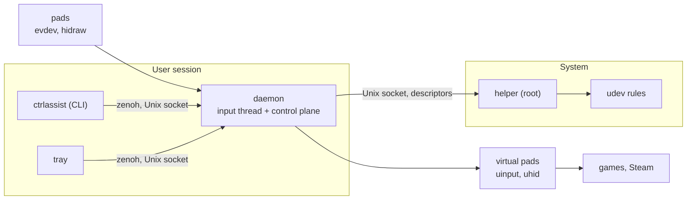

# Architecture

**Status: design, not yet built.** This document is written from the spike findings in [plans/findings/](plans/findings/) and the decisions in [the plan](plans/tisvlay-template-overhaul.md). Each claim that was measured or observed links to its finding; anything else is a design intent that the build will confirm or correct here.

CtrlAssist merges or splits game controllers. It reads physical pads, routes what they do through a graph, and writes the result to virtual pads that games read instead, passing rumble and other feedback the other way.

## Terms

| Term | Meaning |
|---|---|
| pad | A physical controller. |
| virtual pad | A controller the daemon creates for games to read. |
| source, sink | A pad, or a virtual pad, as it appears in a graph. |
| node | A transform between sources and sinks: a mux or a demux. |
| group | Controls owned together: a stick's axes, a lone button, a flight grip. |
| profile | A saved graph with its settings. |
| preset | A built-in profile shape offered by name. |
| setup | A profile that is running. |
| hide | Keep games from seeing a pad. |
| identity | What a virtual pad presents itself as. |
| feedback | What flows from game to pad: rumble, LEDs, trigger effects. |

## Processes



| Process | Runs as | Does |
|---|---|---|
| daemon | the user, as a systemd user service | Owns the pads, the virtual pads, the running setups and the profiles. |
| helper | root, started on demand by a system socket | Hides and restores pads, and hands the daemon open descriptors for them. Nothing else. |
| clients | the user | The CLI and tray in the first release; a GUI and a TUI later. They hold no state the daemon doesn't. |

The daemon and clients are verbs of one binary, `ctrlassist`. The helper is a separate, small binary with no async runtime and no zenoh, so that the code running as root is short enough to read in one sitting.

Why these are separate processes: a client crash must not drop a virtual pad mid-game, a GUI toolkit should not share a process with the input thread, and a gamescope session may have no tray at all.

## Crates

One workspace, one shared version.

| Crate | Holds | Depends on | Published |
|---|---|---|---|
| `ctrlassist-core` | Controls, pad state, groups, layouts; the mux and demux nodes; the graph; the feedback router. No device, async or serialization code. | nothing | yes |
| `ctrlassist-protocol` | The key space, wire payloads, the rpc table, the profile schema, typed wire errors, session configuration. | core, serde, zenoh | yes |
| `ctrlassist` | The client SDK: a daemon client and a state watcher. | protocol | yes |
| `ctrlassist-device` | Everything that touches the kernel: pads from descriptors, uinput and uhid virtual pads, the SDL controller database, hotplug, the input thread, the helper's client side, the unprivileged hiding fallback. | core, evdev, udev | no |
| `ctrlassist-helper` | The root binary. | libc, udev | no |
| `ctrlassist-daemon` | The control plane: profile store, setup lifecycle, the zenoh bridge. A library; the CLI's `service daemon` verb runs it. | core, protocol, device, runtime | no |
| `ctrlassist-cli` | The `ctrlassist` binary and its clap tree as a library. | SDK, daemon, tray, runtime | no |
| `ctrlassist-tray` | The ksni tray and notifications. | SDK, runtime | no |
| `ctrlassist-runtime` | Process glue from TisVlay: logging, durable file writes. | tracing | no |
| `ctrlassist-test` | Fake pads through uinput and uhid, and the fixtures the VM checks use. | evdev | no |
| `ctrlassist-docgen` | Generated partials for the book. | cli | no |

`ctrlassist-core` is the routing graph spike promoted with its tests ([finding](plans/findings/routing-graph.md)). The GUI and TUI crates are added by their own plans.

## The core model

A graph is sources, nodes and sinks. It is validated once (references, arity, no cycles) and then stepped.

**It is level-based.** A node computes its output state from its input states and a little state of its own. A step evaluates the nodes in dependency order and reports, per virtual pad, the difference from what that pad last held. A switch, a pad dropping out, a pad returning and a resync are therefore the same computation as an ordinary event, and nothing can stay held by a pad that is gone.

**Pad state** is a fixed-size value, 64 buttons and 16 axes, addressed by kind and index. The gamepad names are well-known positions in that space, which is what lets two different pads be merged control by control. A step allocates nothing and takes 150 to 330 ns, under 1% of the input path's median ([finding](plans/findings/routing-graph.md)).

**A mux** takes any number of inputs, later ones outranking earlier, and applies one rule to each group:

| Rule | Meaning |
|---|---|
| owned | the highest input active on the group owns every member; with none active, the first input |
| largest | each member takes the input furthest from rest; a button is down if anyone holds it |
| blended | each axis is the mean of the inputs active on the group |
| switched | the input the switch last selected owns the group |

A mode is a table from group kind to rule; there is no per-mode code.

| Mode | Stick | Trigger | Button | Hat |
|---|---|---|---|---|
| priority | owned | largest | owned | owned |
| average | blended | blended | largest | largest |
| toggle | switched | switched | switched | switched |

**Activity** has two parts. A source's deadzone zeroes a resting group before any node sees it. A mux marks an input active on a group at its engage threshold and inactive below its lower release threshold, so an owner doesn't flicker.

**The switch** is a signal into a node. A configured button raises it once per press and is consumed; a client raises the same signal with an rpc. On a switch the virtual pad takes the incoming pad's state: nothing in the code says so, it follows from selecting another input and reporting the difference.

**A demux** sends its input to the selected output and rests the others (unicast), or sends it to all (multicast).

**Feedback** is not input run backward. The graph answers one question, which pads a virtual pad's feedback goes to right now, by walking back from the sink through each node's feedback setting. A router turns a game's requests into commands per pad and, when the answer changes, moves the effects: uploaded and started on a pad that joins, stopped and removed on one that leaves. An upload is reported to the game as accepted if any target pad took it or rumble is off, and refused only if every pad asked refused it.

## The daemon

```mermaid
flowchart TB
    subgraph input["input thread (real-time if allowed)"]
        epoll["epoll: pads, virtual pads, wake"]
        graph["graphs + feedback routers"]
        epoll --> graph --> epoll
    end
    subgraph control["control plane (tokio)"]
        reactor["reactor: profiles, setups, pads"]
        bridge["zenoh bridge"]
        hotplug["udev monitor"]
        helperc["helper client"]
        reactor <--> bridge
        hotplug --> reactor
        reactor <--> helperc
    end
    reactor -- "commands + descriptors, wake" --> epoll
    graph -- "events, never blocking" --> reactor
```

**The input thread** is the whole data path. It sleeps in `epoll_wait` with no timeout over every pad, every virtual pad, and one wake descriptor, and makes no wakeups while idle ([finding](plans/findings/input-loop.md)). On a pad's readiness it reads a whole report frame, maps it to a pad state, steps the graph, and writes the changes to the virtual pads. On a virtual pad's readiness it answers the game's feedback request through the router, inline, because the game's call blocks until it is answered. It asks for real-time scheduling at startup and carries on without it if refused; the daemon's status says which.

**Nothing on the input thread blocks on the control plane.** The control plane sends it commands (add or remove a setup, with the descriptors it needs; raise a switch; a pad has gone or returned) through a queue and wakes it through the wake descriptor. The input thread reports back (a pad read failed, an upload was refused, a switch happened) with sends that never wait and are dropped if the control plane is behind. No input event crosses this boundary except the mirror below.

**The control plane** is a single reactor task that owns the profiles, the set of known pads and the running setups, with commands in and state out. It is deliberately not an ECS: the state is a pad list and a few setups. Beside it run the zenoh bridge, a udev monitor for hotplug, and the helper's client.

**zenoh shares the process without disturbing the input thread.** See [Control plane](#control-plane) for the measurement.

**No `println!` anywhere,** as in TisVlay, and here it is load-bearing: a write to a closed pipe panics, and a panic in the daemon takes every virtual pad with it. The loop spike hit exactly this.

## Pads

**Reading.** Pads are read through evdev from descriptors, not paths, because with hiding on the daemon cannot open the path itself. gilrs is not used: it opens pads by path, owns its own polling, and keeps its controller-database parser private ([finding](plans/findings/input-loop.md)).

**Layout.** Xbox and PlayStation family pads get a standard layout from their kernel drivers. For others the device crate applies SDL's controller database through its own parser of that format, so pads gilrs used to normalize keep working.

**Identification.** A pad is known by the kernel's `uniq` value, which is its own address on both pads tested and is what Steam keys its per-pad configuration by; then by vendor and product plus port; then by name. A profile names a pad by address, or by model when any pad of that kind will do. Whether `uniq` is the same over USB and Bluetooth is unverified ([finding](plans/findings/hiding.md)).

**Hotplug.** When a pad in a running setup disconnects, the setup holds: the virtual pad stays, the pad reads as at rest, the other pads carry on, and the router stops sending to it. When the same pad returns it is hidden again, re-bound, and given back its effects. A notification says what happened.

**Not our own output.** The daemon never takes its own virtual pads as sources. It marks them (the `phys` string on uinput pads, the address on uhid pads) and excludes that marker. A Bluetooth pad is itself a uhid device, so "under uhid" cannot be the test. Other software's virtual pads are sources only if a profile names them.

## Hiding

No unprivileged mechanism makes a pad absent to games: Steam and SDL read PlayStation pads through hidraw, which a grab doesn't touch, and Steam's blacklist and SDL's ignore hint each cover one consumer, by vendor and product, at start only ([finding](plans/findings/hiding.md)). So hiding is the helper's job.

**The helper** listens on a system Unix socket. For each pad the daemon asks it to hide, it:

1. installs a runtime udev rule denying that pad's event, js and hidraw nodes to everyone, in a file that sorts after systemd's `uaccess` rule and before its seat rule, so it also holds when the pad reconnects;
2. opens the nodes itself and passes the descriptors to the daemon;
3. on the pad's return, passes fresh descriptors, the rule having applied before any game could see the node;
4. when the daemon's connection closes, for any reason, removes its rules and restores each node's mode and group, which removing a rule does not do by itself.

Access arrives as descriptors rather than permissions because the daemon and the games are the same user: anything that denies the games denies the daemon. Cleanup hangs on the connection closing, which the kernel reports even when the daemon is killed, and the rules live under `/run`, so a reboot clears whatever a dead helper left.

Only the user with the active session on the seat may use the helper. It checks the peer's credentials on each connection.

**Without the helper** (a Flatpak, or a user who didn't install it) the daemon falls back to what an unprivileged process can do: a grab, which silences evdev and joydev readers and is undone by the kernel if the daemon dies, and Steam's controller blacklist, which hides a pad from Steam after Steam restarts. The blacklist is a persistent edit to a file the daemon doesn't own, so each entry is recorded in the daemon's state directory before it is written, reconciled at startup, and removed at shutdown. The daemon's status says which mechanism is in use and what it leaves visible.

## Virtual pads

A virtual pad's capabilities and identity are fixed when it is created; changing them means the game sees a disconnect. So a sink is created from what the profile declares, and a change to a running setup is either live (the sink is untouched) or disruptive, and clients say which.

| Identity | Made with | Why |
|---|---|---|
| generic (the default) | uinput | Adopted by SDL and Steam; honest about being virtual |
| Xbox family | uinput with the pad's IDs | SDL and Steam recognize the IDs by name |
| PlayStation family | uhid | SDL and Steam claim Sony's IDs for their hidraw driver and ignore an evdev node carrying them, so a uinput pad with those IDs is invisible to both |

([finding](plans/findings/identity.md))

A PlayStation identity is a small emulator: it replays a real pad's report descriptor, answers the kernel driver's feature-report requests, and turns pad state into the pad's input report. Its data is read from a connected pad and cached in the user's state directory; none of it ships in the repository. Each gets its own address, which also serves as the daemon's marker.

**Feedback on a virtual pad** comes in two forms: force-feedback requests on uinput, and the pad's raw output report on uhid, which also carries LEDs and trigger effects. Rumble is routed everywhere, translated between the two forms as needed. Between a sink and a source of the same kind the whole output report passes through; between unlike pads everything but rumble is dropped.

## Control plane

zenoh over a Unix socket at `$XDG_RUNTIME_DIR/ctrlassist/zenoh.sock`, with the daemon as the router and clients in client mode. A zenoh session in the daemon leaves the input thread alone: it still makes no wakeups when idle, and its latency is unchanged, while the rest of the daemon wakes about three times a second and uses about 8 MB more memory ([finding](plans/findings/zenoh.md)). The patterns are TisVlay's: cached publishers for state, queryables for rpcs declared once in a table, a liveliness token for presence, typed wire errors, and a `major.minor` check between client and daemon. TisVlay's zenoh laws apply.

Draft key space:

| Key | Kind | Holds |
|---|---|---|
| `ctrlassist/daemon` | state | version, whether real-time scheduling was granted, which hiding mechanism is in use |
| `ctrlassist/pad/<id>` | state | name, model, address, connected, hidden, which setup uses it |
| `ctrlassist/profile/<name>` | state | the profile |
| `ctrlassist/setup/<name>` | state | running, held (a pad is missing), each node's selected input, pads that refused rumble |
| `ctrlassist/mirror/<pad>` | stream | the pad's current state |
| `ctrlassist/rpc/profile/{put,delete}` | rpc | write a profile |
| `ctrlassist/rpc/setup/{start,stop,switch}` | rpc | run a profile, stop it, raise a node's switch |
| `ctrlassist/rpc/pad/identify` | rpc | buzz a pad so the user can tell which is which |

**The mirror** lets a client draw a pad's live state. It is published only while something subscribes: the input thread checks one flag per frame and, when it is set, offers the state with a send that never waits. The control plane publishes the latest state each time its previous publish completes, skipping what arrived in between, so the cost is bounded by what the subscriber takes rather than by the pad's rate.

## Profiles

A profile is a TOML file the daemon owns, one per profile, under `$XDG_CONFIG_HOME/ctrlassist/profiles/`, with a schema version. Clients write profiles through the daemon, never the files. A preset is a profile whose graph is implied by its name; the full form names sources, nodes and sinks. Groups appear only when a pad isn't a gamepad or a mode's table is overridden. The drafts are in the [routing graph finding](plans/findings/routing-graph.md). A profile may be marked to start by itself once the daemon is up and all its pads are connected.

## Permissions and packaging

A stock machine gives a seat user a pad's event and js nodes, and nothing else this needs ([finding](plans/findings/hiding.md)). The native packages install:

- a udev rule granting the seat user `/dev/uinput` and `/dev/uhid`;
- the helper, its socket unit and its service unit;
- the daemon's user unit;
- a raised real-time priority limit for the daemon's unit where the distribution allows it.

Channels: deb, rpm and an Arch package through TisVlay's pipeline, and a Nix package with a NixOS module. A Flatpak is a second tier that runs the daemon and clients in its sandbox without the helper.

## Errors and logging

As TisVlay: published crates expose `thiserror` types; binaries and their glue may use `anyhow`. Logging is `tracing` with structured fields, to the journal when there is one.

## Testing

| Layer | How |
|---|---|
| Routing and feedback | Pure tests in core: scenarios and property tests, no devices |
| Device code | Fake pads made through uinput and uhid; tests skip where `/dev/uinput` isn't writable and run for real in the VM check |
| Wire | Client and daemon on a temporary socket |
| System | A NixOS VM as a flake check: clean-machine permissions, the helper, a setup end to end |
| Hardware | What the above can't reach, listed per change |

## Not yet verified

Carried from the findings; each is confirmed or corrected here as the build reaches it.

- Whether `uniq` matches across USB and Bluetooth for one pad, and what an Xbox pad reports.
- Suspend and resume, and a Bluetooth drop, with a setup running.
- Layout correctness of each identity under real input, and button glyphs in a game.
- Gyro, touchpad and LEDs through a uhid pad; a Bluetooth-style DualSense; a DualShock 4 identity.
- A pad that needs a controller-database mapping.
- Any Proton game.
- The helper itself: the spike proved its mechanism with root commands, not a helper process.
